# Awesome Claude Fable 5.2 Videos

[简体中文](README.zh-CN.md)

A credited list of **277 videos made with Claude Fable 5.2** and shared on X since its release on November 9, 2026: motion graphics, explainers, animated films, 3D scenes and music. The model wrote code that draws every frame; no video model was involved.

Watch them all, with filters, at **[claude-motion.com/fable-5-2-videos](https://claude-motion.com/fable-5-2-videos)**

## Motion graphics

<table>
<tr>
<td width="33%" valign="top"> <b><a href="https://x.com/mathiaschpl/status/2119878412181676283">A motion piece made in 10 minutes</a></b> <a href="https://x.com/mathiaschpl">@mathiaschpl</a> · 0:37 · <a href="https://x.com/mathiaschpl/status/2119878412181676283">original post on X</a> 10 min</td>
<td width="33%" valign="top"> <b><a href="https://x.com/ChrisGPT/status/2119998815856218494">A video telling editors it will take their job</a></b> <a href="https://x.com/ChrisGPT">@ChrisGPT</a> · 0:44 · <a href="https://x.com/ChrisGPT/status/2119998815856218494">original post on X</a></td>
<td width="33%" valign="top"> <b><a href="https://x.com/midudev/status/2119876297304203273">A terminal-style trailer about Rust, made in 10 minutes</a></b> <a href="https://x.com/midudev">@midudev</a> · 0:32 · <a href="https://x.com/midudev/status/2119876297304203273">original post on X</a></td>
</tr>
<tr>
<td width="33%" valign="top"> <b><a href="https://x.com/kevin_t_ngo/status/2123194632670748790">San Francisco, an animation drawn in code</a></b> <a href="https://x.com/kevin_t_ngo">@kevin_t_ngo</a> · 0:52 · <a href="https://x.com/kevin_t_ngo/status/2123194632670748790">original post on X</a></td>
<td width="33%" valign="top"><a href="https://x.com/crtvTeknologist/status/2119894073024606617">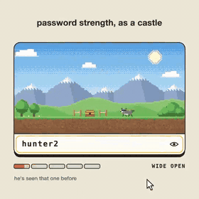</a> <b><a href="https://x.com/crtvTeknologist/status/2119894073024606617">A password strength indicator animation</a></b> <a href="https://x.com/crtvTeknologist">@crtvTeknologist</a> · 0:18 · <a href="https://x.com/crtvTeknologist/status/2119894073024606617">original post on X</a></td>
<td width="33%" valign="top"> <b><a href="https://x.com/DaveJ/status/2120486254852608470">Motion design that stays consistent with an existing design</a></b> <a href="https://x.com/DaveJ">@DaveJ</a> · 0:25 · <a href="https://x.com/DaveJ/status/2120486254852608470">original post on X</a></td>
</tr>
<tr>
<td width="33%" valign="top"> <b><a href="https://x.com/Aprilzz423/status/2123788440714260673">Pocket City, a free skill that turns any street corner into a tiny hand-drawn city</a></b> <a href="https://x.com/Aprilzz423">@Aprilzz423</a> · 0:24 · <a href="https://x.com/Aprilzz423/status/2123788440714260673">original post on X</a></td>
<td width="33%" valign="top"> <b><a href="https://x.com/alegiiaa/status/2120517875144233201">Animations designed in 7 minutes</a></b> <a href="https://x.com/alegiiaa">@alegiiaa</a> · 0:08 · <a href="https://x.com/alegiiaa/status/2120517875144233201">original post on X</a></td>
<td width="33%" valign="top"> <b><a href="https://x.com/bhavya_gx/status/2120210072810983687">Live footage with editing and VFX done by Fable 5.2</a></b> <a href="https://x.com/bhavya_gx">@bhavya_gx</a> · 0:29 · <a href="https://x.com/bhavya_gx/status/2120210072810983687">original post on X</a></td>
</tr>
<tr>
<td width="33%" valign="top"> <b><a href="https://x.com/chetaslua/status/2120179018964324566">A painting drawn by code in plain JavaScript</a></b> <a href="https://x.com/chetaslua">@chetaslua</a> · 0:34 · <a href="https://x.com/chetaslua/status/2120179018964324566">original post on X</a> JavaScript</td>
<td width="33%" valign="top"> <b><a href="https://x.com/op7418/status/2120085300185833878">Typed words become flowing ink in a live fluid simulation</a></b> <a href="https://x.com/op7418">@op7418</a> · 1:06 · <a href="https://x.com/op7418/status/2120085300185833878">original post on X</a></td>
<td width="33%" valign="top"> <b><a href="https://x.com/LexnLin/status/2120167637133238295">A Claude logo animation</a></b> <a href="https://x.com/LexnLin">@LexnLin</a> · 0:30 · <a href="https://x.com/LexnLin/status/2120167637133238295">original post on X</a></td>
</tr>
<tr>
<td width="33%" valign="top"> <b><a href="https://x.com/Khazix0918/status/2119902325460590834">A birthday video for ChatGPT's fourth anniversary</a></b> <a href="https://x.com/Khazix0918">@Khazix0918</a> · 0:58 · <a href="https://x.com/Khazix0918/status/2119902325460590834">original post on X</a></td>
<td width="33%" valign="top"><a href="https://x.com/ravisparikh/status/2120398428157194589">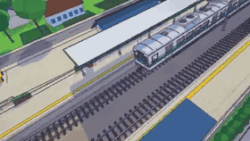</a> <b><a href="https://x.com/ravisparikh/status/2120398428157194589">An anime-style town with a passing train, rendered in 20 seconds</a></b> <a href="https://x.com/ravisparikh">@ravisparikh</a> · 0:08 · <a href="https://x.com/ravisparikh/status/2120398428157194589">original post on X</a></td>
<td width="33%" valign="top"> <b><a href="https://x.com/kevin_t_ngo/status/2125288449788019168">Tokyo, an animation drawn in code</a></b> <a href="https://x.com/kevin_t_ngo">@kevin_t_ngo</a> · 0:52 · <a href="https://x.com/kevin_t_ngo/status/2125288449788019168">original post on X</a></td>
</tr>
<tr>
<td width="33%" valign="top"> <b><a href="https://x.com/jeanalexandre_b/status/2120783430606840084">A photo recreated from 100,000 color patches, by code alone</a></b> <a href="https://x.com/jeanalexandre_b">@jeanalexandre_b</a> · 1:08 · <a href="https://x.com/jeanalexandre_b/status/2120783430606840084">original post on X</a></td>
<td width="33%" valign="top"> <b><a href="https://x.com/ann_nnng/status/2122283549000712249">Interactive Christmas cards with a paper texture</a></b> <a href="https://x.com/ann_nnng">@ann_nnng</a> · 0:35 · <a href="https://x.com/ann_nnng/status/2122283549000712249">original post on X</a></td>
<td width="33%" valign="top"><a href="https://x.com/Gregoirechp/status/2119879667457073355">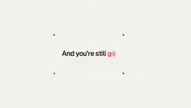</a> <b><a href="https://x.com/Gregoirechp/status/2119879667457073355">A motion design piece, made in a few minutes</a></b> <a href="https://x.com/Gregoirechp">@Gregoirechp</a> · 0:40 · <a href="https://x.com/Gregoirechp/status/2119879667457073355">original post on X</a></td>
</tr>
<tr>
<td width="33%" valign="top"> <b><a href="https://x.com/AmirMushich/status/2121339167800213934">A typographic motion reel in Blender, released as a free template</a></b> <a href="https://x.com/AmirMushich">@AmirMushich</a> · 0:08 · <a href="https://x.com/AmirMushich/status/2121339167800213934">original post on X</a></td>
<td width="33%" valign="top"> <b><a href="https://x.com/crtvTeknologist/status/2121657720289767666">A set of UI controls animated in sakuga style</a></b> <a href="https://x.com/crtvTeknologist">@crtvTeknologist</a> · 0:17 · <a href="https://x.com/crtvTeknologist/status/2121657720289767666">original post on X</a></td>
<td width="33%" valign="top"><a href="https://x.com/internetphysics/status/2119903808935313778">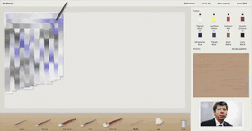</a> <b><a href="https://x.com/internetphysics/status/2119903808935313778">A portrait of Sam Altman in simulated oil paint</a></b> <a href="https://x.com/internetphysics">@internetphysics</a> · 1:00 · <a href="https://x.com/internetphysics/status/2119903808935313778">original post on X</a></td>
</tr>
<tr>
<td width="33%" valign="top"><a href="https://x.com/yuwen_lu_/status/2120230407878930739">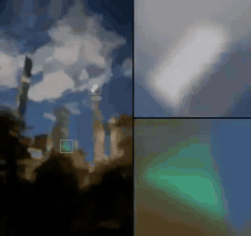</a> <b><a href="https://x.com/yuwen_lu_/status/2120230407878930739">A Central Park photo recreated with p5.js brushes</a></b> <a href="https://x.com/yuwen_lu_">@yuwen_lu_</a> · 0:19 · <a href="https://x.com/yuwen_lu_/status/2120230407878930739">original post on X</a> p5.js</td>
<td width="33%" valign="top"> <b><a href="https://x.com/sota_web15/status/2120446425545023792">A video with 8 minutes of human work and about ¥300 in cost</a></b> <a href="https://x.com/sota_web15">@sota_web15</a> · 1:46 · <a href="https://x.com/sota_web15/status/2120446425545023792">original post on X</a></td>
<td width="33%" valign="top"> <b><a href="https://x.com/LexnLin/status/2121395037565337862">A launch video for Opus 5.6, made in under an hour</a></b> <a href="https://x.com/LexnLin">@LexnLin</a> · 0:20 · <a href="https://x.com/LexnLin/status/2121395037565337862">original post on X</a></td>
</tr>
<tr>
<td width="33%" valign="top"> <b><a href="https://x.com/noel_ai_lab/status/2121589715363303843">Japanese kinetic type under stage lights, music by Suno</a></b> <a href="https://x.com/noel_ai_lab">@noel_ai_lab</a> · 0:29 · <a href="https://x.com/noel_ai_lab/status/2121589715363303843">original post on X</a></td>
<td width="33%" valign="top"> <b><a href="https://x.com/pradeepXkapoor/status/2124022052554453137">A hand-drawn tile world of famous landmarks that builds itself</a></b> <a href="https://x.com/pradeepXkapoor">@pradeepXkapoor</a> · 0:58 · <a href="https://x.com/pradeepXkapoor/status/2124022052554453137">original post on X</a></td>
<td width="33%" valign="top"><a href="https://x.com/venturetwins/status/2120331599283954137">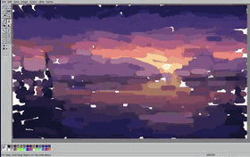</a> <b><a href="https://x.com/venturetwins/status/2120331599283954137">A lake at dusk painted in an MS Paint clone, as a timelapse</a></b> <a href="https://x.com/venturetwins">@venturetwins</a> · 0:46 · <a href="https://x.com/venturetwins/status/2120331599283954137">original post on X</a> 94 min</td>
</tr>
<tr>
<td width="33%" valign="top"> <b><a href="https://x.com/aziz4ai/status/2119928581405200726">A 15-second scene made only with code, no video model</a></b> <a href="https://x.com/aziz4ai">@aziz4ai</a> · 0:15 · <a href="https://x.com/aziz4ai/status/2119928581405200726">original post on X</a></td>
<td width="33%" valign="top"> <b><a href="https://x.com/devteamdrew/status/2120090542419984686">The Seven Wonders of the World, drawn and animated</a></b> <a href="https://x.com/devteamdrew">@devteamdrew</a> · 0:10 · <a href="https://x.com/devteamdrew/status/2120090542419984686">original post on X</a></td>
<td width="33%" valign="top"> <b><a href="https://x.com/justkarangupta/status/2119995965776200047">A light switch with a cat that wakes and a puppy at the door</a></b> <a href="https://x.com/justkarangupta">@justkarangupta</a> · 0:15 · <a href="https://x.com/justkarangupta/status/2119995965776200047">original post on X</a></td>
</tr>
<tr>
<td width="33%" valign="top"> <b><a href="https://x.com/slimer48484/status/2120094263673319609">A painting made in Python, shown stroke by stroke</a></b> <a href="https://x.com/slimer48484">@slimer48484</a> · 0:30 · <a href="https://x.com/slimer48484/status/2120094263673319609">original post on X</a> Python</td>
<td width="33%" valign="top"> <b><a href="https://x.com/Masimo_Blue/status/2119943368612487285">A 10-second promo for Claude pants, with acid techno music</a></b> <a href="https://x.com/Masimo_Blue">@Masimo_Blue</a> · 0:10 · <a href="https://x.com/Masimo_Blue/status/2119943368612487285">original post on X</a></td>
<td width="33%" valign="top"> <b><a href="https://x.com/Hunter_Weiss/status/2119932937642946900">Rocket science explained at high-school level, in one shot</a></b> <a href="https://x.com/Hunter_Weiss">@Hunter_Weiss</a> · 1:58 · <a href="https://x.com/Hunter_Weiss/status/2119932937642946900">original post on X</a> Prompt: “I need you to create the most impressive video I can share with people about Fable 5.2, explaining rocket science as if it were for someone with a high school education.”</td>
</tr>
</table>

## Explainers

<table>
<tr>
<td width="33%" valign="top"> <b><a href="https://x.com/aollivier82/status/2120260208245043663">The history of computer graphics, animated</a></b> <a href="https://x.com/aollivier82">@aollivier82</a> · 0:29 · <a href="https://x.com/aollivier82/status/2120260208245043663">original post on X</a></td>
<td width="33%" valign="top"> <b><a href="https://x.com/cube_224/status/2120152637249315094">A 3-minute Rubik's cube math explainer, made in 2 hours</a></b> <a href="https://x.com/cube_224">@cube_224</a> · 3:06 · <a href="https://x.com/cube_224/status/2120152637249315094">original post on X</a></td>
<td width="33%" valign="top"><a href="https://x.com/imjustnewatai/status/2120695368874631226">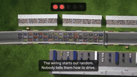</a> <b><a href="https://x.com/imjustnewatai/status/2120695368874631226">50 cars learning to drive without being told how</a></b> <a href="https://x.com/imjustnewatai">@imjustnewatai</a> · 1:38 · <a href="https://x.com/imjustnewatai/status/2120695368874631226">original post on X</a></td>
</tr>
<tr>
<td width="33%" valign="top"> <b><a href="https://x.com/claudeai/status/2120174863210201316">Any question answered step by step on a hand-drawn board</a></b> <a href="https://x.com/claudeai">@claudeai</a> · 0:36 · <a href="https://x.com/claudeai/status/2120174863210201316">original post on X</a></td>
<td width="33%" valign="top"> <b><a href="https://x.com/rileybrown/status/2119946022767980985">The history of writing, from one prompt</a></b> <a href="https://x.com/rileybrown">@rileybrown</a> · 1:36 · <a href="https://x.com/rileybrown/status/2119946022767980985">original post on X</a> <a href="https://v2.video/riley/the-history-of-writing/v1">prompt and files on the maker's page</a></td>
<td width="33%" valign="top"> <b><a href="https://x.com/claudeai/status/2120174860252897530">A podcast about the Egyptian pyramids, drawn in code</a></b> <a href="https://x.com/claudeai">@claudeai</a> · 2:07 · <a href="https://x.com/claudeai/status/2120174860252897530">original post on X</a></td>
</tr>
<tr>
<td width="33%" valign="top"><a href="https://x.com/MartinOesterhel/status/2120464036030517525">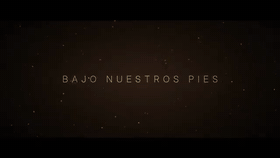</a> <b><a href="https://x.com/MartinOesterhel/status/2120464036030517525">A trailer-style video on the soil texture triangle</a></b> <a href="https://x.com/MartinOesterhel">@MartinOesterhel</a> · 1:32 · <a href="https://x.com/MartinOesterhel/status/2120464036030517525">original post on X</a></td>
<td width="33%" valign="top"> <b><a href="https://x.com/amrnth0/status/2120849097871810973">The great Railway hack, explained</a></b> <a href="https://x.com/amrnth0">@amrnth0</a> · 2:12 · <a href="https://x.com/amrnth0/status/2120849097871810973">original post on X</a></td>
<td width="33%" valign="top"> <b><a href="https://x.com/withbassam/status/2121536898976100486">Stars that carry Arabic names, about 4 revisions at low effort</a></b> <a href="https://x.com/withbassam">@withbassam</a> · 0:18 · <a href="https://x.com/withbassam/status/2121536898976100486">original post on X</a></td>
</tr>
<tr>
<td width="33%" valign="top"> <b><a href="https://x.com/theojaffee/status/2120312766544437738">The Bay Area through 250 years of history, explorable by year</a></b> <a href="https://x.com/theojaffee">@theojaffee</a> · 0:33 · <a href="https://x.com/theojaffee/status/2120312766544437738">original post on X</a></td>
<td width="33%" valign="top"> <b><a href="https://x.com/DeryaTR_/status/2119974354260013293">A 3D journey through the history of science, made in code</a></b> <a href="https://x.com/DeryaTR_">@DeryaTR_</a> · 4:56 · <a href="https://x.com/DeryaTR_/status/2119974354260013293">original post on X</a></td>
<td width="33%" valign="top"><a href="https://x.com/Rasmic/status/2119919466163093768">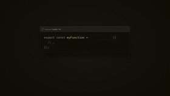</a> <b><a href="https://x.com/Rasmic/status/2119919466163093768">A motion graphics explainer of Convex</a></b> <a href="https://x.com/Rasmic">@Rasmic</a> · 4:08 · <a href="https://x.com/Rasmic/status/2119919466163093768">original post on X</a></td>
</tr>
<tr>
<td width="33%" valign="top"> <b><a href="https://x.com/linxiaobei888/status/2119978892861829227">An English-learning cartoon for children aged 3 to 6</a></b> <a href="https://x.com/linxiaobei888">@linxiaobei888</a> · 2:27 · <a href="https://x.com/linxiaobei888/status/2119978892861829227">original post on X</a> Codex</td>
<td width="33%" valign="top"><a href="https://x.com/konstantinsaifo/status/2119941967136379334">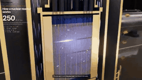</a> <b><a href="https://x.com/konstantinsaifo/status/2119941967136379334">How a nuclear reactor works: a take-apart three.js model</a></b> <a href="https://x.com/konstantinsaifo">@konstantinsaifo</a> · 0:36 · <a href="https://x.com/konstantinsaifo/status/2119941967136379334">original post on X</a> three.js · $92</td>
<td width="33%" valign="top"> <b><a href="https://x.com/MatthewBerman/status/2119868633086378471">A motion graphic explaining how LLMs work</a></b> <a href="https://x.com/MatthewBerman">@MatthewBerman</a> · 0:50 · <a href="https://x.com/MatthewBerman/status/2119868633086378471">original post on X</a></td>
</tr>
</table>

## Animated films

<table>
<tr>
<td width="33%" valign="top"> <b><a href="https://x.com/suna_gaku/status/2119952985933697063">A showcase film that opens on a terminal prompt</a></b> <a href="https://x.com/suna_gaku">@suna_gaku</a> · 1:29 · <a href="https://x.com/suna_gaku/status/2119952985933697063">original post on X</a></td>
<td width="33%" valign="top"><a href="https://x.com/gavinpurcell/status/2120002682421182624">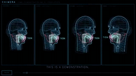</a> <b><a href="https://x.com/gavinpurcell/status/2120002682421182624">A short film made freely from a code repo</a></b> <a href="https://x.com/gavinpurcell">@gavinpurcell</a> · 1:56 · <a href="https://x.com/gavinpurcell/status/2120002682421182624">original post on X</a></td>
<td width="33%" valign="top"><a href="https://x.com/anabology/status/2120010995309457643">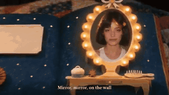</a> <b><a href="https://x.com/anabology/status/2120010995309457643">A storybook dream film from two prompts and 9 hours</a></b> <a href="https://x.com/anabology">@anabology</a> · 4:04 · <a href="https://x.com/anabology/status/2120010995309457643">original post on X</a></td>
</tr>
<tr>
<td width="33%" valign="top"> <b><a href="https://x.com/rileybrown/status/2121642720045261185">The Fable of Clawd, a 2-minute 4K Blender film for about $20</a></b> <a href="https://x.com/rileybrown">@rileybrown</a> · 2:19 · <a href="https://x.com/rileybrown/status/2121642720045261185">original post on X</a></td>
<td width="33%" valign="top"> <b><a href="https://x.com/DanielZambrini/status/2124583559256313944">The world through a hummingbird's eyes, 100% code in Blender</a></b> <a href="https://x.com/DanielZambrini">@DanielZambrini</a> · 0:30 · <a href="https://x.com/DanielZambrini/status/2124583559256313944">original post on X</a></td>
<td width="33%" valign="top"><a href="https://x.com/DanielZambrini/status/2123360069513302141">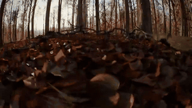</a> <b><a href="https://x.com/DanielZambrini/status/2123360069513302141">A day in the life of a squirrel, rendered by Python in Blender</a></b> <a href="https://x.com/DanielZambrini">@DanielZambrini</a> · 0:30 · <a href="https://x.com/DanielZambrini/status/2123360069513302141">original post on X</a></td>
</tr>
<tr>
<td width="33%" valign="top"> <b><a href="https://x.com/BubbleBrain/status/2122313967473434639">The world through a little cat's eyes, picture and sound all in code</a></b> <a href="https://x.com/BubbleBrain">@BubbleBrain</a> · 1:50 · <a href="https://x.com/BubbleBrain/status/2122313967473434639">original post on X</a></td>
<td width="33%" valign="top"><a href="https://x.com/DeryaTR_/status/2120382619082727604">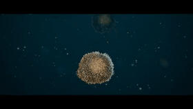</a> <b><a href="https://x.com/DeryaTR_/status/2120382619082727604">The life of a T cell, an 8-minute narrated Blender film</a></b> <a href="https://x.com/DeryaTR_">@DeryaTR_</a> · 8:40 · <a href="https://x.com/DeryaTR_/status/2120382619082727604">original post on X</a></td>
<td width="33%" valign="top"> <b><a href="https://x.com/polinaaAi/status/2120753459498549757">An open-world city driving scene, 45 seconds at 4K</a></b> <a href="https://x.com/polinaaAi">@polinaaAi</a> · 0:46 · <a href="https://x.com/polinaaAi/status/2120753459498549757">original post on X</a></td>
</tr>
<tr>
<td width="33%" valign="top"> <b><a href="https://x.com/devteamdrew/status/2119892540950241283">A 32-second film, posted without a description</a></b> <a href="https://x.com/devteamdrew">@devteamdrew</a> · 0:32 · <a href="https://x.com/devteamdrew/status/2119892540950241283">original post on X</a></td>
<td width="33%" valign="top"> <b><a href="https://x.com/aollivier82/status/2119920990893244510">Its idea of a beautiful video, opening beneath the sea</a></b> <a href="https://x.com/aollivier82">@aollivier82</a> · 0:48 · <a href="https://x.com/aollivier82/status/2119920990893244510">original post on X</a></td>
<td width="33%" valign="top"> <b><a href="https://x.com/kevin_t_ngo/status/2119938129079808282">A film with every frame drawn in JavaScript</a></b> <a href="https://x.com/kevin_t_ngo">@kevin_t_ngo</a> · 1:40 · <a href="https://x.com/kevin_t_ngo/status/2119938129079808282">original post on X</a> JavaScript</td>
</tr>
<tr>
<td width="33%" valign="top"><a href="https://x.com/mattshumer_/status/2119884041331892403">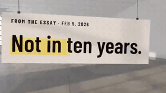</a> <b><a href="https://x.com/mattshumer_/status/2119884041331892403">A 3D gallery of framed social posts, made in one prompt</a></b> <a href="https://x.com/mattshumer_">@mattshumer_</a> · 4:44 · <a href="https://x.com/mattshumer_/status/2119884041331892403">original post on X</a></td>
<td width="33%" valign="top"><a href="https://x.com/kevin_t_ngo/status/2119972124211454139">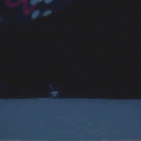</a> <b><a href="https://x.com/kevin_t_ngo/status/2119972124211454139">A 90s-style toy commercial, animated in Python and Blender</a></b> <a href="https://x.com/kevin_t_ngo">@kevin_t_ngo</a> · 1:05 · <a href="https://x.com/kevin_t_ngo/status/2119972124211454139">original post on X</a> Python · Blender</td>
<td width="33%" valign="top"> <b><a href="https://x.com/rute1203d/status/2120077147872391540">A showcase film: technique first, then an emotional turn</a></b> <a href="https://x.com/rute1203d">@rute1203d</a> · 2:26 · <a href="https://x.com/rute1203d/status/2120077147872391540">original post on X</a> Prompt: “あなたが世界有数の動画クリエイターです... 今の実力を見せつける最高の動画を作ってください 技術をみせその後感動を見せる”</td>
</tr>
<tr>
<td width="33%" valign="top"> <b><a href="https://x.com/kevin_t_ngo/status/2120308118127309173">A '90s cereal commercial, all drawn in code</a></b> <a href="https://x.com/kevin_t_ngo">@kevin_t_ngo</a> · 1:04 · <a href="https://x.com/kevin_t_ngo/status/2120308118127309173">original post on X</a></td>
<td width="33%" valign="top"> <b><a href="https://x.com/lemomo_ai/status/2120118194409193682">A night library where 24,000 pages take flight, with piano</a></b> <a href="https://x.com/lemomo_ai">@lemomo_ai</a> · 0:55 · <a href="https://x.com/lemomo_ai/status/2120118194409193682">original post on X</a></td>
<td width="33%" valign="top"> <b><a href="https://x.com/0xMovez/status/2121001440470577157">A 2-minute animated short in Three.js, 8 worlds, 16 shots</a></b> <a href="https://x.com/0xMovez">@0xMovez</a> · 1:41 · <a href="https://x.com/0xMovez/status/2121001440470577157">original post on X</a></td>
</tr>
<tr>
<td width="33%" valign="top"> <b><a href="https://x.com/kevin_t_ngo/status/2120540964909711415">An animated show intro, all code, rendered in Blender</a></b> <a href="https://x.com/kevin_t_ngo">@kevin_t_ngo</a> · 0:45 · <a href="https://x.com/kevin_t_ngo/status/2120540964909711415">original post on X</a></td>
<td width="33%" valign="top"> <b><a href="https://x.com/thomaszhou_/status/2120389154970509666">Beauty, a short film from a one-line prompt</a></b> <a href="https://x.com/thomaszhou_">@thomaszhou_</a> · 1:51 · <a href="https://x.com/thomaszhou_/status/2120389154970509666">original post on X</a></td>
<td width="33%" valign="top"><a href="https://x.com/rileybrown/status/2119973951027724385">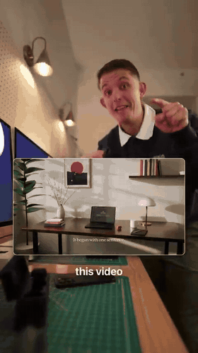</a> <b><a href="https://x.com/rileybrown/status/2119973951027724385">A talking-head video, edited by Fable 5.2</a></b> <a href="https://x.com/rileybrown">@rileybrown</a> · 2:01 · <a href="https://x.com/rileybrown/status/2119973951027724385">original post on X</a></td>
</tr>
<tr>
<td width="33%" valign="top"> <b><a href="https://x.com/EHuanglu/status/2119947980400976267">A script turned into a Disney-style animated film</a></b> <a href="https://x.com/EHuanglu">@EHuanglu</a> · 1:46 · <a href="https://x.com/EHuanglu/status/2119947980400976267">original post on X</a></td>
<td width="33%" valign="top"> <b><a href="https://x.com/mattshumer_/status/2119900920347828670">A 49-minute movie made in code, with voices and graphics</a></b> <a href="https://x.com/mattshumer_">@mattshumer_</a> · 48:49 · <a href="https://x.com/mattshumer_/status/2119900920347828670">original post on X</a></td>
<td width="33%" valign="top"> <b><a href="https://x.com/gavinpurcell/status/2120581152054583369">The next chapter of a spaghetti western saga: young romance</a></b> <a href="https://x.com/gavinpurcell">@gavinpurcell</a> · 2:27 · <a href="https://x.com/gavinpurcell/status/2120581152054583369">original post on X</a></td>
</tr>
<tr>
<td width="33%" valign="top"> <b><a href="https://x.com/jsnnsa/status/2120161161803088061">A documentary about designing a font for a brand kit</a></b> <a href="https://x.com/jsnnsa">@jsnnsa</a> · 1:43 · <a href="https://x.com/jsnnsa/status/2120161161803088061">original post on X</a></td>
<td width="33%" valign="top"> <b><a href="https://x.com/dhruvalgolakiya/status/2120551422324527242">A dragon in flight with simulated fire, rendered in Blender</a></b> <a href="https://x.com/dhruvalgolakiya">@dhruvalgolakiya</a> · 0:30 · <a href="https://x.com/dhruvalgolakiya/status/2120551422324527242">original post on X</a></td>
<td width="33%" valign="top"> <b><a href="https://x.com/0kncn/status/2119901782482543073">Anime short: a steam locomotive that turns into a robot</a></b> <a href="https://x.com/0kncn">@0kncn</a> · 1:30 · <a href="https://x.com/0kncn/status/2119901782482543073">original post on X</a> Blender · <a href="https://x.com/0kncn/status/2119901786060259612">prompt in the maker's reply</a></td>
</tr>
<tr>
<td width="33%" valign="top"><a href="https://x.com/JacobMolBio/status/2120648796334178374">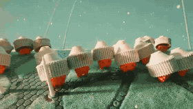</a> <b><a href="https://x.com/JacobMolBio/status/2120648796334178374">Better Half, a 4K Blender short about crabs and phages</a></b> <a href="https://x.com/JacobMolBio">@JacobMolBio</a> · 1:25 · <a href="https://x.com/JacobMolBio/status/2120648796334178374">original post on X</a></td>
<td width="33%" valign="top"> <b><a href="https://x.com/chetaslua/status/2120438091647218025">A pelican tired of the road, a painted film in one HTML file</a></b> <a href="https://x.com/chetaslua">@chetaslua</a> · 0:56 · <a href="https://x.com/chetaslua/status/2120438091647218025">original post on X</a></td>
<td width="33%" valign="top"> <b><a href="https://x.com/MatinSenPai/status/2120210882382971263">A 15-second motion design showreel from one prompt, $11 in API</a></b> <a href="https://x.com/MatinSenPai">@MatinSenPai</a> · 0:15 · <a href="https://x.com/MatinSenPai/status/2120210882382971263">original post on X</a></td>
</tr>
<tr>
<td width="33%" valign="top"> <b><a href="https://x.com/ery_treasure/status/2123041616688820509">Summer countryside from a frog's eye view, made in Blender</a></b> <a href="https://x.com/ery_treasure">@ery_treasure</a> · 1:30 · <a href="https://x.com/ery_treasure/status/2123041616688820509">original post on X</a></td>
<td width="33%" valign="top"> <b><a href="https://x.com/mgrczyk/status/2119943813028548721">A bird at sunrise, painted stroke by stroke with no undo</a></b> <a href="https://x.com/mgrczyk">@mgrczyk</a> · 0:21 · <a href="https://x.com/mgrczyk/status/2119943813028548721">original post on X</a></td>
<td width="33%" valign="top"> <b><a href="https://x.com/diegocabezas01/status/2124488567628149034">A wildfire on a hillside at night, from Fable 5.2 Max</a></b> <a href="https://x.com/diegocabezas01">@diegocabezas01</a> · 0:38 · <a href="https://x.com/diegocabezas01/status/2124488567628149034">original post on X</a></td>
</tr>
<tr>
<td width="33%" valign="top"> <b><a href="https://x.com/higgsfield_ai/status/2120007830065614926">A launch film for an invented robot joint, built in Blender</a></b> <a href="https://x.com/higgsfield_ai">@higgsfield_ai</a> · 0:30 · <a href="https://x.com/higgsfield_ai/status/2120007830065614926">original post on X</a> Blender · 4h 31m</td>
<td width="33%" valign="top"> <b><a href="https://x.com/dfeinition/status/2119881243990859818">Chalk art brought to life</a></b> <a href="https://x.com/dfeinition">@dfeinition</a> · 0:31 · <a href="https://x.com/dfeinition/status/2119881243990859818">original post on X</a></td>
<td width="33%" valign="top"> <b><a href="https://x.com/dfeinition/status/2119886262211625062">Fabric folds with light, camera moves and sound, all in code</a></b> <a href="https://x.com/dfeinition">@dfeinition</a> · 0:19 · <a href="https://x.com/dfeinition/status/2119886262211625062">original post on X</a></td>
</tr>
<tr>
<td width="33%" valign="top"> <b><a href="https://x.com/thomaszhou_/status/2120048570443395161">936, a short film from a one-sentence prompt</a></b> <a href="https://x.com/thomaszhou_">@thomaszhou_</a> · 1:42 · <a href="https://x.com/thomaszhou_/status/2120048570443395161">original post on X</a> Prompt: “请制作一段视频短片，会深刻影响到我的余生。”</td>
<td width="33%" valign="top"> <b><a href="https://x.com/kickingkeys/status/2119945841997672698">A painting piece with video and audio made in code</a></b> <a href="https://x.com/kickingkeys">@kickingkeys</a> · 0:23 · <a href="https://x.com/kickingkeys/status/2119945841997672698">original post on X</a></td>
<td width="33%" valign="top"> <b><a href="https://x.com/dfeinition/status/2119892208937517201">A claymation-style short</a></b> <a href="https://x.com/dfeinition">@dfeinition</a> · 0:20 · <a href="https://x.com/dfeinition/status/2119892208937517201">original post on X</a></td>
</tr>
<tr>
<td width="33%" valign="top"> <b><a href="https://x.com/wangray/status/2120040640423850168">A launch video for BlewUp, styled after a reference video</a></b> <a href="https://x.com/wangray">@wangray</a> · 0:19 · <a href="https://x.com/wangray/status/2120040640423850168">original post on X</a> Prompt: “参考这个 launch video 风格给 BlewUp 做一个类似的视频”</td>
<td width="33%" valign="top"> <b><a href="https://x.com/anstapnever/status/2119915123070644263">A 79-second anime short</a></b> <a href="https://x.com/anstapnever">@anstapnever</a> · 1:19 · <a href="https://x.com/anstapnever/status/2119915123070644263">original post on X</a></td>
<td width="33%" valign="top"> <b><a href="https://x.com/xKaka1456/status/2120008408774717666">A short film on the model's sense of beauty</a></b> <a href="https://x.com/xKaka1456">@xKaka1456</a> · 0:57 · <a href="https://x.com/xKaka1456/status/2120008408774717666">original post on X</a></td>
</tr>
<tr>
<td width="33%" valign="top"><a href="https://x.com/higgsfield_ai/status/2119964448077316238">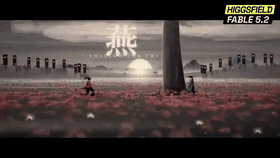</a> <b><a href="https://x.com/higgsfield_ai/status/2119964448077316238">A 90-second 2.5D animated duel, made with Higgsfield MCP</a></b> <a href="https://x.com/higgsfield_ai">@higgsfield_ai</a> · 1:30 · <a href="https://x.com/higgsfield_ai/status/2119964448077316238">original post on X</a> Higgsfield</td>
</tr>
</table>

## 3D scenes

<table>
<tr>
<td width="33%" valign="top"> <b><a href="https://x.com/ebbyamir/status/2120284261089673376">Van Gogh riding through his Starry Night, a playable game</a></b> <a href="https://x.com/ebbyamir">@ebbyamir</a> · 0:53 · <a href="https://x.com/ebbyamir/status/2120284261089673376">original post on X</a></td>
<td width="33%" valign="top"> <b><a href="https://x.com/claudeai/status/2120174844822298730">A 3D model of a cell, built one organelle at a time</a></b> <a href="https://x.com/claudeai">@claudeai</a> · 2:14 · <a href="https://x.com/claudeai/status/2120174844822298730">original post on X</a></td>
<td width="33%" valign="top"> <b><a href="https://x.com/ViktorKav/status/2122647483281015155">A 1996 Uno Mille with a roof ladder on a race track, one 603 KB HTML file</a></b> <a href="https://x.com/ViktorKav">@ViktorKav</a> · 1:00 · <a href="https://x.com/ViktorKav/status/2122647483281015155">original post on X</a></td>
</tr>
<tr>
<td width="33%" valign="top"><a href="https://x.com/BlendiByl/status/2120341251178594532">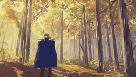</a> <b><a href="https://x.com/BlendiByl/status/2120341251178594532">A browser game with a hand-painted look, made of brush strokes</a></b> <a href="https://x.com/BlendiByl">@BlendiByl</a> · 0:16 · <a href="https://x.com/BlendiByl/status/2120341251178594532">original post on X</a> under 1 hour</td>
<td width="33%" valign="top"> <b><a href="https://x.com/mattshumer_/status/2120282133503820150">An open-world city game demo</a></b> <a href="https://x.com/mattshumer_">@mattshumer_</a> · 1:04 · <a href="https://x.com/mattshumer_/status/2120282133503820150">original post on X</a></td>
<td width="33%" valign="top"> <b><a href="https://x.com/everestchris6/status/2120175941616128277">A 3D walkthrough built from a 2D blueprint</a></b> <a href="https://x.com/everestchris6">@everestchris6</a> · 0:10 · <a href="https://x.com/everestchris6/status/2120175941616128277">original post on X</a></td>
</tr>
<tr>
<td width="33%" valign="top"><a href="https://x.com/rileybrown/status/2119902109709537708">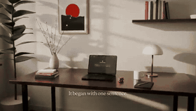</a> <b><a href="https://x.com/rileybrown/status/2119902109709537708">A desk scene in Blender: 13 camera shots, dusk to sunrise</a></b> <a href="https://x.com/rileybrown">@rileybrown</a> · 0:59 · <a href="https://x.com/rileybrown/status/2119902109709537708">original post on X</a> Blender · RunPod · ElevenLabs · $5.75 · 52 min render</td>
<td width="33%" valign="top"> <b><a href="https://x.com/ravisparikh/status/2121333521663017401">A figure that learns to run, rendered in vork</a></b> <a href="https://x.com/ravisparikh">@ravisparikh</a> · 0:30 · <a href="https://x.com/ravisparikh/status/2121333521663017401">original post on X</a></td>
<td width="33%" valign="top"> <b><a href="https://x.com/Dstudio_ai/status/2122569461547098595">A mobile-game-style lobby screen around a 3D model made in Tripo</a></b> <a href="https://x.com/Dstudio_ai">@Dstudio_ai</a> · 1:00 · <a href="https://x.com/Dstudio_ai/status/2122569461547098595">original post on X</a></td>
</tr>
<tr>
<td width="33%" valign="top"> <b><a href="https://x.com/JungleSilicon/status/2121782359901212987">A blue pixel-art dragon in Gaussian splats</a></b> <a href="https://x.com/JungleSilicon">@JungleSilicon</a> · 0:36 · <a href="https://x.com/JungleSilicon/status/2121782359901212987">original post on X</a></td>
<td width="33%" valign="top"> <b><a href="https://x.com/MrTacticalX/status/2121082861902070130">A computer built by three Fable 5.2 agents in 7 h 41 min</a></b> <a href="https://x.com/MrTacticalX">@MrTacticalX</a> · 0:35 · <a href="https://x.com/MrTacticalX/status/2121082861902070130">original post on X</a></td>
<td width="33%" valign="top"><a href="https://x.com/__morse/status/2122013410309153042">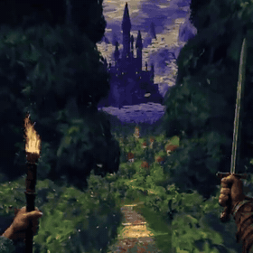</a> <b><a href="https://x.com/__morse/status/2122013410309153042">A first-person forest path with torch and sword, in the browser</a></b> <a href="https://x.com/__morse">@__morse</a> · 0:30 · <a href="https://x.com/__morse/status/2122013410309153042">original post on X</a></td>
</tr>
<tr>
<td width="33%" valign="top"> <b><a href="https://x.com/mixie3D/status/2121548293834740076">A flower scene where every single flower is 3D</a></b> <a href="https://x.com/mixie3D">@mixie3D</a> · 0:30 · <a href="https://x.com/mixie3D/status/2121548293834740076">original post on X</a></td>
<td width="33%" valign="top"> <b><a href="https://x.com/XRarchitect/status/2120947265007440052">A Three.js experiment made with Atlas and Fable 5.2</a></b> <a href="https://x.com/XRarchitect">@XRarchitect</a> · 0:21 · <a href="https://x.com/XRarchitect/status/2120947265007440052">original post on X</a></td>
<td width="33%" valign="top"> <b><a href="https://x.com/chetaslua/status/2121176151234330707">A Three.js scene with no external assets at all</a></b> <a href="https://x.com/chetaslua">@chetaslua</a> · 1:25 · <a href="https://x.com/chetaslua/status/2121176151234330707">original post on X</a></td>
</tr>
<tr>
<td width="33%" valign="top"> <b><a href="https://x.com/apekshik/status/2123139308932702468">AnyMachine: a helicopter, a lifeboat and walking robots modeled and rigged in Blender</a></b> <a href="https://x.com/apekshik">@apekshik</a> · 1:50 · <a href="https://x.com/apekshik/status/2123139308932702468">original post on X</a></td>
<td width="33%" valign="top"> <b><a href="https://x.com/M__Houser/status/2124153573718307003">Age of Dragon, a solo-built open-world fantasy game</a></b> <a href="https://x.com/M__Houser">@M__Houser</a> · 1:30 · <a href="https://x.com/M__Houser/status/2124153573718307003">original post on X</a></td>
<td width="33%" valign="top"><a href="https://x.com/petergostev/status/2119877733488394520">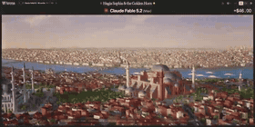</a> <b><a href="https://x.com/petergostev/status/2119877733488394520">Istanbul and the Golden Horn in 3D, made at Max effort</a></b> <a href="https://x.com/petergostev">@petergostev</a> · 0:39 · <a href="https://x.com/petergostev/status/2119877733488394520">original post on X</a></td>
</tr>
<tr>
<td width="33%" valign="top"> <b><a href="https://x.com/Rubzem/status/2122013352755126431">Getting There, a hand-painted storybook game made in 4 hours</a></b> <a href="https://x.com/Rubzem">@Rubzem</a> · 2:17 · <a href="https://x.com/Rubzem/status/2122013352755126431">original post on X</a></td>
<td width="33%" valign="top"> <b><a href="https://x.com/BlendiByl/status/2121594536153718972">A wizard sandbox game with 7 spells, made in one day</a></b> <a href="https://x.com/BlendiByl">@BlendiByl</a> · 0:55 · <a href="https://x.com/BlendiByl/status/2121594536153718972">original post on X</a></td>
<td width="33%" valign="top"> <b><a href="https://x.com/aecyydesign/status/2120239401821487149">A short animation made with Blender</a></b> <a href="https://x.com/aecyydesign">@aecyydesign</a> · 0:10 · <a href="https://x.com/aecyydesign/status/2120239401821487149">original post on X</a> Blender</td>
</tr>
<tr>
<td width="33%" valign="top"> <b><a href="https://x.com/alexalbert__/status/2119916954337349737">Da Vinci's notebook inventions, made interactive from a PDF</a></b> <a href="https://x.com/alexalbert__">@alexalbert__</a> · 0:25 · <a href="https://x.com/alexalbert__/status/2119916954337349737">original post on X</a></td>
<td width="33%" valign="top"> <b><a href="https://x.com/xikhar/status/2122682962647122403">Papertrails, an endless papercraft world that pops up in the browser</a></b> <a href="https://x.com/xikhar">@xikhar</a> · 0:54 · <a href="https://x.com/xikhar/status/2122682962647122403">original post on X</a></td>
<td width="33%" valign="top"> <b><a href="https://x.com/ryoma_nakajima/status/2120052388434473233">A sheet of paper folding itself into origami</a></b> <a href="https://x.com/ryoma_nakajima">@ryoma_nakajima</a> · 0:26 · <a href="https://x.com/ryoma_nakajima/status/2120052388434473233">original post on X</a></td>
</tr>
<tr>
<td width="33%" valign="top"><a href="https://x.com/kevin_t_ngo/status/2125119969109418333">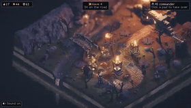</a> <b><a href="https://x.com/kevin_t_ngo/status/2125119969109418333">Cinderwatch, a tower defense game in a single HTML file</a></b> <a href="https://x.com/kevin_t_ngo">@kevin_t_ngo</a> · 0:20 · <a href="https://x.com/kevin_t_ngo/status/2125119969109418333">original post on X</a></td>
<td width="33%" valign="top"> <b><a href="https://x.com/_sholtodouglas/status/2119935331499925557">An arena shooter with portals</a></b> <a href="https://x.com/_sholtodouglas">@_sholtodouglas</a> · 1:11 · <a href="https://x.com/_sholtodouglas/status/2119935331499925557">original post on X</a></td>
<td width="33%" valign="top"><a href="https://x.com/emollick/status/2119918307457577163">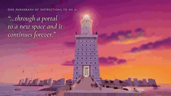</a> <b><a href="https://x.com/emollick/status/2119918307457577163">An endless trip through 450 worlds linked by portals</a></b> <a href="https://x.com/emollick">@emollick</a> · 1:11 · <a href="https://x.com/emollick/status/2119918307457577163">original post on X</a></td>
</tr>
<tr>
<td width="33%" valign="top"> <b><a href="https://x.com/alexmichael/status/2119876626179870838">A video made from scratch with Python controlling Blender</a></b> <a href="https://x.com/alexmichael">@alexmichael</a> · 0:18 · <a href="https://x.com/alexmichael/status/2119876626179870838">original post on X</a> Python · Blender</td>
<td width="33%" valign="top"><a href="https://x.com/BlendiByl/status/2120694003230560585">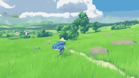</a> <b><a href="https://x.com/BlendiByl/status/2120694003230560585">A playable painted valley in anime-film style, open source</a></b> <a href="https://x.com/BlendiByl">@BlendiByl</a> · 0:23 · <a href="https://x.com/BlendiByl/status/2120694003230560585">original post on X</a></td>
<td width="33%" valign="top"> <b><a href="https://x.com/kevin_t_ngo/status/2120238844754923874">A dark fantasy souls-like boss fight, playable in the browser</a></b> <a href="https://x.com/kevin_t_ngo">@kevin_t_ngo</a> · 2:18 · <a href="https://x.com/kevin_t_ngo/status/2120238844754923874">original post on X</a></td>
</tr>
<tr>
<td width="33%" valign="top"> <b><a href="https://x.com/Grummz/status/2120255060957659498">A small first-person shooter level with no stock assets</a></b> <a href="https://x.com/Grummz">@Grummz</a> · 0:40 · <a href="https://x.com/Grummz/status/2120255060957659498">original post on X</a> 2.9 hours</td>
<td width="33%" valign="top"> <b><a href="https://x.com/pingouh/status/2120636604624560229">A robot biped animated by code, controllable in Unreal</a></b> <a href="https://x.com/pingouh">@pingouh</a> · 1:12 · <a href="https://x.com/pingouh/status/2120636604624560229">original post on X</a></td>
<td width="33%" valign="top"> <b><a href="https://x.com/chrisjdimarco/status/2120752985949057215">A million nanobots that morph into shapes, in Three.js</a></b> <a href="https://x.com/chrisjdimarco">@chrisjdimarco</a> · 1:31 · <a href="https://x.com/chrisjdimarco/status/2120752985949057215">original post on X</a></td>
</tr>
<tr>
<td width="33%" valign="top"> <b><a href="https://x.com/fe_yukichi/status/2122489950981779504">A listless bunny-eared character in Blender, about 8,000 triangles</a></b> <a href="https://x.com/fe_yukichi">@fe_yukichi</a> · 0:13 · <a href="https://x.com/fe_yukichi/status/2122489950981779504">original post on X</a></td>
<td width="33%" valign="top"> <b><a href="https://x.com/LexnLin/status/2119880654858977333">Made in about 30 minutes, with a few Opus 5.5 subagents</a></b> <a href="https://x.com/LexnLin">@LexnLin</a> · 0:30 · <a href="https://x.com/LexnLin/status/2119880654858977333">original post on X</a> about 30 min</td>
<td width="33%" valign="top"><a href="https://x.com/JungleSilicon/status/2120452158961397975">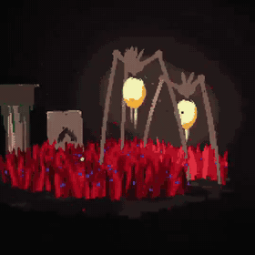</a> <b><a href="https://x.com/JungleSilicon/status/2120452158961397975">Pixel-art scenes made as Gaussian splats</a></b> <a href="https://x.com/JungleSilicon">@JungleSilicon</a> · 1:48 · <a href="https://x.com/JungleSilicon/status/2120452158961397975">original post on X</a></td>
</tr>
<tr>
<td width="33%" valign="top"> <b><a href="https://x.com/ChrisGPT/status/2122866766590173419">An underwater survival game that starts on half a submarine</a></b> <a href="https://x.com/ChrisGPT">@ChrisGPT</a> · 1:28 · <a href="https://x.com/ChrisGPT/status/2122866766590173419">original post on X</a></td>
<td width="33%" valign="top"><a href="https://x.com/vib3coded/status/2122472401124401585">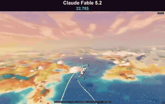</a> <b><a href="https://x.com/vib3coded/status/2122472401124401585">A pixel-art fighter jet game, made in 38 minutes for $22.78</a></b> <a href="https://x.com/vib3coded">@vib3coded</a> · 0:16 · <a href="https://x.com/vib3coded/status/2122472401124401585">original post on X</a></td>
<td width="33%" valign="top"> <b><a href="https://x.com/kevin_t_ngo/status/2125321244686029289">A procedural open-world RPG in one 300 kB HTML file, every pixel from shaders</a></b> <a href="https://x.com/kevin_t_ngo">@kevin_t_ngo</a> · 0:30 · <a href="https://x.com/kevin_t_ngo/status/2125321244686029289">original post on X</a></td>
</tr>
<tr>
<td width="33%" valign="top"> <b><a href="https://x.com/RezAIT00/status/2120498246426706176">A game environment made overnight with Blender and Unreal</a></b> <a href="https://x.com/RezAIT00">@RezAIT00</a> · 0:48 · <a href="https://x.com/RezAIT00/status/2120498246426706176">original post on X</a></td>
<td width="33%" valign="top"> <b><a href="https://x.com/xikhar/status/2119966147328299284">A Bugatti Tourbillon modeled and rendered in Blender</a></b> <a href="https://x.com/xikhar">@xikhar</a> · 0:34 · <a href="https://x.com/xikhar/status/2119966147328299284">original post on X</a> Blender · 2.5 hours</td>
<td width="33%" valign="top"><a href="https://x.com/deedydas/status/2120079288372494782">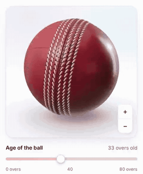</a> <b><a href="https://x.com/deedydas/status/2120079288372494782">A rendered cricket ball</a></b> <a href="https://x.com/deedydas">@deedydas</a> · 0:18 · <a href="https://x.com/deedydas/status/2120079288372494782">original post on X</a></td>
</tr>
<tr>
<td width="33%" valign="top"> <b><a href="https://x.com/Xian0063/status/2120417834694250522">A paper planner rebuilt as an interactive 3D planner</a></b> <a href="https://x.com/Xian0063">@Xian0063</a> · 0:40 · <a href="https://x.com/Xian0063/status/2120417834694250522">original post on X</a></td>
<td width="33%" valign="top"> <b><a href="https://x.com/op7418/status/2120694045299327187">A 3D action game made in one afternoon, in a 30 MB HTML file</a></b> <a href="https://x.com/op7418">@op7418</a> · 1:06 · <a href="https://x.com/op7418/status/2120694045299327187">original post on X</a></td>
<td width="33%" valign="top"> <b><a href="https://x.com/literallydenis/status/2120866958790848953">Ancient Babylon around 600 BC, built in 8 hours</a></b> <a href="https://x.com/literallydenis">@literallydenis</a> · 1:06 · <a href="https://x.com/literallydenis/status/2120866958790848953">original post on X</a></td>
</tr>
<tr>
<td width="33%" valign="top"> <b><a href="https://x.com/anshu4321/status/2119938067758772403">One square kilometer of Indiranagar, built from map data</a></b> <a href="https://x.com/anshu4321">@anshu4321</a> · 0:35 · <a href="https://x.com/anshu4321/status/2119938067758772403">original post on X</a></td>
<td width="33%" valign="top"> <b><a href="https://x.com/JungleSilicon/status/2120807580461306010">Inkwell in 3D pixel art, rendered with Gaussian splats</a></b> <a href="https://x.com/JungleSilicon">@JungleSilicon</a> · 9:18 · <a href="https://x.com/JungleSilicon/status/2120807580461306010">original post on X</a></td>
<td width="33%" valign="top"><a href="https://x.com/chongdashu/status/2120154573356793883">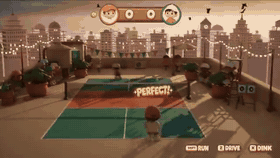</a> <b><a href="https://x.com/chongdashu/status/2120154573356793883">A pickleball game in the Unreal Engine 5.9 Preview</a></b> <a href="https://x.com/chongdashu">@chongdashu</a> · 0:49 · <a href="https://x.com/chongdashu/status/2120154573356793883">original post on X</a></td>
</tr>
<tr>
<td width="33%" valign="top"> <b><a href="https://x.com/AymericRoucher/status/2120247208918266080">A Lord of the Rings river scene with simulated water</a></b> <a href="https://x.com/AymericRoucher">@AymericRoucher</a> · 0:08 · <a href="https://x.com/AymericRoucher/status/2120247208918266080">original post on X</a> a few days</td>
<td width="33%" valign="top"><a href="https://x.com/MengTo/status/2121896633848017145">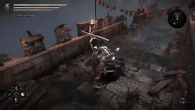</a> <b><a href="https://x.com/MengTo/status/2121896633848017145">A Dark Souls-inspired browser game, made in 3 days</a></b> <a href="https://x.com/MengTo">@MengTo</a> · 1:39 · <a href="https://x.com/MengTo/status/2121896633848017145">original post on X</a></td>
<td width="33%" valign="top"> <b><a href="https://x.com/calebfahlgren/status/2120680918914601165">A 3D house built from one prompt in a few hours</a></b> <a href="https://x.com/calebfahlgren">@calebfahlgren</a> · 0:44 · <a href="https://x.com/calebfahlgren/status/2120680918914601165">original post on X</a></td>
</tr>
<tr>
<td width="33%" valign="top"> <b><a href="https://x.com/XRarchitect/status/2121336108370014266">More Three.js experiments with Atlas and Fable 5.2</a></b> <a href="https://x.com/XRarchitect">@XRarchitect</a> · 0:26 · <a href="https://x.com/XRarchitect/status/2121336108370014266">original post on X</a></td>
<td width="33%" valign="top"> <b><a href="https://x.com/thegeomaster/status/2122421921790767239">A playable 3D platformer level, from concept art to Blender in one day</a></b> <a href="https://x.com/thegeomaster">@thegeomaster</a> · 1:02 · <a href="https://x.com/thegeomaster/status/2122421921790767239">original post on X</a></td>
<td width="33%" valign="top"> <b><a href="https://x.com/higgsfield_ai/status/2119893970897490135">A rigged zombie hand in Blender that crawls and backflips</a></b> <a href="https://x.com/higgsfield_ai">@higgsfield_ai</a> · 0:19 · <a href="https://x.com/higgsfield_ai/status/2119893970897490135">original post on X</a> Blender · Higgsfield</td>
</tr>
<tr>
<td width="33%" valign="top"> <b><a href="https://x.com/Rubzem/status/2125304202587234481">Getting There, four new chapters of the hand-painted storybook game</a></b> <a href="https://x.com/Rubzem">@Rubzem</a> · 1:26 · <a href="https://x.com/Rubzem/status/2125304202587234481">original post on X</a></td>
<td width="33%" valign="top"><a href="https://x.com/oalanicolas/status/2120138473826877590">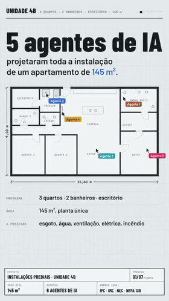</a> <b><a href="https://x.com/oalanicolas/status/2120138473826877590">A complete set of design drawings for an apartment</a></b> <a href="https://x.com/oalanicolas">@oalanicolas</a> · 0:46 · <a href="https://x.com/oalanicolas/status/2120138473826877590">original post on X</a></td>
<td width="33%" valign="top"> <b><a href="https://x.com/nickvernij/status/2122361634190696575">An Amsterdam street in 3D, built from the Street View API</a></b> <a href="https://x.com/nickvernij">@nickvernij</a> · 0:15 · <a href="https://x.com/nickvernij/status/2122361634190696575">original post on X</a></td>
</tr>
<tr>
<td width="33%" valign="top"> <b><a href="https://x.com/camperaigg/status/2121516404138754091">An alien-world shooter from one reference image in 30 minutes</a></b> <a href="https://x.com/camperaigg">@camperaigg</a> · 0:24 · <a href="https://x.com/camperaigg/status/2121516404138754091">original post on X</a></td>
<td width="33%" valign="top"> <b><a href="https://x.com/higgsfield_ai/status/2119993841692582398">A 3D city built by ten agents in Blender</a></b> <a href="https://x.com/higgsfield_ai">@higgsfield_ai</a> · 0:38 · <a href="https://x.com/higgsfield_ai/status/2119993841692582398">original post on X</a> Blender · Higgsfield MCP</td>
<td width="33%" valign="top"> <b><a href="https://x.com/KHvostikk/status/2120621109125202344">A reference image turned into a 3D model with PBR textures</a></b> <a href="https://x.com/KHvostikk">@KHvostikk</a> · 0:12 · <a href="https://x.com/KHvostikk/status/2120621109125202344">original post on X</a></td>
</tr>
<tr>
<td width="33%" valign="top"> <b><a href="https://x.com/LexnLin/status/2120910879361548565">A realistic bedroom built in Three.js, no 3D assets</a></b> <a href="https://x.com/LexnLin">@LexnLin</a> · 0:45 · <a href="https://x.com/LexnLin/status/2120910879361548565">original post on X</a></td>
<td width="33%" valign="top"> <b><a href="https://x.com/kevin_t_ngo/status/2121780322106999106">A made-up streamer plays an itch.io game and reacts to chat</a></b> <a href="https://x.com/kevin_t_ngo">@kevin_t_ngo</a> · 2:08 · <a href="https://x.com/kevin_t_ngo/status/2121780322106999106">original post on X</a></td>
<td width="33%" valign="top"><a href="https://x.com/pwnies/status/2119987174884143348">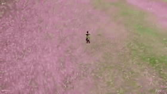</a> <b><a href="https://x.com/pwnies/status/2119987174884143348">A broom-riding game inspired by Kiki's Delivery Service</a></b> <a href="https://x.com/pwnies">@pwnies</a> · 0:45 · <a href="https://x.com/pwnies/status/2119987174884143348">original post on X</a></td>
</tr>
<tr>
<td width="33%" valign="top"> <b><a href="https://x.com/DilumSanjaya/status/2120561077385867663">A rocker-bogie rover simulated on alien terrain</a></b> <a href="https://x.com/DilumSanjaya">@DilumSanjaya</a> · 1:22 · <a href="https://x.com/DilumSanjaya/status/2120561077385867663">original post on X</a></td>
<td width="33%" valign="top"><a href="https://x.com/gamemangaanime/status/2122416618177479147">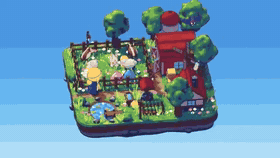</a> <b><a href="https://x.com/gamemangaanime/status/2122416618177479147">A pixel-art farm island in Gaussian splats, with no 3D models</a></b> <a href="https://x.com/gamemangaanime">@gamemangaanime</a> · 0:30 · <a href="https://x.com/gamemangaanime/status/2122416618177479147">original post on X</a></td>
<td width="33%" valign="top"> <b><a href="https://x.com/scottstts/status/2120254108104007712">Dragon's Nest, a dragon over a pagoda valley in Three.js</a></b> <a href="https://x.com/scottstts">@scottstts</a> · 1:00 · <a href="https://x.com/scottstts/status/2120254108104007712">original post on X</a></td>
</tr>
<tr>
<td width="33%" valign="top"><a href="https://x.com/BlendiByl/status/2122673770607591855">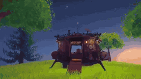</a> <b><a href="https://x.com/BlendiByl/status/2122673770607591855">A tiny solar system you can fly around, inspired by Outer Wilds</a></b> <a href="https://x.com/BlendiByl">@BlendiByl</a> · 1:20 · <a href="https://x.com/BlendiByl/status/2122673770607591855">original post on X</a></td>
<td width="33%" valign="top"> <b><a href="https://x.com/hectorVFX/status/2125250192773390610">A burning house in Blender and Unreal Engine, directed by voice from a phone</a></b> <a href="https://x.com/hectorVFX">@hectorVFX</a> · 0:13 · <a href="https://x.com/hectorVFX/status/2125250192773390610">original post on X</a></td>
<td width="33%" valign="top"> <b><a href="https://x.com/LexnLin/status/2121737343287828694">A little Three.js city at sunset, seen from a train</a></b> <a href="https://x.com/LexnLin">@LexnLin</a> · 1:00 · <a href="https://x.com/LexnLin/status/2121737343287828694">original post on X</a></td>
</tr>
<tr>
<td width="33%" valign="top"> <b><a href="https://x.com/BlendiByl/status/2121130385723789637">A colored-pencil game town, shaded in code, open source</a></b> <a href="https://x.com/BlendiByl">@BlendiByl</a> · 0:14 · <a href="https://x.com/BlendiByl/status/2121130385723789637">original post on X</a></td>
<td width="33%" valign="top"><a href="https://x.com/JaydenDavisNC/status/2120306434575392793">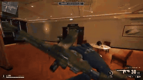</a> <b><a href="https://x.com/JaydenDavisNC/status/2120306434575392793">A first-person shooter in Three.js with no outside assets</a></b> <a href="https://x.com/JaydenDavisNC">@JaydenDavisNC</a> · 3:46 · <a href="https://x.com/JaydenDavisNC/status/2120306434575392793">original post on X</a></td>
<td width="33%" valign="top"><a href="https://x.com/anvithbuilds/status/2122408638950371579">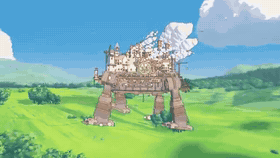</a> <b><a href="https://x.com/anvithbuilds/status/2122408638950371579">A town walking on mechanical legs over green hills, one-shot in three.js</a></b> <a href="https://x.com/anvithbuilds">@anvithbuilds</a> · 0:52 · <a href="https://x.com/anvithbuilds/status/2122408638950371579">original post on X</a></td>
</tr>
<tr>
<td width="33%" valign="top"> <b><a href="https://x.com/davis7/status/2120810499415908356">A browser scene from 48 hours of Fable 5.2 leading Opus 5.5</a></b> <a href="https://x.com/davis7">@davis7</a> · 0:26 · <a href="https://x.com/davis7/status/2120810499415908356">original post on X</a></td>
<td width="33%" valign="top"> <b><a href="https://x.com/hayashimon1/status/2124647333329862986">A mechanical tengu hall moved from Blender to Unreal Engine, renders 100x faster</a></b> <a href="https://x.com/hayashimon1">@hayashimon1</a> · 0:20 · <a href="https://x.com/hayashimon1/status/2124647333329862986">original post on X</a></td>
<td width="33%" valign="top"> <b><a href="https://x.com/alightinastorm/status/2120010936584945922">A Three.js basketball game with animation and sound</a></b> <a href="https://x.com/alightinastorm">@alightinastorm</a> · 0:41 · <a href="https://x.com/alightinastorm/status/2120010936584945922">original post on X</a> Three.js</td>
</tr>
<tr>
<td width="33%" valign="top"> <b><a href="https://x.com/Rubzem/status/2124142554371502140">A physics puzzle platformer where you play as shapeshifting water, 190 KB</a></b> <a href="https://x.com/Rubzem">@Rubzem</a> · 0:40 · <a href="https://x.com/Rubzem/status/2124142554371502140">original post on X</a></td>
<td width="33%" valign="top"> <b><a href="https://x.com/JungleSilicon/status/2121498263522328811">A green serpent on a mossy rock, in pixel-art Gaussian splats</a></b> <a href="https://x.com/JungleSilicon">@JungleSilicon</a> · 0:30 · <a href="https://x.com/JungleSilicon/status/2121498263522328811">original post on X</a></td>
<td width="33%" valign="top"> <b><a href="https://x.com/KanaWorks_AI/status/2120098607382880627">A flight over an endless generated world, in one take</a></b> <a href="https://x.com/KanaWorks_AI">@KanaWorks_AI</a> · 0:37 · <a href="https://x.com/KanaWorks_AI/status/2120098607382880627">original post on X</a></td>
</tr>
<tr>
<td width="33%" valign="top"> <b><a href="https://x.com/imantiai/status/2119979537320534135">A tropical-island shooter in raw WebGPU, from a 9-hour run</a></b> <a href="https://x.com/imantiai">@imantiai</a> · 0:31 · <a href="https://x.com/imantiai/status/2119979537320534135">original post on X</a></td>
<td width="33%" valign="top"> <b><a href="https://x.com/BlendiByl/status/2124439671006748853">An art deco 3D scene drawn in code, open source</a></b> <a href="https://x.com/BlendiByl">@BlendiByl</a> · 0:37 · <a href="https://x.com/BlendiByl/status/2124439671006748853">original post on X</a></td>
<td width="33%" valign="top"> <b><a href="https://x.com/maxt3chno/status/2121296570872107145">A Three.js yacht simulator built with no 3D models</a></b> <a href="https://x.com/maxt3chno">@maxt3chno</a> · 1:36 · <a href="https://x.com/maxt3chno/status/2121296570872107145">original post on X</a></td>
</tr>
<tr>
<td width="33%" valign="top"> <b><a href="https://x.com/KanaWorks_AI/status/2121962610711277978">A mountain temple through the seasons in interactive 4D splats</a></b> <a href="https://x.com/KanaWorks_AI">@KanaWorks_AI</a> · 1:00 · <a href="https://x.com/KanaWorks_AI/status/2121962610711277978">original post on X</a></td>
<td width="33%" valign="top"><a href="https://x.com/mxvdl/status/2120809570344050705">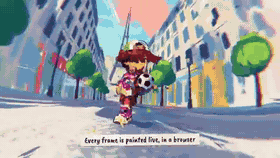</a> <b><a href="https://x.com/mxvdl/status/2120809570344050705">A breakdown of a lightweight Three.js brush-stroke shader</a></b> <a href="https://x.com/mxvdl">@mxvdl</a> · 1:40 · <a href="https://x.com/mxvdl/status/2120809570344050705">original post on X</a></td>
<td width="33%" valign="top"> <b><a href="https://x.com/earthtojake/status/2120247469900800316">A humanoid robot design, with CAD files and a simulation</a></b> <a href="https://x.com/earthtojake">@earthtojake</a> · 0:39 · <a href="https://x.com/earthtojake/status/2120247469900800316">original post on X</a> build123d · MuJoCo · Blender · overnight</td>
</tr>
<tr>
<td width="33%" valign="top"> <b><a href="https://x.com/builderjaydub/status/2120223731520040966">A helicopter against a medieval castle, a browser game</a></b> <a href="https://x.com/builderjaydub">@builderjaydub</a> · 1:04 · <a href="https://x.com/builderjaydub/status/2120223731520040966">original post on X</a></td>
<td width="33%" valign="top"><a href="https://x.com/MrTacticalX/status/2120342453807157720">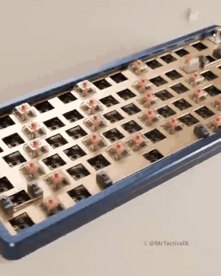</a> <b><a href="https://x.com/MrTacticalX/status/2120342453807157720">A mechanical keyboard built and typed on in Blender, 2 h 55 min and $90.78</a></b> <a href="https://x.com/MrTacticalX">@MrTacticalX</a> · 0:21 · <a href="https://x.com/MrTacticalX/status/2120342453807157720">original post on X</a></td>
<td width="33%" valign="top"><a href="https://x.com/tkm_hmng8/status/2120813043101946324">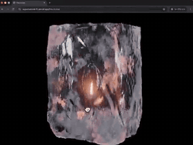</a> <b><a href="https://x.com/tkm_hmng8/status/2120813043101946324">Fire burning inside ice, in WebGPU without Three.js</a></b> <a href="https://x.com/tkm_hmng8">@tkm_hmng8</a> · 0:19 · <a href="https://x.com/tkm_hmng8/status/2120813043101946324">original post on X</a></td>
</tr>
<tr>
<td width="33%" valign="top"> <b><a href="https://x.com/MengTo/status/2121139143615074501">A Japanese-style FPS in a sakura valley, under 10 MB of HTML</a></b> <a href="https://x.com/MengTo">@MengTo</a> · 0:53 · <a href="https://x.com/MengTo/status/2121139143615074501">original post on X</a></td>
<td width="33%" valign="top"> <b><a href="https://x.com/MengTo/status/2120316203738829180">A Three.js apartment recreated in Blender</a></b> <a href="https://x.com/MengTo">@MengTo</a> · 0:52 · <a href="https://x.com/MengTo/status/2120316203738829180">original post on X</a> Blender</td>
<td width="33%" valign="top"><a href="https://x.com/kevin_t_ngo/status/2121701020598415465">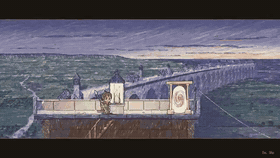</a> <b><a href="https://x.com/kevin_t_ngo/status/2121701020598415465">A side-scrolling RPG demo with every visual drawn in code</a></b> <a href="https://x.com/kevin_t_ngo">@kevin_t_ngo</a> · 1:45 · <a href="https://x.com/kevin_t_ngo/status/2121701020598415465">original post on X</a></td>
</tr>
<tr>
<td width="33%" valign="top"> <b><a href="https://x.com/ann_nnng/status/2120156122133004665">Fishing and farming in an embossed paper style</a></b> <a href="https://x.com/ann_nnng">@ann_nnng</a> · 0:29 · <a href="https://x.com/ann_nnng/status/2120156122133004665">original post on X</a></td>
<td width="33%" valign="top"> <b><a href="https://x.com/oalanicolas/status/2120266468780585456">A 3D walkthrough of a house, from its floor plan and photos</a></b> <a href="https://x.com/oalanicolas">@oalanicolas</a> · 0:45 · <a href="https://x.com/oalanicolas/status/2120266468780585456">original post on X</a> <a href="https://x.com/oalanicolas/status/2120266468780585456">prompt in the maker's reply</a></td>
<td width="33%" valign="top"> <b><a href="https://x.com/MrTacticalX/status/2121671659371585638">A glass keyboard modeled in Blender, 7 hours and $139.87</a></b> <a href="https://x.com/MrTacticalX">@MrTacticalX</a> · 0:32 · <a href="https://x.com/MrTacticalX/status/2121671659371585638">original post on X</a></td>
</tr>
<tr>
<td width="33%" valign="top"> <b><a href="https://x.com/JungleSilicon/status/2121893902286524880">A bee in a glowing honeycomb, in pixel-art Gaussian splats</a></b> <a href="https://x.com/JungleSilicon">@JungleSilicon</a> · 0:38 · <a href="https://x.com/JungleSilicon/status/2121893902286524880">original post on X</a></td>
<td width="33%" valign="top"> <b><a href="https://x.com/kevin_t_ngo/status/2122969346935017497">Dawnlings, a cozy platformer demo playable in the browser</a></b> <a href="https://x.com/kevin_t_ngo">@kevin_t_ngo</a> · 0:55 · <a href="https://x.com/kevin_t_ngo/status/2122969346935017497">original post on X</a></td>
<td width="33%" valign="top"><a href="https://x.com/anvithbuilds/status/2122993773722608099">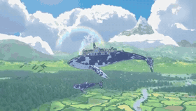</a> <b><a href="https://x.com/anvithbuilds/status/2122993773722608099">Whales flying over a green valley, one-shotted in three.js</a></b> <a href="https://x.com/anvithbuilds">@anvithbuilds</a> · 0:22 · <a href="https://x.com/anvithbuilds/status/2122993773722608099">original post on X</a></td>
</tr>
<tr>
<td width="33%" valign="top"> <b><a href="https://x.com/scottstts/status/2121262812228141395">Astral Realm, a procedural Three.js scene made in 2 hours</a></b> <a href="https://x.com/scottstts">@scottstts</a> · 2:00 · <a href="https://x.com/scottstts/status/2121262812228141395">original post on X</a></td>
<td width="33%" valign="top"> <b><a href="https://x.com/ForwardEditor/status/2119867743965163994">A dragon-riding simulator</a></b> <a href="https://x.com/ForwardEditor">@ForwardEditor</a> · 0:38 · <a href="https://x.com/ForwardEditor/status/2119867743965163994">original post on X</a></td>
<td width="33%" valign="top"> <b><a href="https://x.com/devteamdrew/status/2121405946211799421">The aurora borealis, drawn in code</a></b> <a href="https://x.com/devteamdrew">@devteamdrew</a> · 0:10 · <a href="https://x.com/devteamdrew/status/2121405946211799421">original post on X</a></td>
</tr>
<tr>
<td width="33%" valign="top"> <b><a href="https://x.com/scottstts/status/2121626206613491787">Ivory Kingdom, a procedural palace in Three.js in about 2 hours</a></b> <a href="https://x.com/scottstts">@scottstts</a> · 2:00 · <a href="https://x.com/scottstts/status/2121626206613491787">original post on X</a></td>
<td width="33%" valign="top"><a href="https://x.com/apekshik/status/2122464141990588795">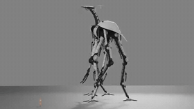</a> <b><a href="https://x.com/apekshik/status/2122464141990588795">A 100-foot walking robot in Blender, 160 parts with a rig and walk cycle</a></b> <a href="https://x.com/apekshik">@apekshik</a> · 1:27 · <a href="https://x.com/apekshik/status/2122464141990588795">original post on X</a></td>
<td width="33%" valign="top"> <b><a href="https://x.com/deedydas/status/2119930300990177509">Photorealistic honey simulation in WebGL, in real time</a></b> <a href="https://x.com/deedydas">@deedydas</a> · 0:51 · <a href="https://x.com/deedydas/status/2119930300990177509">original post on X</a> WebGL · Prompt: “Can you write the most intricate photorealistic simulation of honey in WebGL in the browser”</td>
</tr>
<tr>
<td width="33%" valign="top"> <b><a href="https://x.com/LexnLin/status/2122359035751989341">An apartment block walking on mechanical legs through the mist</a></b> <a href="https://x.com/LexnLin">@LexnLin</a> · 0:45 · <a href="https://x.com/LexnLin/status/2122359035751989341">original post on X</a></td>
<td width="33%" valign="top"> <b><a href="https://x.com/0xKense1/status/2120518961221529661">A game boss sculpted in Blender by code from a 3-view sheet</a></b> <a href="https://x.com/0xKense1">@0xKense1</a> · 0:39 · <a href="https://x.com/0xKense1/status/2120518961221529661">original post on X</a></td>
<td width="33%" valign="top"><a href="https://x.com/kevin_t_ngo/status/2124669366512001493">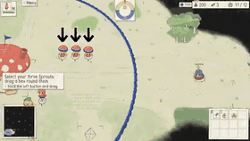</a> <b><a href="https://x.com/kevin_t_ngo/status/2124669366512001493">Ballpoint Dominion, a strategy game where you draw your army in ink</a></b> <a href="https://x.com/kevin_t_ngo">@kevin_t_ngo</a> · 0:53 · <a href="https://x.com/kevin_t_ngo/status/2124669366512001493">original post on X</a></td>
</tr>
<tr>
<td width="33%" valign="top"><a href="https://x.com/MaxXWilliamson/status/2119953172634677533">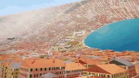</a> <b><a href="https://x.com/MaxXWilliamson/status/2119953172634677533">A Mediterranean-themed space habitat</a></b> <a href="https://x.com/MaxXWilliamson">@MaxXWilliamson</a> · 0:25 · <a href="https://x.com/MaxXWilliamson/status/2119953172634677533">original post on X</a></td>
<td width="33%" valign="top"><a href="https://x.com/sparklabhq/status/2119917375080521921">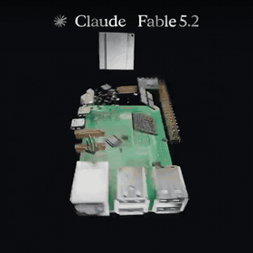</a> <b><a href="https://x.com/sparklabhq/status/2119917375080521921">An animated Raspberry Pi 5</a></b> <a href="https://x.com/sparklabhq">@sparklabhq</a> · 0:06 · <a href="https://x.com/sparklabhq/status/2119917375080521921">original post on X</a> Prompt: “animate a raspberry pi 5”</td>
<td width="33%" valign="top"><a href="https://x.com/JungleSilicon/status/2122929026084012461">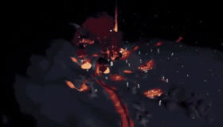</a> <b><a href="https://x.com/JungleSilicon/status/2122929026084012461">Lava, clockwork and an owl in pixel-art Gaussian splats</a></b> <a href="https://x.com/JungleSilicon">@JungleSilicon</a> · 0:28 · <a href="https://x.com/JungleSilicon/status/2122929026084012461">original post on X</a></td>
</tr>
<tr>
<td width="33%" valign="top"> <b><a href="https://x.com/alexwg/status/2120205080796315824">Neon Requiem, a cyberpunk shooter from one prompt</a></b> <a href="https://x.com/alexwg">@alexwg</a> · 1:07 · <a href="https://x.com/alexwg/status/2120205080796315824">original post on X</a></td>
<td width="33%" valign="top"><a href="https://x.com/NathanWilbanks_/status/2122359334290313441">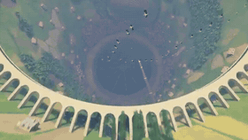</a> <b><a href="https://x.com/NathanWilbanks_/status/2122359334290313441">An interactive O'Neill cylinder world in one 1,064 KB HTML file</a></b> <a href="https://x.com/NathanWilbanks_">@NathanWilbanks_</a> · 1:17 · <a href="https://x.com/NathanWilbanks_/status/2122359334290313441">original post on X</a></td>
<td width="33%" valign="top"> <b><a href="https://x.com/vib3coded/status/2122640890309050820">A pixel-art helicopter game over a coastal city, 19 minutes and $19.79</a></b> <a href="https://x.com/vib3coded">@vib3coded</a> · 0:18 · <a href="https://x.com/vib3coded/status/2122640890309050820">original post on X</a></td>
</tr>
<tr>
<td width="33%" valign="top"> <b><a href="https://x.com/_nilni/status/2119977575053443467">CinderDeep, a roguelike where every pixel is simulated</a></b> <a href="https://x.com/_nilni">@_nilni</a> · 0:29 · <a href="https://x.com/_nilni/status/2119977575053443467">original post on X</a></td>
<td width="33%" valign="top"> <b><a href="https://x.com/dfeinition/status/2119867661463019972">A spider web holding 7,330 dew drops, drawn in code</a></b> <a href="https://x.com/dfeinition">@dfeinition</a> · 0:41 · <a href="https://x.com/dfeinition/status/2119867661463019972">original post on X</a></td>
<td width="33%" valign="top"> <b><a href="https://x.com/LexnLin/status/2122112228522623459">A castle on a cliff from about 9,000 lines of Python in Blender</a></b> <a href="https://x.com/LexnLin">@LexnLin</a> · 0:45 · <a href="https://x.com/LexnLin/status/2122112228522623459">original post on X</a></td>
</tr>
<tr>
<td width="33%" valign="top"> <b><a href="https://x.com/apekshik/status/2120224530367119758">A procedurally rigged arm that grabs a ball</a></b> <a href="https://x.com/apekshik">@apekshik</a> · 0:37 · <a href="https://x.com/apekshik/status/2120224530367119758">original post on X</a></td>
<td width="33%" valign="top"> <b><a href="https://x.com/LexnLin/status/2121934071429468543">A first-person shooter in a mountain valley, built in 2 days</a></b> <a href="https://x.com/LexnLin">@LexnLin</a> · 0:45 · <a href="https://x.com/LexnLin/status/2121934071429468543">original post on X</a></td>
<td width="33%" valign="top"> <b><a href="https://x.com/Angaisb_/status/2119917807119089926">A scene set somewhere in northern Italy</a></b> <a href="https://x.com/Angaisb_">@Angaisb_</a> · 0:20 · <a href="https://x.com/Angaisb_/status/2119917807119089926">original post on X</a></td>
</tr>
<tr>
<td width="33%" valign="top"> <b><a href="https://x.com/danjan_design/status/2124960426454905138">A snowy mountain lodge where snow turns into a blizzard</a></b> <a href="https://x.com/danjan_design">@danjan_design</a> · 0:14 · <a href="https://x.com/danjan_design/status/2124960426454905138">original post on X</a></td>
<td width="33%" valign="top"> <b><a href="https://x.com/LexnLin/status/2121253191748669705">An open-world RPG demo made without any assets</a></b> <a href="https://x.com/LexnLin">@LexnLin</a> · 1:20 · <a href="https://x.com/LexnLin/status/2121253191748669705">original post on X</a></td>
<td width="33%" valign="top"> <b><a href="https://x.com/Angaisb_/status/2119947748690841841">A voxel lake</a></b> <a href="https://x.com/Angaisb_">@Angaisb_</a> · 0:15 · <a href="https://x.com/Angaisb_/status/2119947748690841841">original post on X</a></td>
</tr>
<tr>
<td width="33%" valign="top"><a href="https://x.com/chetaslua/status/2120111159726727321">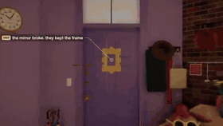</a> <b><a href="https://x.com/chetaslua/status/2120111159726727321">Monica's apartment, built in Three.js</a></b> <a href="https://x.com/chetaslua">@chetaslua</a> · 0:32 · <a href="https://x.com/chetaslua/status/2120111159726727321">original post on X</a> Three.js</td>
<td width="33%" valign="top"> <b><a href="https://x.com/higgsfield_ai/status/2119910344998912507">Paris, 1940, in three.js from Higgsfield reference images</a></b> <a href="https://x.com/higgsfield_ai">@higgsfield_ai</a> · 0:24 · <a href="https://x.com/higgsfield_ai/status/2119910344998912507">original post on X</a> three.js · Higgsfield</td>
<td width="33%" valign="top"> <b><a href="https://x.com/pleometric/status/2119901747930186234">A 3D video test with the Bryce rendering engine</a></b> <a href="https://x.com/pleometric">@pleometric</a> · 0:15 · <a href="https://x.com/pleometric/status/2119901747930186234">original post on X</a> Bryce</td>
</tr>
<tr>
<td width="33%" valign="top"> <b><a href="https://x.com/seiiiiiiiiiiru/status/2119919169768747313">A scene made by operating Blender</a></b> <a href="https://x.com/seiiiiiiiiiiru">@seiiiiiiiiiiru</a> · 0:20 · <a href="https://x.com/seiiiiiiiiiiru/status/2119919169768747313">original post on X</a> Blender</td>
<td width="33%" valign="top"> <b><a href="https://x.com/marcthecreatorr/status/2119890973560054072">A 3D sailing ship built in three.js, no external assets</a></b> <a href="https://x.com/marcthecreatorr">@marcthecreatorr</a> · 0:53 · <a href="https://x.com/marcthecreatorr/status/2119890973560054072">original post on X</a> three.js · Claude Code · ~$17 · ~38 min</td>
<td width="33%" valign="top"> <b><a href="https://x.com/orcdev/status/2120248774861689199">A four-elements 3D benchmark scene in Three.js</a></b> <a href="https://x.com/orcdev">@orcdev</a> · 0:29 · <a href="https://x.com/orcdev/status/2120248774861689199">original post on X</a> Three.js</td>
</tr>
<tr>
<td width="33%" valign="top"> <b><a href="https://x.com/loktar00/status/2119958719362666708">A Machu Picchu tiny world with volumetric fog and alpacas</a></b> <a href="https://x.com/loktar00">@loktar00</a> · 0:40 · <a href="https://x.com/loktar00/status/2119958719362666708">original post on X</a></td>
<td width="33%" valign="top"> <b><a href="https://x.com/ivanfioravanti/status/2119936753892983162">Hangzhou West Lake, built with three.js</a></b> <a href="https://x.com/ivanfioravanti">@ivanfioravanti</a> · 0:10 · <a href="https://x.com/ivanfioravanti/status/2119936753892983162">original post on X</a> three.js</td>
<td width="33%" valign="top"> <b><a href="https://x.com/leo114119/status/2119928576548237346">An anime-style 3D island with thousands of cycling pelicans</a></b> <a href="https://x.com/leo114119">@leo114119</a> · 0:46 · <a href="https://x.com/leo114119/status/2119928576548237346">original post on X</a></td>
</tr>
</table>

## Music

<table>
<tr>
<td width="33%" valign="top"> <b><a href="https://x.com/imjustnewatai/status/2120383964686729410">A symphony shaped like a training run, from noise to melody</a></b> <a href="https://x.com/imjustnewatai">@imjustnewatai</a> · 2:09 · <a href="https://x.com/imjustnewatai/status/2120383964686729410">original post on X</a></td>
<td width="33%" valign="top"> <b><a href="https://x.com/kevin_t_ngo/status/2123980980994318416">Fable 5.2 builds its own voice in plain Python</a></b> <a href="https://x.com/kevin_t_ngo">@kevin_t_ngo</a> · 0:40 · <a href="https://x.com/kevin_t_ngo/status/2123980980994318416">original post on X</a></td>
<td width="33%" valign="top"> <b><a href="https://x.com/deedydas/status/2120905625852936318">A 72-bar house track composed from music theory</a></b> <a href="https://x.com/deedydas">@deedydas</a> · 5:51 · <a href="https://x.com/deedydas/status/2120905625852936318">original post on X</a></td>
</tr>
<tr>
<td width="33%" valign="top"> <b><a href="https://x.com/imjustnewatai/status/2119919644836347926">A Beethoven-style piano sonata movement, scored in LilyPond</a></b> <a href="https://x.com/imjustnewatai">@imjustnewatai</a> · 2:51 · <a href="https://x.com/imjustnewatai/status/2119919644836347926">original post on X</a> LilyPond</td>
<td width="33%" valign="top"><a href="https://x.com/parhelion318/status/2120212304809918827">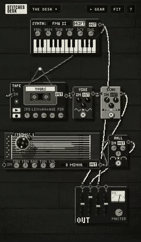</a> <b><a href="https://x.com/parhelion318/status/2120212304809918827">A tape-style ambient music setup</a></b> <a href="https://x.com/parhelion318">@parhelion318</a> · 0:44 · <a href="https://x.com/parhelion318/status/2120212304809918827">original post on X</a> Opus 5.5</td>
<td width="33%" valign="top"> <b><a href="https://x.com/imjustnewatai/status/2119902327423258787">A symphony, written when asked for its best</a></b> <a href="https://x.com/imjustnewatai">@imjustnewatai</a> · 4:09 · <a href="https://x.com/imjustnewatai/status/2119902327423258787">original post on X</a></td>
</tr>
<tr>
<td width="33%" valign="top"> <b><a href="https://x.com/kevin_t_ngo/status/2120198663062622581">A music video animated in Python and rendered in Blender</a></b> <a href="https://x.com/kevin_t_ngo">@kevin_t_ngo</a> · 1:17 · <a href="https://x.com/kevin_t_ngo/status/2120198663062622581">original post on X</a> Python · Blender</td>
<td width="33%" valign="top"> <b><a href="https://x.com/WesRoth/status/2119953913160093817">Another video made in one shot</a></b> <a href="https://x.com/WesRoth">@WesRoth</a> · 2:27 · <a href="https://x.com/WesRoth/status/2119953913160093817">original post on X</a></td>
<td width="33%" valign="top"> <b><a href="https://x.com/codyavant/status/2119987600437985600">A software analog synth being played</a></b> <a href="https://x.com/codyavant">@codyavant</a> · 0:36 · <a href="https://x.com/codyavant/status/2119987600437985600">original post on X</a></td>
</tr>
<tr>
<td width="33%" valign="top"> <b><a href="https://x.com/Avenoxai/status/2120129114346488084">Kaldığım Yerden, its own lyrics and an all-code music video</a></b> <a href="https://x.com/Avenoxai">@Avenoxai</a> · 2:55 · <a href="https://x.com/Avenoxai/status/2120129114346488084">original post on X</a></td>
<td width="33%" valign="top"> <b><a href="https://x.com/WesRoth/status/2119911161386934330">A music video with lyrics</a></b> <a href="https://x.com/WesRoth">@WesRoth</a> · 0:37 · <a href="https://x.com/WesRoth/status/2119911161386934330">original post on X</a></td>
<td width="33%" valign="top"> <b><a href="https://x.com/higgsfield_ai/status/2119907675265987047">Claude sings a sci-fi lo-fi track made from scratch</a></b> <a href="https://x.com/higgsfield_ai">@higgsfield_ai</a> · 0:50 · <a href="https://x.com/higgsfield_ai/status/2119907675265987047">original post on X</a> Higgsfield</td>
</tr>
</table>

## Model comparisons

<table>
<tr>
<td width="33%" valign="top"> <b><a href="https://x.com/EnvolDev/status/2119907318729245180">Cathedral of Ice: Fable 5.2 vs Opus 5.5</a></b> <a href="https://x.com/EnvolDev">@EnvolDev</a> · 0:25 · <a href="https://x.com/EnvolDev/status/2119907318729245180">original post on X</a> $81.10 · 1h 56m 52s</td>
<td width="33%" valign="top"> <b><a href="https://x.com/vib3coded/status/2121646685319221546">A jelly orange slice from the same prompt: Fable 5.2 vs Opus 5.5</a></b> <a href="https://x.com/vib3coded">@vib3coded</a> · 0:17 · <a href="https://x.com/vib3coded/status/2121646685319221546">original post on X</a></td>
<td width="33%" valign="top"> <b><a href="https://x.com/jony_palino/status/2122072152686121146">A galloping horse: Gemini 4 Krypton vs Fable 5.2 vs Opus 5.5 vs DeepSeek V4.1 Flash</a></b> <a href="https://x.com/jony_palino">@jony_palino</a> · 0:17 · <a href="https://x.com/jony_palino/status/2122072152686121146">original post on X</a></td>
</tr>
<tr>
<td width="33%" valign="top"> <b><a href="https://x.com/MrTacticalX/status/2119955647542542439">Glass pool: Fable 5.2 vs Opus 5.5</a></b> <a href="https://x.com/MrTacticalX">@MrTacticalX</a> · 0:30 · <a href="https://x.com/MrTacticalX/status/2119955647542542439">original post on X</a> $57.87 · 1 hr 30 min</td>
<td width="33%" valign="top"> <b><a href="https://x.com/kinderlayer/status/2120890033833922611">Cobra bursting through a carpet: Fable 5.2 vs Gemini 4 Argon</a></b> <a href="https://x.com/kinderlayer">@kinderlayer</a> · 0:30 · <a href="https://x.com/kinderlayer/status/2120890033833922611">original post on X</a></td>
<td width="33%" valign="top"> <b><a href="https://x.com/kinderlayer/status/2124465319087308918">An engine in cross-section from one prompt: Fable 5.2 vs GPT-6.2 Astra vs Gemini 4 Neon vs Grok 4.7</a></b> <a href="https://x.com/kinderlayer">@kinderlayer</a> · 0:12 · <a href="https://x.com/kinderlayer/status/2124465319087308918">original post on X</a></td>
</tr>
<tr>
<td width="33%" valign="top"> <b><a href="https://x.com/dom_scholz/status/2122862040326807696">A seabed submarine in three.js: Fable 5.2 at 242 KB vs GPT-6.2 Astra at 32.9 MB</a></b> <a href="https://x.com/dom_scholz">@dom_scholz</a> · 0:40 · <a href="https://x.com/dom_scholz/status/2122862040326807696">original post on X</a></td>
<td width="33%" valign="top"> <b><a href="https://x.com/developedbyed/status/2119898145777983634">Same scene side by side: Opus 5.5 vs Fable 5.2</a></b> <a href="https://x.com/developedbyed">@developedbyed</a> · 0:12 · <a href="https://x.com/developedbyed/status/2119898145777983634">original post on X</a></td>
<td width="33%" valign="top"> <b><a href="https://x.com/maxt3chno/status/2121714155757441227">A yacht simulator, Three.js vs Blender, built with Opus 5.5 and Fable 5.2</a></b> <a href="https://x.com/maxt3chno">@maxt3chno</a> · 0:52 · <a href="https://x.com/maxt3chno/status/2121714155757441227">original post on X</a></td>
</tr>
<tr>
<td width="33%" valign="top"> <b><a href="https://x.com/EnvolDev/status/2122803967272866254">A plane from the Alpine Gold prompt: GPT-6.2 Astra vs GPT-6.2 Sol vs Fable 5.2 vs Opus 5.5</a></b> <a href="https://x.com/EnvolDev">@EnvolDev</a> · 0:25 · <a href="https://x.com/EnvolDev/status/2122803967272866254">original post on X</a></td>
<td width="33%" valign="top"> <b><a href="https://x.com/omni1896837/status/2119900615447044494">An Earth scene five months apart: Fable 5 vs Fable 5.2</a></b> <a href="https://x.com/omni1896837">@omni1896837</a> · 1:00 · <a href="https://x.com/omni1896837/status/2119900615447044494">original post on X</a></td>
<td width="33%" valign="top"> <b><a href="https://x.com/kinderlayer/status/2120112222227648957">A lion clawing out of a carpet: Fable 5.2 vs Gemini 4 Argon</a></b> <a href="https://x.com/kinderlayer">@kinderlayer</a> · 0:30 · <a href="https://x.com/kinderlayer/status/2120112222227648957">original post on X</a></td>
</tr>
<tr>
<td width="33%" valign="top"> <b><a href="https://x.com/EnvolDev/status/2122773694783349144">A cathedral of ice from the same prompt: GPT-6.2 Astra vs Fable 5.2</a></b> <a href="https://x.com/EnvolDev">@EnvolDev</a> · 0:25 · <a href="https://x.com/EnvolDev/status/2122773694783349144">original post on X</a></td>
<td width="33%" valign="top"> <b><a href="https://x.com/eliadele/status/2123878763624857693">A seaplane landing at Bora Bora from one sentence: four frontier models side by side</a></b> <a href="https://x.com/eliadele">@eliadele</a> · 1:16 · <a href="https://x.com/eliadele/status/2123878763624857693">original post on X</a></td>
<td width="33%" valign="top"> <b><a href="https://x.com/mizugame_22/status/2123756243827486822">A rainy Kyoto alley at night in Blender: Fable 5.2 vs GPT-6.2 Astra vs Gemini 4 Neon</a></b> <a href="https://x.com/mizugame_22">@mizugame_22</a> · 0:13 · <a href="https://x.com/mizugame_22/status/2123756243827486822">original post on X</a></td>
</tr>
<tr>
<td width="33%" valign="top"> <b><a href="https://x.com/rayanabdulcader/status/2119995155625181371">Dock icons fight as stick figures, Opus 5.5 vs Fable 5.2</a></b> <a href="https://x.com/rayanabdulcader">@rayanabdulcader</a> · 0:56 · <a href="https://x.com/rayanabdulcader/status/2119995155625181371">original post on X</a></td>
<td width="33%" valign="top"> <b><a href="https://x.com/AmirMushich/status/2122815524124152216">A robotic hand modeled and animated in Blender: GPT-6.2 Astra vs Fable 5.2</a></b> <a href="https://x.com/AmirMushich">@AmirMushich</a> · 0:12 · <a href="https://x.com/AmirMushich/status/2122815524124152216">original post on X</a></td>
<td width="33%" valign="top"> <b><a href="https://x.com/jony_palino/status/2123889278501495127">A cyclist at sunset: Gemini 4 Neon vs GPT-6.2 Sol vs DeepSeek V4.1 Flash vs Fable 5.2</a></b> <a href="https://x.com/jony_palino">@jony_palino</a> · 0:16 · <a href="https://x.com/jony_palino/status/2123889278501495127">original post on X</a></td>
</tr>
<tr>
<td width="33%" valign="top"> <b><a href="https://x.com/ChrisGPT/status/2122837291874070590">A 10-second cowboy toy film in Blender: GPT-6.2 Astra vs Fable 5.2</a></b> <a href="https://x.com/ChrisGPT">@ChrisGPT</a> · 0:10 · <a href="https://x.com/ChrisGPT/status/2122837291874070590">original post on X</a></td>
<td width="33%" valign="top"> <b><a href="https://x.com/vib3coded/status/2120489288857252235">Jelly physics: Opus 5.5 ($4.51) vs Fable 5.2 ($16.97)</a></b> <a href="https://x.com/vib3coded">@vib3coded</a> · 0:17 · <a href="https://x.com/vib3coded/status/2120489288857252235">original post on X</a></td>
<td width="33%" valign="top"> <b><a href="https://x.com/MrTacticalX/status/2122806350543774075">A glass pool from the same prompt: Fable 5.2 vs GPT-6.2 Astra</a></b> <a href="https://x.com/MrTacticalX">@MrTacticalX</a> · 0:30 · <a href="https://x.com/MrTacticalX/status/2122806350543774075">original post on X</a></td>
</tr>
<tr>
<td width="33%" valign="top"> <b><a href="https://x.com/PhotoGarrido/status/2122292866894680476">A waterfall simulation benchmark in Houdini: Astra 6 vs Fable 5.2</a></b> <a href="https://x.com/PhotoGarrido">@PhotoGarrido</a> · 0:20 · <a href="https://x.com/PhotoGarrido/status/2122292866894680476">original post on X</a></td>
<td width="33%" valign="top"> <b><a href="https://x.com/dom_scholz/status/2119933150025363661">Opus 5.5 vs Fable 5.2 on the same task</a></b> <a href="https://x.com/dom_scholz">@dom_scholz</a> · 0:30 · <a href="https://x.com/dom_scholz/status/2119933150025363661">original post on X</a></td>
<td width="33%" valign="top"> <b><a href="https://x.com/semichenkko/status/2119960596951236675">First prompt vs final: 1886 New York floating in the sky</a></b> <a href="https://x.com/semichenkko">@semichenkko</a> · 0:10 · <a href="https://x.com/semichenkko/status/2119960596951236675">original post on X</a></td>
</tr>
<tr>
<td width="33%" valign="top"> <b><a href="https://x.com/0xmurasame/status/2122091376011854236">An Arctic icebreaker from the same prompt: Fable 5.2 vs GPT-6 Astra</a></b> <a href="https://x.com/0xmurasame">@0xmurasame</a> · 0:10 · <a href="https://x.com/0xmurasame/status/2122091376011854236">original post on X</a></td>
<td width="33%" valign="top"> <b><a href="https://x.com/lemomo_ai/status/2123305001804333337">A strawberry melting out of ice: Gemini 4 Neon vs Fable 5.2 vs Opus 5.5 vs GPT-6.2 Astra</a></b> <a href="https://x.com/lemomo_ai">@lemomo_ai</a> · 0:20 · <a href="https://x.com/lemomo_ai/status/2123305001804333337">original post on X</a></td>
<td width="33%" valign="top"> <b><a href="https://x.com/loktar00/status/2119980613369319706">A moonlit harbor town from the same prompt: DeepSeek vs Fable 5.2</a></b> <a href="https://x.com/loktar00">@loktar00</a> · 0:30 · <a href="https://x.com/loktar00/status/2119980613369319706">original post on X</a></td>
</tr>
<tr>
<td width="33%" valign="top"> <b><a href="https://x.com/MrTacticalX/status/2120565434424439292">Lighthouse in a stormy sea, oil painting: Fable 5.1 vs 5.2</a></b> <a href="https://x.com/MrTacticalX">@MrTacticalX</a> · 0:39 · <a href="https://x.com/MrTacticalX/status/2120565434424439292">original post on X</a></td>
<td width="33%" valign="top"> <b><a href="https://x.com/rubenssoto_ai/status/2122879969420566740">A campfire in the woods: GPT-6.2 Astra vs Fable 5.2 vs Opus 5.5</a></b> <a href="https://x.com/rubenssoto_ai">@rubenssoto_ai</a> · 0:30 · <a href="https://x.com/rubenssoto_ai/status/2122879969420566740">original post on X</a></td>
<td width="33%" valign="top"> <b><a href="https://x.com/EnvolDev/status/2121339316311888329">A seaplane film at four Fable 5.2 effort levels, $61.90 to $288.25</a></b> <a href="https://x.com/EnvolDev">@EnvolDev</a> · 0:25 · <a href="https://x.com/EnvolDev/status/2121339316311888329">original post on X</a></td>
</tr>
<tr>
<td width="33%" valign="top"> <b><a href="https://x.com/vib3coded/status/2122384446397768047">A jelly sperm whale: Opus 5.5 at $5.02 vs Fable 5.2 at $24.60</a></b> <a href="https://x.com/vib3coded">@vib3coded</a> · 0:17 · <a href="https://x.com/vib3coded/status/2122384446397768047">original post on X</a></td>
<td width="33%" valign="top"> <b><a href="https://x.com/EnvolDev/status/2121701704139956250">Rio above the clouds: Fable 5.2 vs Opus 5.5 vs Gemini 4 Hydrogen vs GPT-6 Astra</a></b> <a href="https://x.com/EnvolDev">@EnvolDev</a> · 0:25 · <a href="https://x.com/EnvolDev/status/2121701704139956250">original post on X</a></td>
<td width="33%" valign="top"> <b><a href="https://x.com/noclipepe/status/2120846360064692377">T-Rex runner game: Fable 5.2 vs Qwen4-Max, Gemini and GPT-6</a></b> <a href="https://x.com/noclipepe">@noclipepe</a> · 0:28 · <a href="https://x.com/noclipepe/status/2120846360064692377">original post on X</a></td>
</tr>
<tr>
<td width="33%" valign="top"> <b><a href="https://x.com/vib3coded/status/2124245249786855836">A pixel-art flight game: GPT-6.2 Astra ($5.31) vs Fable 5.2 ($22.78)</a></b> <a href="https://x.com/vib3coded">@vib3coded</a> · 0:16 · <a href="https://x.com/vib3coded/status/2124245249786855836">original post on X</a></td>
<td width="33%" valign="top"> <b><a href="https://x.com/Bhavani_00007/status/2119902204320780676">Rocket launch scene: Fable 5.2 vs Opus 5.5</a></b> <a href="https://x.com/Bhavani_00007">@Bhavani_00007</a> · 0:25 · <a href="https://x.com/Bhavani_00007/status/2119902204320780676">original post on X</a> $23.45 · 32 min</td>
<td width="33%" valign="top"> <b><a href="https://x.com/vib3coded/status/2124612292490752267">A koi pond: GPT-6.2 Astra (28 min, $8.71) vs Fable 5.2 (16 min, $12.44)</a></b> <a href="https://x.com/vib3coded">@vib3coded</a> · 0:17 · <a href="https://x.com/vib3coded/status/2124612292490752267">original post on X</a></td>
</tr>
<tr>
<td width="33%" valign="top"> <b><a href="https://x.com/ZryMiller/status/2120674046983720973">Opus 4.6 vs Fable 5.2, released 278 days apart</a></b> <a href="https://x.com/ZryMiller">@ZryMiller</a> · 0:33 · <a href="https://x.com/ZryMiller/status/2120674046983720973">original post on X</a></td>
<td width="33%" valign="top"> <b><a href="https://x.com/IndependentEco/status/2123169526619758996">A 30-minute run on the same 3D battlefield, with speed and cost: Fable 5.2 vs Gemini 4 Neon</a></b> <a href="https://x.com/IndependentEco">@IndependentEco</a> · 1:20 · <a href="https://x.com/IndependentEco/status/2123169526619758996">original post on X</a></td>
<td width="33%" valign="top"> <b><a href="https://x.com/dom_scholz/status/2120281700991463448">Fable 5.2 and Opus 5.5 on the same task, with more time</a></b> <a href="https://x.com/dom_scholz">@dom_scholz</a> · 0:30 · <a href="https://x.com/dom_scholz/status/2120281700991463448">original post on X</a></td>
</tr>
<tr>
<td width="33%" valign="top"> <b><a href="https://x.com/vib3coded/status/2119951060752375827">Jelly orca: Fable 5.2 vs Opus 5.5</a></b> <a href="https://x.com/vib3coded">@vib3coded</a> · 0:18 · <a href="https://x.com/vib3coded/status/2119951060752375827">original post on X</a></td>
<td width="33%" valign="top"> <b><a href="https://x.com/theoardley/status/2120124748159996152">A 3D short in the Zack D. Films style, Opus 5.5 vs Fable 5.2</a></b> <a href="https://x.com/theoardley">@theoardley</a> · 0:56 · <a href="https://x.com/theoardley/status/2120124748159996152">original post on X</a> Blender · MPFB · <a href="https://x.com/theoardley/status/2120124748159996152">prompt in the maker's reply</a></td>
<td width="33%" valign="top"> <b><a href="https://x.com/pleometric/status/2119879605607862329">Animation test: smoother than Opus, not a big jump</a></b> <a href="https://x.com/pleometric">@pleometric</a> · 0:50 · <a href="https://x.com/pleometric/status/2119879605607862329">original post on X</a></td>
</tr>
<tr>
<td width="33%" valign="top"> <b><a href="https://x.com/karminski3/status/2120007187808534965">The same demo from DeepSeek V4.1 Flash and Fable 5.2</a></b> <a href="https://x.com/karminski3">@karminski3</a> · 1:00 · <a href="https://x.com/karminski3/status/2120007187808534965">original post on X</a> $40</td>
<td width="33%" valign="top"> <b><a href="https://x.com/ZryMiller/status/2120180769033441317">One prompt at four effort levels, from low to xhigh</a></b> <a href="https://x.com/ZryMiller">@ZryMiller</a> · 1:00 · <a href="https://x.com/ZryMiller/status/2120180769033441317">original post on X</a> 29–86 min, $7.09–$42.10</td>
<td width="33%" valign="top"> <b><a href="https://x.com/MrTacticalX/status/2119949557664735583">Snow globe: Fable 5.2 vs Opus 5.5</a></b> <a href="https://x.com/MrTacticalX">@MrTacticalX</a> · 0:30 · <a href="https://x.com/MrTacticalX/status/2119949557664735583">original post on X</a> $6.97 · 21 min</td>
</tr>
</table>

## Make your own

- [How to make a video with Claude Fable 5.2](https://claude-motion.com/claude-fable-video): three ways, and the same four prompts run on Fable 5.2 and Opus 5.5.
- [HTML to video](https://claude-motion.com/html-to-video): paste the HTML the model wrote and save it as MP4, GIF or WebM, free, in your browser.
- [Motion Director](https://github.com/hideewsj-maker/motion-skills): a free skill for Claude Code, Codex and Cursor that makes a whole film with music.

## Add a video

Open an issue or a pull request with the link to the post on X. The post should say it was made with Fable 5.2. Entries are checked by hand.

## Credit and removal

Every video belongs to the person who made it; each entry names its maker and links to the original post. Titles are descriptions of what the post says. If an entry is yours and you want it removed, open an issue or write to the takedown address on claude-motion.com and it comes down.

The list itself (titles, categories, this text) is CC BY 4.0. The videos and prompts are their makers'.
