# Awesome Claude Fable 5.2 Videos

[简体中文](README.zh-CN.md)

A credited list of **146 videos made with Claude Fable 5.2** and shared on X since its release on November 9, 2026: motion graphics, explainers, animated films, 3D scenes and music. The model wrote code that draws every frame; no video model was involved.

Watch them all, with filters, at **[claude-motion.com/fable-5-2-videos](https://claude-motion.com/fable-5-2-videos)**

## Motion graphics

<table>
<tr>
<td width="33%" valign="top"><a href="https://x.com/mathiaschpl/status/2119878412181676283">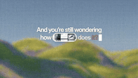</a> <b><a href="https://x.com/mathiaschpl/status/2119878412181676283">A motion piece made in 10 minutes</a></b> <a href="https://x.com/mathiaschpl">@mathiaschpl</a> · 0:37 · <a href="https://x.com/mathiaschpl/status/2119878412181676283">original post on X</a> 10 min</td>
<td width="33%" valign="top"><a href="https://x.com/DaveJ/status/2120486254852608470">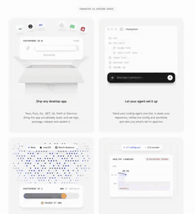</a> <b><a href="https://x.com/DaveJ/status/2120486254852608470">Motion design that stays consistent with an existing design</a></b> <a href="https://x.com/DaveJ">@DaveJ</a> · 0:25 · <a href="https://x.com/DaveJ/status/2120486254852608470">original post on X</a></td>
<td width="33%" valign="top"> <b><a href="https://x.com/alegiiaa/status/2120517875144233201">Animations designed in 7 minutes</a></b> <a href="https://x.com/alegiiaa">@alegiiaa</a> · 0:08 · <a href="https://x.com/alegiiaa/status/2120517875144233201">original post on X</a></td>
</tr>
<tr>
<td width="33%" valign="top"> <b><a href="https://x.com/bhavya_gx/status/2120210072810983687">Live footage with editing and VFX done by Fable 5.2</a></b> <a href="https://x.com/bhavya_gx">@bhavya_gx</a> · 0:29 · <a href="https://x.com/bhavya_gx/status/2120210072810983687">original post on X</a></td>
<td width="33%" valign="top"> <b><a href="https://x.com/chetaslua/status/2120179018964324566">A painting drawn by code in plain JavaScript</a></b> <a href="https://x.com/chetaslua">@chetaslua</a> · 0:34 · <a href="https://x.com/chetaslua/status/2120179018964324566">original post on X</a> JavaScript</td>
<td width="33%" valign="top"> <b><a href="https://x.com/op7418/status/2120085300185833878">Typed words become flowing ink in a live fluid simulation</a></b> <a href="https://x.com/op7418">@op7418</a> · 1:06 · <a href="https://x.com/op7418/status/2120085300185833878">original post on X</a></td>
</tr>
<tr>
<td width="33%" valign="top"> <b><a href="https://x.com/LexnLin/status/2120167637133238295">A Claude logo animation</a></b> <a href="https://x.com/LexnLin">@LexnLin</a> · 0:30 · <a href="https://x.com/LexnLin/status/2120167637133238295">original post on X</a></td>
<td width="33%" valign="top"> <b><a href="https://x.com/Khazix0918/status/2119902325460590834">A birthday video for ChatGPT's fourth anniversary</a></b> <a href="https://x.com/Khazix0918">@Khazix0918</a> · 0:58 · <a href="https://x.com/Khazix0918/status/2119902325460590834">original post on X</a></td>
<td width="33%" valign="top"> <b><a href="https://x.com/Gregoirechp/status/2119879667457073355">A motion design piece, made in a few minutes</a></b> <a href="https://x.com/Gregoirechp">@Gregoirechp</a> · 0:40 · <a href="https://x.com/Gregoirechp/status/2119879667457073355">original post on X</a></td>
</tr>
<tr>
<td width="33%" valign="top"> <b><a href="https://x.com/jeanalexandre_b/status/2120783430606840084">A photo recreated from 100,000 color patches, by code alone</a></b> <a href="https://x.com/jeanalexandre_b">@jeanalexandre_b</a> · 1:08 · <a href="https://x.com/jeanalexandre_b/status/2120783430606840084">original post on X</a></td>
<td width="33%" valign="top"> <b><a href="https://x.com/internetphysics/status/2119903808935313778">A portrait of Sam Altman in simulated oil paint</a></b> <a href="https://x.com/internetphysics">@internetphysics</a> · 1:00 · <a href="https://x.com/internetphysics/status/2119903808935313778">original post on X</a></td>
<td width="33%" valign="top"> <b><a href="https://x.com/yuwen_lu_/status/2120230407878930739">A Central Park photo recreated with p5.js brushes</a></b> <a href="https://x.com/yuwen_lu_">@yuwen_lu_</a> · 0:19 · <a href="https://x.com/yuwen_lu_/status/2120230407878930739">original post on X</a> p5.js</td>
</tr>
<tr>
<td width="33%" valign="top"> <b><a href="https://x.com/sota_web15/status/2120446425545023792">A video with 8 minutes of human work and about ¥300 in cost</a></b> <a href="https://x.com/sota_web15">@sota_web15</a> · 1:46 · <a href="https://x.com/sota_web15/status/2120446425545023792">original post on X</a></td>
<td width="33%" valign="top"><a href="https://x.com/aziz4ai/status/2119928581405200726">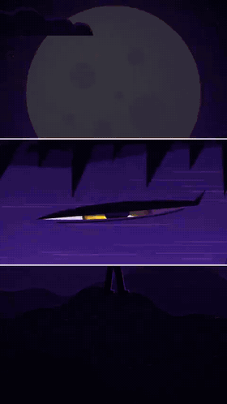</a> <b><a href="https://x.com/aziz4ai/status/2119928581405200726">A 15-second scene made only with code, no video model</a></b> <a href="https://x.com/aziz4ai">@aziz4ai</a> · 0:15 · <a href="https://x.com/aziz4ai/status/2119928581405200726">original post on X</a></td>
<td width="33%" valign="top"> <b><a href="https://x.com/venturetwins/status/2120331599283954137">A lake at dusk painted in an MS Paint clone, as a timelapse</a></b> <a href="https://x.com/venturetwins">@venturetwins</a> · 0:46 · <a href="https://x.com/venturetwins/status/2120331599283954137">original post on X</a> 94 min</td>
</tr>
<tr>
<td width="33%" valign="top"> <b><a href="https://x.com/devteamdrew/status/2120090542419984686">The Seven Wonders of the World, drawn and animated</a></b> <a href="https://x.com/devteamdrew">@devteamdrew</a> · 0:10 · <a href="https://x.com/devteamdrew/status/2120090542419984686">original post on X</a></td>
<td width="33%" valign="top"> <b><a href="https://x.com/other__reality/status/2119885430627913784">Clawd builds and releases a new Claude model</a></b> <a href="https://x.com/other__reality">@other__reality</a> · 0:26 · <a href="https://x.com/other__reality/status/2119885430627913784">original post on X</a> Prompt: “Create an animated video of clawd creating and releasing Claude Fable 5.2”</td>
<td width="33%" valign="top"><a href="https://x.com/justkarangupta/status/2119995965776200047">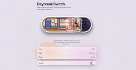</a> <b><a href="https://x.com/justkarangupta/status/2119995965776200047">A light switch with a cat that wakes and a puppy at the door</a></b> <a href="https://x.com/justkarangupta">@justkarangupta</a> · 0:15 · <a href="https://x.com/justkarangupta/status/2119995965776200047">original post on X</a></td>
</tr>
<tr>
<td width="33%" valign="top"><a href="https://x.com/slimer48484/status/2120094263673319609">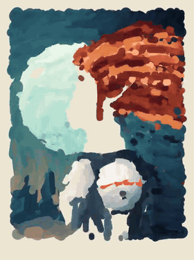</a> <b><a href="https://x.com/slimer48484/status/2120094263673319609">A painting made in Python, shown stroke by stroke</a></b> <a href="https://x.com/slimer48484">@slimer48484</a> · 0:30 · <a href="https://x.com/slimer48484/status/2120094263673319609">original post on X</a> Python</td>
<td width="33%" valign="top"> <b><a href="https://x.com/Masimo_Blue/status/2119943368612487285">A 10-second promo for Claude pants, with acid techno music</a></b> <a href="https://x.com/Masimo_Blue">@Masimo_Blue</a> · 0:10 · <a href="https://x.com/Masimo_Blue/status/2119943368612487285">original post on X</a></td>
<td width="33%" valign="top"><a href="https://x.com/Hunter_Weiss/status/2119932937642946900">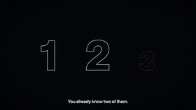</a> <b><a href="https://x.com/Hunter_Weiss/status/2119932937642946900">Rocket science explained at high-school level, in one shot</a></b> <a href="https://x.com/Hunter_Weiss">@Hunter_Weiss</a> · 1:58 · <a href="https://x.com/Hunter_Weiss/status/2119932937642946900">original post on X</a> Prompt: “I need you to create the most impressive video I can share with people about Fable 5.2, explaining rocket science as if it were for someone with a high school education.”</td>
</tr>
</table>

## Explainers

<table>
<tr>
<td width="33%" valign="top"><a href="https://x.com/aollivier82/status/2120260208245043663">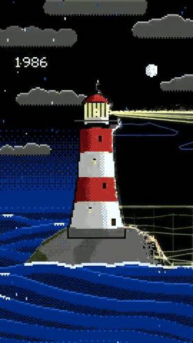</a> <b><a href="https://x.com/aollivier82/status/2120260208245043663">The history of computer graphics, animated</a></b> <a href="https://x.com/aollivier82">@aollivier82</a> · 0:29 · <a href="https://x.com/aollivier82/status/2120260208245043663">original post on X</a></td>
<td width="33%" valign="top"> <b><a href="https://x.com/imjustnewatai/status/2120695368874631226">50 cars learning to drive without being told how</a></b> <a href="https://x.com/imjustnewatai">@imjustnewatai</a> · 1:38 · <a href="https://x.com/imjustnewatai/status/2120695368874631226">original post on X</a></td>
<td width="33%" valign="top"> <b><a href="https://x.com/rileybrown/status/2119946022767980985">The history of writing, from one prompt</a></b> <a href="https://x.com/rileybrown">@rileybrown</a> · 1:36 · <a href="https://x.com/rileybrown/status/2119946022767980985">original post on X</a> <a href="https://v2.video/riley/the-history-of-writing/v1">prompt and files on the maker's page</a></td>
</tr>
<tr>
<td width="33%" valign="top"> <b><a href="https://x.com/MartinOesterhel/status/2120464036030517525">A trailer-style video on the soil texture triangle</a></b> <a href="https://x.com/MartinOesterhel">@MartinOesterhel</a> · 1:32 · <a href="https://x.com/MartinOesterhel/status/2120464036030517525">original post on X</a></td>
<td width="33%" valign="top"><a href="https://x.com/amrnth0/status/2120849097871810973">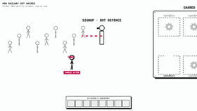</a> <b><a href="https://x.com/amrnth0/status/2120849097871810973">The great Railway hack, explained</a></b> <a href="https://x.com/amrnth0">@amrnth0</a> · 2:12 · <a href="https://x.com/amrnth0/status/2120849097871810973">original post on X</a></td>
<td width="33%" valign="top"><a href="https://x.com/DeryaTR_/status/2119974354260013293">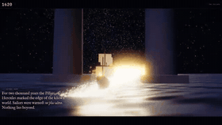</a> <b><a href="https://x.com/DeryaTR_/status/2119974354260013293">A 3D journey through the history of science, made in code</a></b> <a href="https://x.com/DeryaTR_">@DeryaTR_</a> · 4:56 · <a href="https://x.com/DeryaTR_/status/2119974354260013293">original post on X</a></td>
</tr>
<tr>
<td width="33%" valign="top"> <b><a href="https://x.com/Rasmic/status/2119919466163093768">A motion graphics explainer of Convex</a></b> <a href="https://x.com/Rasmic">@Rasmic</a> · 4:08 · <a href="https://x.com/Rasmic/status/2119919466163093768">original post on X</a></td>
<td width="33%" valign="top"> <b><a href="https://x.com/linxiaobei888/status/2119978892861829227">An English-learning cartoon for children aged 3 to 6</a></b> <a href="https://x.com/linxiaobei888">@linxiaobei888</a> · 2:27 · <a href="https://x.com/linxiaobei888/status/2119978892861829227">original post on X</a> Codex</td>
<td width="33%" valign="top"> <b><a href="https://x.com/konstantinsaifo/status/2119941967136379334">How a nuclear reactor works: a take-apart three.js model</a></b> <a href="https://x.com/konstantinsaifo">@konstantinsaifo</a> · 0:36 · <a href="https://x.com/konstantinsaifo/status/2119941967136379334">original post on X</a> three.js · $92</td>
</tr>
<tr>
<td width="33%" valign="top"> <b><a href="https://x.com/MatthewBerman/status/2119868633086378471">A motion graphic explaining how LLMs work</a></b> <a href="https://x.com/MatthewBerman">@MatthewBerman</a> · 0:50 · <a href="https://x.com/MatthewBerman/status/2119868633086378471">original post on X</a></td>
</tr>
</table>

## Animated films

<table>
<tr>
<td width="33%" valign="top"> <b><a href="https://x.com/gavinpurcell/status/2120002682421182624">A short film made freely from a code repo</a></b> <a href="https://x.com/gavinpurcell">@gavinpurcell</a> · 1:56 · <a href="https://x.com/gavinpurcell/status/2120002682421182624">original post on X</a></td>
<td width="33%" valign="top"> <b><a href="https://x.com/devteamdrew/status/2119892540950241283">A 32-second film, posted without a description</a></b> <a href="https://x.com/devteamdrew">@devteamdrew</a> · 0:32 · <a href="https://x.com/devteamdrew/status/2119892540950241283">original post on X</a></td>
<td width="33%" valign="top"> <b><a href="https://x.com/polinaaAi/status/2120753459498549757">An open-world city driving scene, 45 seconds at 4K</a></b> <a href="https://x.com/polinaaAi">@polinaaAi</a> · 0:46 · <a href="https://x.com/polinaaAi/status/2120753459498549757">original post on X</a></td>
</tr>
<tr>
<td width="33%" valign="top"><a href="https://x.com/kevin_t_ngo/status/2119938129079808282">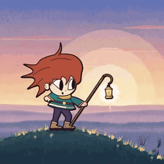</a> <b><a href="https://x.com/kevin_t_ngo/status/2119938129079808282">A film with every frame drawn in JavaScript</a></b> <a href="https://x.com/kevin_t_ngo">@kevin_t_ngo</a> · 1:40 · <a href="https://x.com/kevin_t_ngo/status/2119938129079808282">original post on X</a> JavaScript</td>
<td width="33%" valign="top"> <b><a href="https://x.com/kevin_t_ngo/status/2119972124211454139">A 90s-style toy commercial, animated in Python and Blender</a></b> <a href="https://x.com/kevin_t_ngo">@kevin_t_ngo</a> · 1:05 · <a href="https://x.com/kevin_t_ngo/status/2119972124211454139">original post on X</a> Python · Blender</td>
<td width="33%" valign="top"> <b><a href="https://x.com/rute1203d/status/2120077147872391540">A showcase film: technique first, then an emotional turn</a></b> <a href="https://x.com/rute1203d">@rute1203d</a> · 2:26 · <a href="https://x.com/rute1203d/status/2120077147872391540">original post on X</a> Prompt: “あなたが世界有数の動画クリエイターです... 今の実力を見せつける最高の動画を作ってください 技術をみせその後感動を見せる”</td>
</tr>
<tr>
<td width="33%" valign="top"><a href="https://x.com/kevin_t_ngo/status/2120308118127309173">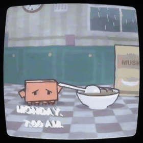</a> <b><a href="https://x.com/kevin_t_ngo/status/2120308118127309173">A '90s cereal commercial, all drawn in code</a></b> <a href="https://x.com/kevin_t_ngo">@kevin_t_ngo</a> · 1:04 · <a href="https://x.com/kevin_t_ngo/status/2120308118127309173">original post on X</a></td>
<td width="33%" valign="top"> <b><a href="https://x.com/lemomo_ai/status/2120118194409193682">A night library where 24,000 pages take flight, with piano</a></b> <a href="https://x.com/lemomo_ai">@lemomo_ai</a> · 0:55 · <a href="https://x.com/lemomo_ai/status/2120118194409193682">original post on X</a></td>
<td width="33%" valign="top"> <b><a href="https://x.com/0xMovez/status/2121001440470577157">A 2-minute animated short in Three.js, 8 worlds, 16 shots</a></b> <a href="https://x.com/0xMovez">@0xMovez</a> · 1:41 · <a href="https://x.com/0xMovez/status/2121001440470577157">original post on X</a></td>
</tr>
<tr>
<td width="33%" valign="top"><a href="https://x.com/kevin_t_ngo/status/2120540964909711415">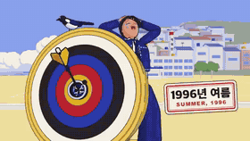</a> <b><a href="https://x.com/kevin_t_ngo/status/2120540964909711415">An animated show intro, all code, rendered in Blender</a></b> <a href="https://x.com/kevin_t_ngo">@kevin_t_ngo</a> · 0:45 · <a href="https://x.com/kevin_t_ngo/status/2120540964909711415">original post on X</a></td>
<td width="33%" valign="top"> <b><a href="https://x.com/rileybrown/status/2119973951027724385">A talking-head video, edited by Fable 5.2</a></b> <a href="https://x.com/rileybrown">@rileybrown</a> · 2:01 · <a href="https://x.com/rileybrown/status/2119973951027724385">original post on X</a></td>
<td width="33%" valign="top"> <b><a href="https://x.com/EHuanglu/status/2119947980400976267">A script turned into a Disney-style animated film</a></b> <a href="https://x.com/EHuanglu">@EHuanglu</a> · 1:46 · <a href="https://x.com/EHuanglu/status/2119947980400976267">original post on X</a></td>
</tr>
<tr>
<td width="33%" valign="top"> <b><a href="https://x.com/mattshumer_/status/2119900920347828670">A 49-minute movie made in code, with voices and graphics</a></b> <a href="https://x.com/mattshumer_">@mattshumer_</a> · 48:49 · <a href="https://x.com/mattshumer_/status/2119900920347828670">original post on X</a></td>
<td width="33%" valign="top"> <b><a href="https://x.com/jsnnsa/status/2120161161803088061">A documentary about designing a font for a brand kit</a></b> <a href="https://x.com/jsnnsa">@jsnnsa</a> · 1:43 · <a href="https://x.com/jsnnsa/status/2120161161803088061">original post on X</a></td>
<td width="33%" valign="top"> <b><a href="https://x.com/dhruvalgolakiya/status/2120551422324527242">A dragon in flight with simulated fire, rendered in Blender</a></b> <a href="https://x.com/dhruvalgolakiya">@dhruvalgolakiya</a> · 0:30 · <a href="https://x.com/dhruvalgolakiya/status/2120551422324527242">original post on X</a></td>
</tr>
<tr>
<td width="33%" valign="top"><a href="https://x.com/gavinpurcell/status/2120581152054583369">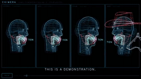</a> <b><a href="https://x.com/gavinpurcell/status/2120581152054583369">The next chapter of a spaghetti western saga: young romance</a></b> <a href="https://x.com/gavinpurcell">@gavinpurcell</a> · 2:27 · <a href="https://x.com/gavinpurcell/status/2120581152054583369">original post on X</a></td>
<td width="33%" valign="top"> <b><a href="https://x.com/0kncn/status/2119901782482543073">Anime short: a steam locomotive that turns into a robot</a></b> <a href="https://x.com/0kncn">@0kncn</a> · 1:30 · <a href="https://x.com/0kncn/status/2119901782482543073">original post on X</a> Blender · <a href="https://x.com/0kncn/status/2119901786060259612">prompt in the maker's reply</a></td>
<td width="33%" valign="top"> <b><a href="https://x.com/JacobMolBio/status/2120648796334178374">Better Half, a 4K Blender short about crabs and phages</a></b> <a href="https://x.com/JacobMolBio">@JacobMolBio</a> · 1:25 · <a href="https://x.com/JacobMolBio/status/2120648796334178374">original post on X</a></td>
</tr>
<tr>
<td width="33%" valign="top"><a href="https://x.com/chetaslua/status/2120438091647218025">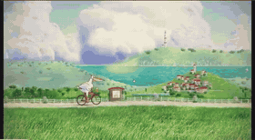</a> <b><a href="https://x.com/chetaslua/status/2120438091647218025">A pelican tired of the road, a painted film in one HTML file</a></b> <a href="https://x.com/chetaslua">@chetaslua</a> · 0:56 · <a href="https://x.com/chetaslua/status/2120438091647218025">original post on X</a></td>
<td width="33%" valign="top"><a href="https://x.com/mgrczyk/status/2119943813028548721">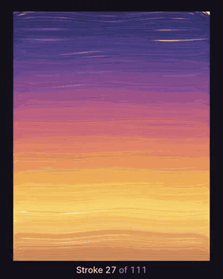</a> <b><a href="https://x.com/mgrczyk/status/2119943813028548721">A bird at sunrise, painted stroke by stroke with no undo</a></b> <a href="https://x.com/mgrczyk">@mgrczyk</a> · 0:21 · <a href="https://x.com/mgrczyk/status/2119943813028548721">original post on X</a></td>
<td width="33%" valign="top"> <b><a href="https://x.com/higgsfield_ai/status/2120007830065614926">A launch film for an invented robot joint, built in Blender</a></b> <a href="https://x.com/higgsfield_ai">@higgsfield_ai</a> · 0:30 · <a href="https://x.com/higgsfield_ai/status/2120007830065614926">original post on X</a> Blender · 4h 31m</td>
</tr>
<tr>
<td width="33%" valign="top"> <b><a href="https://x.com/dfeinition/status/2119881243990859818">Chalk art brought to life</a></b> <a href="https://x.com/dfeinition">@dfeinition</a> · 0:31 · <a href="https://x.com/dfeinition/status/2119881243990859818">original post on X</a></td>
<td width="33%" valign="top"> <b><a href="https://x.com/dfeinition/status/2119886262211625062">Fabric folds with light, camera moves and sound, all in code</a></b> <a href="https://x.com/dfeinition">@dfeinition</a> · 0:19 · <a href="https://x.com/dfeinition/status/2119886262211625062">original post on X</a></td>
<td width="33%" valign="top"> <b><a href="https://x.com/thomaszhou_/status/2120048570443395161">936, a short film from a one-sentence prompt</a></b> <a href="https://x.com/thomaszhou_">@thomaszhou_</a> · 1:42 · <a href="https://x.com/thomaszhou_/status/2120048570443395161">original post on X</a> Prompt: “请制作一段视频短片，会深刻影响到我的余生。”</td>
</tr>
<tr>
<td width="33%" valign="top"><a href="https://x.com/dfeinition/status/2119892208937517201">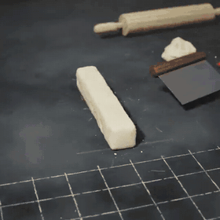</a> <b><a href="https://x.com/dfeinition/status/2119892208937517201">A claymation-style short</a></b> <a href="https://x.com/dfeinition">@dfeinition</a> · 0:20 · <a href="https://x.com/dfeinition/status/2119892208937517201">original post on X</a></td>
<td width="33%" valign="top"> <b><a href="https://x.com/kickingkeys/status/2119945841997672698">A painting piece with video and audio made in code</a></b> <a href="https://x.com/kickingkeys">@kickingkeys</a> · 0:23 · <a href="https://x.com/kickingkeys/status/2119945841997672698">original post on X</a></td>
<td width="33%" valign="top"> <b><a href="https://x.com/wangray/status/2120040640423850168">A launch video for BlewUp, styled after a reference video</a></b> <a href="https://x.com/wangray">@wangray</a> · 0:19 · <a href="https://x.com/wangray/status/2120040640423850168">original post on X</a> Prompt: “参考这个 launch video 风格给 BlewUp 做一个类似的视频”</td>
</tr>
<tr>
<td width="33%" valign="top"> <b><a href="https://x.com/anstapnever/status/2119915123070644263">A 79-second anime short</a></b> <a href="https://x.com/anstapnever">@anstapnever</a> · 1:19 · <a href="https://x.com/anstapnever/status/2119915123070644263">original post on X</a></td>
<td width="33%" valign="top"> <b><a href="https://x.com/xKaka1456/status/2120008408774717666">A short film on the model's sense of beauty</a></b> <a href="https://x.com/xKaka1456">@xKaka1456</a> · 0:57 · <a href="https://x.com/xKaka1456/status/2120008408774717666">original post on X</a></td>
<td width="33%" valign="top"> <b><a href="https://x.com/higgsfield_ai/status/2119964448077316238">A 90-second 2.5D animated duel, made with Higgsfield MCP</a></b> <a href="https://x.com/higgsfield_ai">@higgsfield_ai</a> · 1:30 · <a href="https://x.com/higgsfield_ai/status/2119964448077316238">original post on X</a> Higgsfield</td>
</tr>
</table>

## 3D scenes

<table>
<tr>
<td width="33%" valign="top"><a href="https://x.com/claudeai/status/2120174844822298730">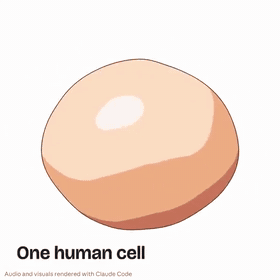</a> <b><a href="https://x.com/claudeai/status/2120174844822298730">A 3D model of a cell, built one organelle at a time</a></b> <a href="https://x.com/claudeai">@claudeai</a> · 2:14 · <a href="https://x.com/claudeai/status/2120174844822298730">original post on X</a></td>
<td width="33%" valign="top"> <b><a href="https://x.com/BlendiByl/status/2120341251178594532">A browser game with a hand-painted look, made of brush strokes</a></b> <a href="https://x.com/BlendiByl">@BlendiByl</a> · 0:16 · <a href="https://x.com/BlendiByl/status/2120341251178594532">original post on X</a> under 1 hour</td>
<td width="33%" valign="top"> <b><a href="https://x.com/mattshumer_/status/2120282133503820150">An open-world city game demo</a></b> <a href="https://x.com/mattshumer_">@mattshumer_</a> · 1:04 · <a href="https://x.com/mattshumer_/status/2120282133503820150">original post on X</a></td>
</tr>
<tr>
<td width="33%" valign="top"> <b><a href="https://x.com/everestchris6/status/2120175941616128277">A 3D walkthrough built from a 2D blueprint</a></b> <a href="https://x.com/everestchris6">@everestchris6</a> · 0:10 · <a href="https://x.com/everestchris6/status/2120175941616128277">original post on X</a></td>
<td width="33%" valign="top"> <b><a href="https://x.com/rileybrown/status/2119902109709537708">A desk scene in Blender: 13 camera shots, dusk to sunrise</a></b> <a href="https://x.com/rileybrown">@rileybrown</a> · 0:59 · <a href="https://x.com/rileybrown/status/2119902109709537708">original post on X</a> Blender · RunPod · ElevenLabs · $5.75 · 52 min render</td>
<td width="33%" valign="top"> <b><a href="https://x.com/XRarchitect/status/2120947265007440052">A Three.js experiment made with Atlas and Fable 5.2</a></b> <a href="https://x.com/XRarchitect">@XRarchitect</a> · 0:21 · <a href="https://x.com/XRarchitect/status/2120947265007440052">original post on X</a></td>
</tr>
<tr>
<td width="33%" valign="top"> <b><a href="https://x.com/MrTacticalX/status/2121082861902070130">A computer built by three Fable 5.2 agents in 7 h 41 min</a></b> <a href="https://x.com/MrTacticalX">@MrTacticalX</a> · 0:35 · <a href="https://x.com/MrTacticalX/status/2121082861902070130">original post on X</a></td>
<td width="33%" valign="top"> <b><a href="https://x.com/ravisparikh/status/2121333521663017401">A figure that learns to run, rendered in vork</a></b> <a href="https://x.com/ravisparikh">@ravisparikh</a> · 0:30 · <a href="https://x.com/ravisparikh/status/2121333521663017401">original post on X</a></td>
<td width="33%" valign="top"> <b><a href="https://x.com/chetaslua/status/2121176151234330707">A Three.js scene with no external assets at all</a></b> <a href="https://x.com/chetaslua">@chetaslua</a> · 1:25 · <a href="https://x.com/chetaslua/status/2121176151234330707">original post on X</a></td>
</tr>
<tr>
<td width="33%" valign="top"> <b><a href="https://x.com/aecyydesign/status/2120239401821487149">A short animation made with Blender</a></b> <a href="https://x.com/aecyydesign">@aecyydesign</a> · 0:10 · <a href="https://x.com/aecyydesign/status/2120239401821487149">original post on X</a> Blender</td>
<td width="33%" valign="top"> <b><a href="https://x.com/alexmichael/status/2119876626179870838">A video made from scratch with Python controlling Blender</a></b> <a href="https://x.com/alexmichael">@alexmichael</a> · 0:18 · <a href="https://x.com/alexmichael/status/2119876626179870838">original post on X</a> Python · Blender</td>
<td width="33%" valign="top"> <b><a href="https://x.com/BlendiByl/status/2120694003230560585">A playable painted valley in anime-film style, open source</a></b> <a href="https://x.com/BlendiByl">@BlendiByl</a> · 0:23 · <a href="https://x.com/BlendiByl/status/2120694003230560585">original post on X</a></td>
</tr>
<tr>
<td width="33%" valign="top"> <b><a href="https://x.com/kevin_t_ngo/status/2120238844754923874">A dark fantasy souls-like boss fight, playable in the browser</a></b> <a href="https://x.com/kevin_t_ngo">@kevin_t_ngo</a> · 2:18 · <a href="https://x.com/kevin_t_ngo/status/2120238844754923874">original post on X</a></td>
<td width="33%" valign="top"><a href="https://x.com/Grummz/status/2120255060957659498">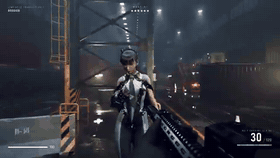</a> <b><a href="https://x.com/Grummz/status/2120255060957659498">A small first-person shooter level with no stock assets</a></b> <a href="https://x.com/Grummz">@Grummz</a> · 0:40 · <a href="https://x.com/Grummz/status/2120255060957659498">original post on X</a> 2.9 hours</td>
<td width="33%" valign="top"> <b><a href="https://x.com/pingouh/status/2120636604624560229">A robot biped animated by code, controllable in Unreal</a></b> <a href="https://x.com/pingouh">@pingouh</a> · 1:12 · <a href="https://x.com/pingouh/status/2120636604624560229">original post on X</a></td>
</tr>
<tr>
<td width="33%" valign="top"> <b><a href="https://x.com/chrisjdimarco/status/2120752985949057215">A million nanobots that morph into shapes, in Three.js</a></b> <a href="https://x.com/chrisjdimarco">@chrisjdimarco</a> · 1:31 · <a href="https://x.com/chrisjdimarco/status/2120752985949057215">original post on X</a></td>
<td width="33%" valign="top"> <b><a href="https://x.com/LexnLin/status/2119880654858977333">Made in about 30 minutes, with a few Opus 5.5 subagents</a></b> <a href="https://x.com/LexnLin">@LexnLin</a> · 0:30 · <a href="https://x.com/LexnLin/status/2119880654858977333">original post on X</a> about 30 min</td>
<td width="33%" valign="top"> <b><a href="https://x.com/JungleSilicon/status/2120452158961397975">Pixel-art scenes made as Gaussian splats</a></b> <a href="https://x.com/JungleSilicon">@JungleSilicon</a> · 1:48 · <a href="https://x.com/JungleSilicon/status/2120452158961397975">original post on X</a></td>
</tr>
<tr>
<td width="33%" valign="top"> <b><a href="https://x.com/RezAIT00/status/2120498246426706176">A game environment made overnight with Blender and Unreal</a></b> <a href="https://x.com/RezAIT00">@RezAIT00</a> · 0:48 · <a href="https://x.com/RezAIT00/status/2120498246426706176">original post on X</a></td>
<td width="33%" valign="top"><a href="https://x.com/xikhar/status/2119966147328299284">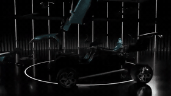</a> <b><a href="https://x.com/xikhar/status/2119966147328299284">A Bugatti Tourbillon modeled and rendered in Blender</a></b> <a href="https://x.com/xikhar">@xikhar</a> · 0:34 · <a href="https://x.com/xikhar/status/2119966147328299284">original post on X</a> Blender · 2.5 hours</td>
<td width="33%" valign="top"> <b><a href="https://x.com/literallydenis/status/2120866958790848953">Ancient Babylon around 600 BC, built in 8 hours</a></b> <a href="https://x.com/literallydenis">@literallydenis</a> · 1:06 · <a href="https://x.com/literallydenis/status/2120866958790848953">original post on X</a></td>
</tr>
<tr>
<td width="33%" valign="top"> <b><a href="https://x.com/op7418/status/2120694045299327187">A 3D action game made in one afternoon, in a 30 MB HTML file</a></b> <a href="https://x.com/op7418">@op7418</a> · 1:06 · <a href="https://x.com/op7418/status/2120694045299327187">original post on X</a></td>
<td width="33%" valign="top"><a href="https://x.com/JungleSilicon/status/2120807580461306010">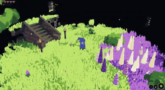</a> <b><a href="https://x.com/JungleSilicon/status/2120807580461306010">Inkwell in 3D pixel art, rendered with Gaussian splats</a></b> <a href="https://x.com/JungleSilicon">@JungleSilicon</a> · 9:18 · <a href="https://x.com/JungleSilicon/status/2120807580461306010">original post on X</a></td>
<td width="33%" valign="top"><a href="https://x.com/calebfahlgren/status/2120680918914601165">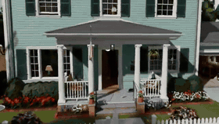</a> <b><a href="https://x.com/calebfahlgren/status/2120680918914601165">A 3D house built from one prompt in a few hours</a></b> <a href="https://x.com/calebfahlgren">@calebfahlgren</a> · 0:44 · <a href="https://x.com/calebfahlgren/status/2120680918914601165">original post on X</a></td>
</tr>
<tr>
<td width="33%" valign="top"> <b><a href="https://x.com/AymericRoucher/status/2120247208918266080">A Lord of the Rings river scene with simulated water</a></b> <a href="https://x.com/AymericRoucher">@AymericRoucher</a> · 0:08 · <a href="https://x.com/AymericRoucher/status/2120247208918266080">original post on X</a> a few days</td>
<td width="33%" valign="top"><a href="https://x.com/higgsfield_ai/status/2119893970897490135">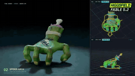</a> <b><a href="https://x.com/higgsfield_ai/status/2119893970897490135">A rigged zombie hand in Blender that crawls and backflips</a></b> <a href="https://x.com/higgsfield_ai">@higgsfield_ai</a> · 0:19 · <a href="https://x.com/higgsfield_ai/status/2119893970897490135">original post on X</a> Blender · Higgsfield</td>
<td width="33%" valign="top"><a href="https://x.com/KHvostikk/status/2120621109125202344">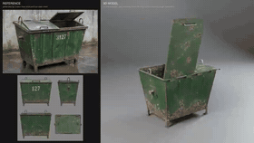</a> <b><a href="https://x.com/KHvostikk/status/2120621109125202344">A reference image turned into a 3D model with PBR textures</a></b> <a href="https://x.com/KHvostikk">@KHvostikk</a> · 0:12 · <a href="https://x.com/KHvostikk/status/2120621109125202344">original post on X</a></td>
</tr>
<tr>
<td width="33%" valign="top"><a href="https://x.com/higgsfield_ai/status/2119993841692582398">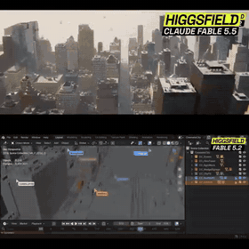</a> <b><a href="https://x.com/higgsfield_ai/status/2119993841692582398">A 3D city built by ten agents in Blender</a></b> <a href="https://x.com/higgsfield_ai">@higgsfield_ai</a> · 0:38 · <a href="https://x.com/higgsfield_ai/status/2119993841692582398">original post on X</a> Blender · Higgsfield MCP</td>
<td width="33%" valign="top"> <b><a href="https://x.com/LexnLin/status/2120910879361548565">A realistic bedroom built in Three.js, no 3D assets</a></b> <a href="https://x.com/LexnLin">@LexnLin</a> · 0:45 · <a href="https://x.com/LexnLin/status/2120910879361548565">original post on X</a></td>
<td width="33%" valign="top"><a href="https://x.com/DilumSanjaya/status/2120561077385867663">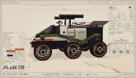</a> <b><a href="https://x.com/DilumSanjaya/status/2120561077385867663">A rocker-bogie rover simulated on alien terrain</a></b> <a href="https://x.com/DilumSanjaya">@DilumSanjaya</a> · 1:22 · <a href="https://x.com/DilumSanjaya/status/2120561077385867663">original post on X</a></td>
</tr>
<tr>
<td width="33%" valign="top"><a href="https://x.com/BlendiByl/status/2121130385723789637">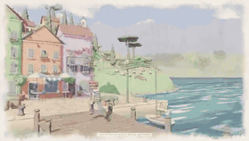</a> <b><a href="https://x.com/BlendiByl/status/2121130385723789637">A colored-pencil game town, shaded in code, open source</a></b> <a href="https://x.com/BlendiByl">@BlendiByl</a> · 0:14 · <a href="https://x.com/BlendiByl/status/2121130385723789637">original post on X</a></td>
<td width="33%" valign="top"><a href="https://x.com/davis7/status/2120810499415908356">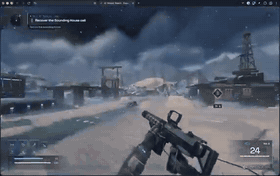</a> <b><a href="https://x.com/davis7/status/2120810499415908356">A browser scene from 48 hours of Fable 5.2 leading Opus 5.5</a></b> <a href="https://x.com/davis7">@davis7</a> · 0:26 · <a href="https://x.com/davis7/status/2120810499415908356">original post on X</a></td>
<td width="33%" valign="top"> <b><a href="https://x.com/alightinastorm/status/2120010936584945922">A Three.js basketball game with animation and sound</a></b> <a href="https://x.com/alightinastorm">@alightinastorm</a> · 0:41 · <a href="https://x.com/alightinastorm/status/2120010936584945922">original post on X</a> Three.js</td>
</tr>
<tr>
<td width="33%" valign="top"> <b><a href="https://x.com/XRarchitect/status/2121336108370014266">More Three.js experiments with Atlas and Fable 5.2</a></b> <a href="https://x.com/XRarchitect">@XRarchitect</a> · 0:26 · <a href="https://x.com/XRarchitect/status/2121336108370014266">original post on X</a></td>
<td width="33%" valign="top"> <b><a href="https://x.com/KanaWorks_AI/status/2120098607382880627">A flight over an endless generated world, in one take</a></b> <a href="https://x.com/KanaWorks_AI">@KanaWorks_AI</a> · 0:37 · <a href="https://x.com/KanaWorks_AI/status/2120098607382880627">original post on X</a></td>
<td width="33%" valign="top"> <b><a href="https://x.com/mixie3D/status/2121548293834740076">A flower scene where every single flower is 3D</a></b> <a href="https://x.com/mixie3D">@mixie3D</a> · 0:30 · <a href="https://x.com/mixie3D/status/2121548293834740076">original post on X</a></td>
</tr>
<tr>
<td width="33%" valign="top"> <b><a href="https://x.com/mxvdl/status/2120809570344050705">A breakdown of a lightweight Three.js brush-stroke shader</a></b> <a href="https://x.com/mxvdl">@mxvdl</a> · 1:40 · <a href="https://x.com/mxvdl/status/2120809570344050705">original post on X</a></td>
<td width="33%" valign="top"> <b><a href="https://x.com/earthtojake/status/2120247469900800316">A humanoid robot design, with CAD files and a simulation</a></b> <a href="https://x.com/earthtojake">@earthtojake</a> · 0:39 · <a href="https://x.com/earthtojake/status/2120247469900800316">original post on X</a> build123d · MuJoCo · Blender · overnight</td>
<td width="33%" valign="top"> <b><a href="https://x.com/tkm_hmng8/status/2120813043101946324">Fire burning inside ice, in WebGPU without Three.js</a></b> <a href="https://x.com/tkm_hmng8">@tkm_hmng8</a> · 0:19 · <a href="https://x.com/tkm_hmng8/status/2120813043101946324">original post on X</a></td>
</tr>
<tr>
<td width="33%" valign="top"> <b><a href="https://x.com/maxt3chno/status/2121296570872107145">A Three.js yacht simulator built with no 3D models</a></b> <a href="https://x.com/maxt3chno">@maxt3chno</a> · 1:36 · <a href="https://x.com/maxt3chno/status/2121296570872107145">original post on X</a></td>
<td width="33%" valign="top"><a href="https://x.com/MengTo/status/2120316203738829180">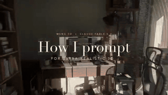</a> <b><a href="https://x.com/MengTo/status/2120316203738829180">A Three.js apartment recreated in Blender</a></b> <a href="https://x.com/MengTo">@MengTo</a> · 0:52 · <a href="https://x.com/MengTo/status/2120316203738829180">original post on X</a> Blender</td>
<td width="33%" valign="top"><a href="https://x.com/oalanicolas/status/2120266468780585456">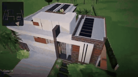</a> <b><a href="https://x.com/oalanicolas/status/2120266468780585456">A 3D walkthrough of a house, from its floor plan and photos</a></b> <a href="https://x.com/oalanicolas">@oalanicolas</a> · 0:45 · <a href="https://x.com/oalanicolas/status/2120266468780585456">original post on X</a> <a href="https://x.com/oalanicolas/status/2120266468780585456">prompt in the maker's reply</a></td>
</tr>
<tr>
<td width="33%" valign="top"><a href="https://x.com/MengTo/status/2121139143615074501">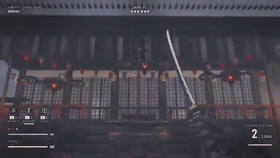</a> <b><a href="https://x.com/MengTo/status/2121139143615074501">A Japanese-style FPS in a sakura valley, under 10 MB of HTML</a></b> <a href="https://x.com/MengTo">@MengTo</a> · 0:53 · <a href="https://x.com/MengTo/status/2121139143615074501">original post on X</a></td>
<td width="33%" valign="top"> <b><a href="https://x.com/deedydas/status/2119930300990177509">Photorealistic honey simulation in WebGL, in real time</a></b> <a href="https://x.com/deedydas">@deedydas</a> · 0:51 · <a href="https://x.com/deedydas/status/2119930300990177509">original post on X</a> WebGL · Prompt: “Can you write the most intricate photorealistic simulation of honey in WebGL in the browser”</td>
<td width="33%" valign="top"> <b><a href="https://x.com/0xKense1/status/2120518961221529661">A game boss sculpted in Blender by code from a 3-view sheet</a></b> <a href="https://x.com/0xKense1">@0xKense1</a> · 0:39 · <a href="https://x.com/0xKense1/status/2120518961221529661">original post on X</a></td>
</tr>
<tr>
<td width="33%" valign="top"> <b><a href="https://x.com/sparklabhq/status/2119917375080521921">An animated Raspberry Pi 5</a></b> <a href="https://x.com/sparklabhq">@sparklabhq</a> · 0:06 · <a href="https://x.com/sparklabhq/status/2119917375080521921">original post on X</a> Prompt: “animate a raspberry pi 5”</td>
<td width="33%" valign="top"> <b><a href="https://x.com/MaxXWilliamson/status/2119953172634677533">A Mediterranean-themed space habitat</a></b> <a href="https://x.com/MaxXWilliamson">@MaxXWilliamson</a> · 0:25 · <a href="https://x.com/MaxXWilliamson/status/2119953172634677533">original post on X</a></td>
<td width="33%" valign="top"> <b><a href="https://x.com/scottstts/status/2121262812228141395">Astral Realm, a procedural Three.js scene made in 2 hours</a></b> <a href="https://x.com/scottstts">@scottstts</a> · 2:00 · <a href="https://x.com/scottstts/status/2121262812228141395">original post on X</a></td>
</tr>
<tr>
<td width="33%" valign="top"><a href="https://x.com/Angaisb_/status/2119947748690841841">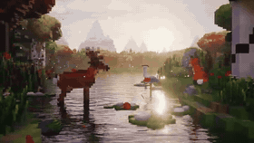</a> <b><a href="https://x.com/Angaisb_/status/2119947748690841841">A voxel lake</a></b> <a href="https://x.com/Angaisb_">@Angaisb_</a> · 0:15 · <a href="https://x.com/Angaisb_/status/2119947748690841841">original post on X</a></td>
<td width="33%" valign="top"> <b><a href="https://x.com/chetaslua/status/2120111159726727321">Monica's apartment, built in Three.js</a></b> <a href="https://x.com/chetaslua">@chetaslua</a> · 0:32 · <a href="https://x.com/chetaslua/status/2120111159726727321">original post on X</a> Three.js</td>
<td width="33%" valign="top"> <b><a href="https://x.com/higgsfield_ai/status/2119910344998912507">Paris, 1940, in three.js from Higgsfield reference images</a></b> <a href="https://x.com/higgsfield_ai">@higgsfield_ai</a> · 0:24 · <a href="https://x.com/higgsfield_ai/status/2119910344998912507">original post on X</a> three.js · Higgsfield</td>
</tr>
<tr>
<td width="33%" valign="top"><a href="https://x.com/pleometric/status/2119901747930186234">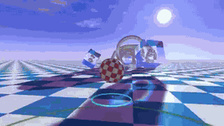</a> <b><a href="https://x.com/pleometric/status/2119901747930186234">A 3D video test with the Bryce rendering engine</a></b> <a href="https://x.com/pleometric">@pleometric</a> · 0:15 · <a href="https://x.com/pleometric/status/2119901747930186234">original post on X</a> Bryce</td>
<td width="33%" valign="top"><a href="https://x.com/seiiiiiiiiiiru/status/2119919169768747313">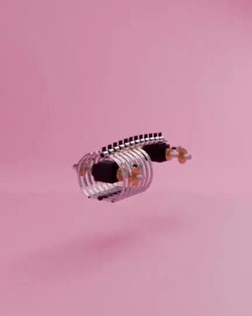</a> <b><a href="https://x.com/seiiiiiiiiiiru/status/2119919169768747313">A scene made by operating Blender</a></b> <a href="https://x.com/seiiiiiiiiiiru">@seiiiiiiiiiiru</a> · 0:20 · <a href="https://x.com/seiiiiiiiiiiru/status/2119919169768747313">original post on X</a> Blender</td>
<td width="33%" valign="top"> <b><a href="https://x.com/marcthecreatorr/status/2119890973560054072">A 3D sailing ship built in three.js, no external assets</a></b> <a href="https://x.com/marcthecreatorr">@marcthecreatorr</a> · 0:53 · <a href="https://x.com/marcthecreatorr/status/2119890973560054072">original post on X</a> three.js · Claude Code · ~$17 · ~38 min</td>
</tr>
<tr>
<td width="33%" valign="top"><a href="https://x.com/orcdev/status/2120248774861689199">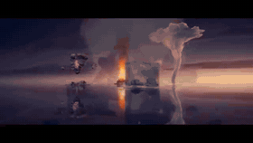</a> <b><a href="https://x.com/orcdev/status/2120248774861689199">A four-elements 3D benchmark scene in Three.js</a></b> <a href="https://x.com/orcdev">@orcdev</a> · 0:29 · <a href="https://x.com/orcdev/status/2120248774861689199">original post on X</a> Three.js</td>
<td width="33%" valign="top"><a href="https://x.com/loktar00/status/2119958719362666708">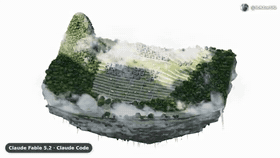</a> <b><a href="https://x.com/loktar00/status/2119958719362666708">A Machu Picchu tiny world with volumetric fog and alpacas</a></b> <a href="https://x.com/loktar00">@loktar00</a> · 0:40 · <a href="https://x.com/loktar00/status/2119958719362666708">original post on X</a></td>
<td width="33%" valign="top"> <b><a href="https://x.com/ivanfioravanti/status/2119936753892983162">Hangzhou West Lake, built with three.js</a></b> <a href="https://x.com/ivanfioravanti">@ivanfioravanti</a> · 0:10 · <a href="https://x.com/ivanfioravanti/status/2119936753892983162">original post on X</a> three.js</td>
</tr>
<tr>
<td width="33%" valign="top"> <b><a href="https://x.com/leo114119/status/2119928576548237346">An anime-style 3D island with thousands of cycling pelicans</a></b> <a href="https://x.com/leo114119">@leo114119</a> · 0:46 · <a href="https://x.com/leo114119/status/2119928576548237346">original post on X</a></td>
</tr>
</table>

## Music

<table>
<tr>
<td width="33%" valign="top"><a href="https://x.com/deedydas/status/2120905625852936318">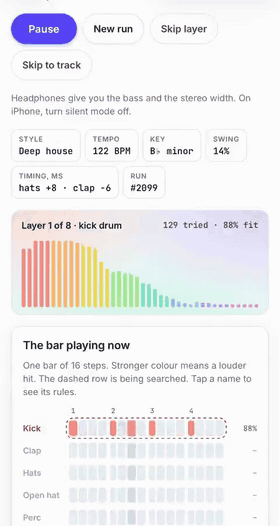</a> <b><a href="https://x.com/deedydas/status/2120905625852936318">A 72-bar house track composed from music theory</a></b> <a href="https://x.com/deedydas">@deedydas</a> · 5:51 · <a href="https://x.com/deedydas/status/2120905625852936318">original post on X</a></td>
<td width="33%" valign="top"> <b><a href="https://x.com/imjustnewatai/status/2119919644836347926">A Beethoven-style piano sonata movement, scored in LilyPond</a></b> <a href="https://x.com/imjustnewatai">@imjustnewatai</a> · 2:51 · <a href="https://x.com/imjustnewatai/status/2119919644836347926">original post on X</a> LilyPond</td>
<td width="33%" valign="top"> <b><a href="https://x.com/parhelion318/status/2120212304809918827">A tape-style ambient music setup</a></b> <a href="https://x.com/parhelion318">@parhelion318</a> · 0:44 · <a href="https://x.com/parhelion318/status/2120212304809918827">original post on X</a> Opus 5.5</td>
</tr>
<tr>
<td width="33%" valign="top"> <b><a href="https://x.com/imjustnewatai/status/2119902327423258787">A symphony, written when asked for its best</a></b> <a href="https://x.com/imjustnewatai">@imjustnewatai</a> · 4:09 · <a href="https://x.com/imjustnewatai/status/2119902327423258787">original post on X</a></td>
<td width="33%" valign="top"> <b><a href="https://x.com/kevin_t_ngo/status/2120198663062622581">A music video animated in Python and rendered in Blender</a></b> <a href="https://x.com/kevin_t_ngo">@kevin_t_ngo</a> · 1:17 · <a href="https://x.com/kevin_t_ngo/status/2120198663062622581">original post on X</a> Python · Blender</td>
<td width="33%" valign="top"> <b><a href="https://x.com/WesRoth/status/2119953913160093817">Another video made in one shot</a></b> <a href="https://x.com/WesRoth">@WesRoth</a> · 2:27 · <a href="https://x.com/WesRoth/status/2119953913160093817">original post on X</a></td>
</tr>
<tr>
<td width="33%" valign="top"><a href="https://x.com/codyavant/status/2119987600437985600">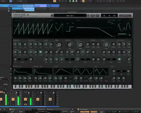</a> <b><a href="https://x.com/codyavant/status/2119987600437985600">A software analog synth being played</a></b> <a href="https://x.com/codyavant">@codyavant</a> · 0:36 · <a href="https://x.com/codyavant/status/2119987600437985600">original post on X</a></td>
<td width="33%" valign="top"> <b><a href="https://x.com/WesRoth/status/2119911161386934330">A music video with lyrics</a></b> <a href="https://x.com/WesRoth">@WesRoth</a> · 0:37 · <a href="https://x.com/WesRoth/status/2119911161386934330">original post on X</a></td>
<td width="33%" valign="top"> <b><a href="https://x.com/higgsfield_ai/status/2119907675265987047">Claude sings a sci-fi lo-fi track made from scratch</a></b> <a href="https://x.com/higgsfield_ai">@higgsfield_ai</a> · 0:50 · <a href="https://x.com/higgsfield_ai/status/2119907675265987047">original post on X</a> Higgsfield</td>
</tr>
</table>

## Model comparisons

<table>
<tr>
<td width="33%" valign="top"><a href="https://x.com/EnvolDev/status/2119907318729245180">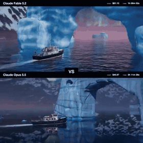</a> <b><a href="https://x.com/EnvolDev/status/2119907318729245180">Cathedral of Ice: Fable 5.2 vs Opus 5.5</a></b> <a href="https://x.com/EnvolDev">@EnvolDev</a> · 0:25 · <a href="https://x.com/EnvolDev/status/2119907318729245180">original post on X</a> $81.10 · 1h 56m 52s</td>
<td width="33%" valign="top"> <b><a href="https://x.com/MrTacticalX/status/2119955647542542439">Glass pool: Fable 5.2 vs Opus 5.5</a></b> <a href="https://x.com/MrTacticalX">@MrTacticalX</a> · 0:30 · <a href="https://x.com/MrTacticalX/status/2119955647542542439">original post on X</a> $57.87 · 1 hr 30 min</td>
<td width="33%" valign="top"> <b><a href="https://x.com/kinderlayer/status/2120890033833922611">Cobra bursting through a carpet: Fable 5.2 vs Gemini 4 Argon</a></b> <a href="https://x.com/kinderlayer">@kinderlayer</a> · 0:30 · <a href="https://x.com/kinderlayer/status/2120890033833922611">original post on X</a></td>
</tr>
<tr>
<td width="33%" valign="top"><a href="https://x.com/developedbyed/status/2119898145777983634">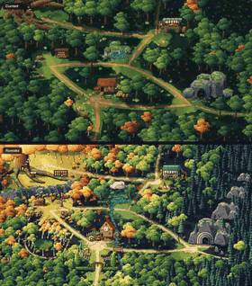</a> <b><a href="https://x.com/developedbyed/status/2119898145777983634">Same scene side by side: Opus 5.5 vs Fable 5.2</a></b> <a href="https://x.com/developedbyed">@developedbyed</a> · 0:12 · <a href="https://x.com/developedbyed/status/2119898145777983634">original post on X</a></td>
<td width="33%" valign="top"> <b><a href="https://x.com/rayanabdulcader/status/2119995155625181371">Dock icons fight as stick figures, Opus 5.5 vs Fable 5.2</a></b> <a href="https://x.com/rayanabdulcader">@rayanabdulcader</a> · 0:56 · <a href="https://x.com/rayanabdulcader/status/2119995155625181371">original post on X</a></td>
<td width="33%" valign="top"><a href="https://x.com/vib3coded/status/2120489288857252235">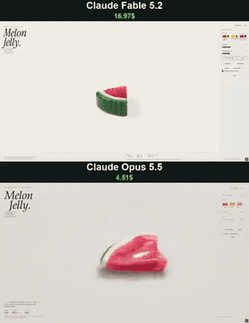</a> <b><a href="https://x.com/vib3coded/status/2120489288857252235">Jelly physics: Opus 5.5 ($4.51) vs Fable 5.2 ($16.97)</a></b> <a href="https://x.com/vib3coded">@vib3coded</a> · 0:17 · <a href="https://x.com/vib3coded/status/2120489288857252235">original post on X</a></td>
</tr>
<tr>
<td width="33%" valign="top"><a href="https://x.com/dom_scholz/status/2119933150025363661">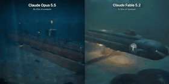</a> <b><a href="https://x.com/dom_scholz/status/2119933150025363661">Opus 5.5 vs Fable 5.2 on the same task</a></b> <a href="https://x.com/dom_scholz">@dom_scholz</a> · 0:30 · <a href="https://x.com/dom_scholz/status/2119933150025363661">original post on X</a></td>
<td width="33%" valign="top"> <b><a href="https://x.com/MrTacticalX/status/2120565434424439292">Lighthouse in a stormy sea, oil painting: Fable 5.1 vs 5.2</a></b> <a href="https://x.com/MrTacticalX">@MrTacticalX</a> · 0:39 · <a href="https://x.com/MrTacticalX/status/2120565434424439292">original post on X</a></td>
<td width="33%" valign="top"> <b><a href="https://x.com/Bhavani_00007/status/2119902204320780676">Rocket launch scene: Fable 5.2 vs Opus 5.5</a></b> <a href="https://x.com/Bhavani_00007">@Bhavani_00007</a> · 0:25 · <a href="https://x.com/Bhavani_00007/status/2119902204320780676">original post on X</a> $23.45 · 32 min</td>
</tr>
<tr>
<td width="33%" valign="top"><a href="https://x.com/ZryMiller/status/2120674046983720973">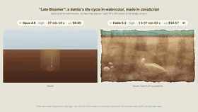</a> <b><a href="https://x.com/ZryMiller/status/2120674046983720973">Opus 4.6 vs Fable 5.2, released 278 days apart</a></b> <a href="https://x.com/ZryMiller">@ZryMiller</a> · 0:33 · <a href="https://x.com/ZryMiller/status/2120674046983720973">original post on X</a></td>
<td width="33%" valign="top"> <b><a href="https://x.com/noclipepe/status/2120846360064692377">T-Rex runner game: Fable 5.2 vs Qwen4-Max, Gemini and GPT-6</a></b> <a href="https://x.com/noclipepe">@noclipepe</a> · 0:28 · <a href="https://x.com/noclipepe/status/2120846360064692377">original post on X</a></td>
<td width="33%" valign="top"><a href="https://x.com/dom_scholz/status/2120281700991463448">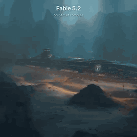</a> <b><a href="https://x.com/dom_scholz/status/2120281700991463448">Fable 5.2 and Opus 5.5 on the same task, with more time</a></b> <a href="https://x.com/dom_scholz">@dom_scholz</a> · 0:30 · <a href="https://x.com/dom_scholz/status/2120281700991463448">original post on X</a></td>
</tr>
<tr>
<td width="33%" valign="top"><a href="https://x.com/vib3coded/status/2119951060752375827">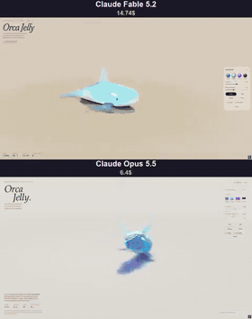</a> <b><a href="https://x.com/vib3coded/status/2119951060752375827">Jelly orca: Fable 5.2 vs Opus 5.5</a></b> <a href="https://x.com/vib3coded">@vib3coded</a> · 0:18 · <a href="https://x.com/vib3coded/status/2119951060752375827">original post on X</a></td>
<td width="33%" valign="top"> <b><a href="https://x.com/theoardley/status/2120124748159996152">A 3D short in the Zack D. Films style, Opus 5.5 vs Fable 5.2</a></b> <a href="https://x.com/theoardley">@theoardley</a> · 0:56 · <a href="https://x.com/theoardley/status/2120124748159996152">original post on X</a> Blender · MPFB · <a href="https://x.com/theoardley/status/2120124748159996152">prompt in the maker's reply</a></td>
<td width="33%" valign="top"><a href="https://x.com/pleometric/status/2119879605607862329">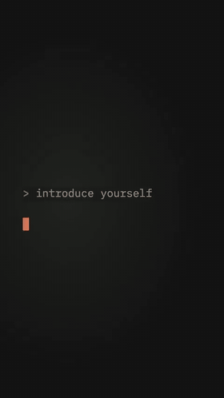</a> <b><a href="https://x.com/pleometric/status/2119879605607862329">Animation test: smoother than Opus, not a big jump</a></b> <a href="https://x.com/pleometric">@pleometric</a> · 0:50 · <a href="https://x.com/pleometric/status/2119879605607862329">original post on X</a></td>
</tr>
<tr>
<td width="33%" valign="top"><a href="https://x.com/karminski3/status/2120007187808534965">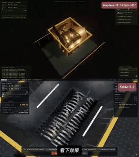</a> <b><a href="https://x.com/karminski3/status/2120007187808534965">The same demo from DeepSeek V4.1 Flash and Fable 5.2</a></b> <a href="https://x.com/karminski3">@karminski3</a> · 1:00 · <a href="https://x.com/karminski3/status/2120007187808534965">original post on X</a> $40</td>
<td width="33%" valign="top"> <b><a href="https://x.com/ZryMiller/status/2120180769033441317">One prompt at four effort levels, from low to xhigh</a></b> <a href="https://x.com/ZryMiller">@ZryMiller</a> · 1:00 · <a href="https://x.com/ZryMiller/status/2120180769033441317">original post on X</a> 29–86 min, $7.09–$42.10</td>
<td width="33%" valign="top"> <b><a href="https://x.com/MrTacticalX/status/2119949557664735583">Snow globe: Fable 5.2 vs Opus 5.5</a></b> <a href="https://x.com/MrTacticalX">@MrTacticalX</a> · 0:30 · <a href="https://x.com/MrTacticalX/status/2119949557664735583">original post on X</a> $6.97 · 21 min</td>
</tr>
</table>

## Make your own

- [How to make a video with Claude Fable 5.2](https://claude-motion.com/claude-fable-video): three ways, and the same four prompts run on Fable 5.2 and Opus 5.5.
- [HTML to video](https://claude-motion.com/html-to-video): paste the HTML the model wrote and save it as MP4, GIF or WebM, free, in your browser.
- [Motion Director](https://github.com/hideewsj-maker/motion-skills): a free skill for Claude Code, Codex and Cursor that makes a whole film with music.

## Add a video

Open an issue or a pull request with the link to the post on X. The post should say it was made with Fable 5.2. Entries are checked by hand.

## Credit and removal

Every video belongs to the person who made it; each entry names its maker and links to the original post. Titles are descriptions of what the post says. If an entry is yours and you want it removed, open an issue or write to the takedown address on claude-motion.com and it comes down.

The list itself (titles, categories, this text) is CC BY 4.0. The videos and prompts are their makers'.
