# Claude Fable 5.2 视频作品合集

[English](README.md)

收录 **100 条用 Claude Fable 5.2 做出的视频**，都是 2026 年 11 月 9 日发布以来创作者在 X 上分享的：动态图形、讲解视频、动画短片、3D 场景和音乐。每一帧都由模型写的代码画出来，没有用视频模型。

带分类筛选的完整合集： **[claude-motion.com/fable-5-2-videos](https://claude-motion.com/zh/fable-5-2-videos)**

## 动态图形

<table>
<tr>
<td width="33%" valign="top"><a href="https://x.com/mathiaschpl/status/2119878412181676283">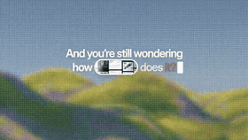</a> <b><a href="https://x.com/mathiaschpl/status/2119878412181676283">10 分钟做出的一段动效</a></b> <a href="https://x.com/mathiaschpl">@mathiaschpl</a> · 0:37 · <a href="https://x.com/mathiaschpl/status/2119878412181676283">X 原帖</a> 10 min</td>
<td width="33%" valign="top"><a href="https://x.com/Khazix0918/status/2119902325460590834">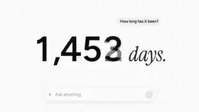</a> <b><a href="https://x.com/Khazix0918/status/2119902325460590834">为 ChatGPT 四周年做的庆生视频</a></b> <a href="https://x.com/Khazix0918">@Khazix0918</a> · 0:58 · <a href="https://x.com/Khazix0918/status/2119902325460590834">X 原帖</a></td>
<td width="33%" valign="top"> <b><a href="https://x.com/op7418/status/2120085300185833878">打出的字化作水墨形象，实时流体模拟</a></b> <a href="https://x.com/op7418">@op7418</a> · 1:06 · <a href="https://x.com/op7418/status/2120085300185833878">X 原帖</a></td>
</tr>
<tr>
<td width="33%" valign="top"> <b><a href="https://x.com/chetaslua/status/2120179018964324566">用纯 JavaScript 代码画出的一幅画</a></b> <a href="https://x.com/chetaslua">@chetaslua</a> · 0:34 · <a href="https://x.com/chetaslua/status/2120179018964324566">X 原帖</a> JavaScript</td>
<td width="33%" valign="top"><a href="https://x.com/Gregoirechp/status/2119879667457073355">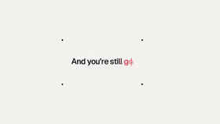</a> <b><a href="https://x.com/Gregoirechp/status/2119879667457073355">几分钟做出的一段动效设计</a></b> <a href="https://x.com/Gregoirechp">@Gregoirechp</a> · 0:40 · <a href="https://x.com/Gregoirechp/status/2119879667457073355">X 原帖</a></td>
<td width="33%" valign="top"><a href="https://x.com/internetphysics/status/2119903808935313778">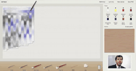</a> <b><a href="https://x.com/internetphysics/status/2119903808935313778">用模拟油画颜料画的 Sam Altman 肖像</a></b> <a href="https://x.com/internetphysics">@internetphysics</a> · 1:00 · <a href="https://x.com/internetphysics/status/2119903808935313778">X 原帖</a></td>
</tr>
<tr>
<td width="33%" valign="top"> <b><a href="https://x.com/LexnLin/status/2120167637133238295">一段 Claude 标志动画</a></b> <a href="https://x.com/LexnLin">@LexnLin</a> · 0:30 · <a href="https://x.com/LexnLin/status/2120167637133238295">X 原帖</a></td>
<td width="33%" valign="top"><a href="https://x.com/aziz4ai/status/2119928581405200726">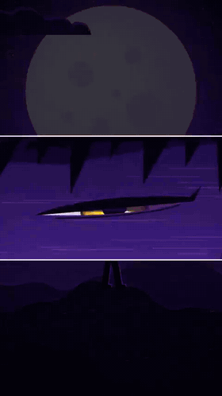</a> <b><a href="https://x.com/aziz4ai/status/2119928581405200726">只用代码做出的 15 秒场景，没有用视频模型</a></b> <a href="https://x.com/aziz4ai">@aziz4ai</a> · 0:15 · <a href="https://x.com/aziz4ai/status/2119928581405200726">X 原帖</a></td>
<td width="33%" valign="top"> <b><a href="https://x.com/other__reality/status/2119885430627913784">Clawd 打造并发布新 Claude 模型的动画</a></b> <a href="https://x.com/other__reality">@other__reality</a> · 0:26 · <a href="https://x.com/other__reality/status/2119885430627913784">X 原帖</a> 提示词: “Create an animated video of clawd creating and releasing Claude Fable 5.2”</td>
</tr>
<tr>
<td width="33%" valign="top"> <b><a href="https://x.com/bhavya_gx/status/2120210072810983687">实拍素材，剪辑和特效由 Fable 5.2 完成</a></b> <a href="https://x.com/bhavya_gx">@bhavya_gx</a> · 0:29 · <a href="https://x.com/bhavya_gx/status/2120210072810983687">X 原帖</a></td>
<td width="33%" valign="top"><a href="https://x.com/yuwen_lu_/status/2120230407878930739">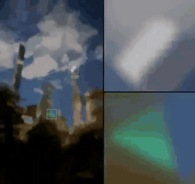</a> <b><a href="https://x.com/yuwen_lu_/status/2120230407878930739">用 p5.js 笔刷重现的一张中央公园照片</a></b> <a href="https://x.com/yuwen_lu_">@yuwen_lu_</a> · 0:19 · <a href="https://x.com/yuwen_lu_/status/2120230407878930739">X 原帖</a> p5.js</td>
<td width="33%" valign="top"><a href="https://x.com/devteamdrew/status/2120090542419984686">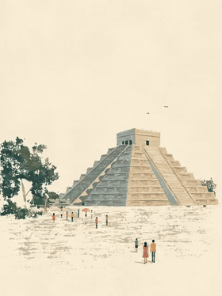</a> <b><a href="https://x.com/devteamdrew/status/2120090542419984686">绘制并做成动画的世界七大奇迹</a></b> <a href="https://x.com/devteamdrew">@devteamdrew</a> · 0:10 · <a href="https://x.com/devteamdrew/status/2120090542419984686">X 原帖</a></td>
</tr>
<tr>
<td width="33%" valign="top"> <b><a href="https://x.com/justkarangupta/status/2119995965776200047">一个电灯开关：小猫醒来，小狗来敲门</a></b> <a href="https://x.com/justkarangupta">@justkarangupta</a> · 0:15 · <a href="https://x.com/justkarangupta/status/2119995965776200047">X 原帖</a></td>
<td width="33%" valign="top"><a href="https://x.com/venturetwins/status/2120331599283954137">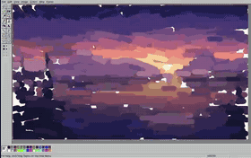</a> <b><a href="https://x.com/venturetwins/status/2120331599283954137">在 MS Paint 仿制版里画的黄昏湖景，延时呈现</a></b> <a href="https://x.com/venturetwins">@venturetwins</a> · 0:46 · <a href="https://x.com/venturetwins/status/2120331599283954137">X 原帖</a> 94 min</td>
<td width="33%" valign="top"><a href="https://x.com/slimer48484/status/2120094263673319609">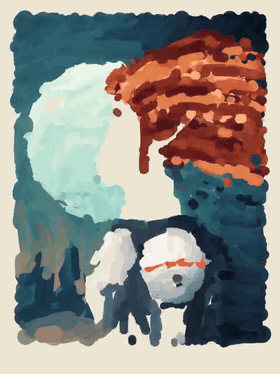</a> <b><a href="https://x.com/slimer48484/status/2120094263673319609">用 Python 画的一幅画，逐笔呈现</a></b> <a href="https://x.com/slimer48484">@slimer48484</a> · 0:30 · <a href="https://x.com/slimer48484/status/2120094263673319609">X 原帖</a> Python</td>
</tr>
<tr>
<td width="33%" valign="top"> <b><a href="https://x.com/Masimo_Blue/status/2119943368612487285">10 秒 Claude 裤子宣传片，配酸性 Techno</a></b> <a href="https://x.com/Masimo_Blue">@Masimo_Blue</a> · 0:10 · <a href="https://x.com/Masimo_Blue/status/2119943368612487285">X 原帖</a></td>
<td width="33%" valign="top"><a href="https://x.com/Hunter_Weiss/status/2119932937642946900">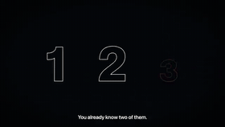</a> <b><a href="https://x.com/Hunter_Weiss/status/2119932937642946900">一次生成：面向高中水平讲解火箭科学</a></b> <a href="https://x.com/Hunter_Weiss">@Hunter_Weiss</a> · 1:58 · <a href="https://x.com/Hunter_Weiss/status/2119932937642946900">X 原帖</a> 提示词: “I need you to create the most impressive video I can share with people about Fable 5.2, explaining rocket science as if it were for someone with a high school education.”</td>
</tr>
</table>

## 讲解视频

<table>
<tr>
<td width="33%" valign="top"> <b><a href="https://x.com/rileybrown/status/2119946022767980985">文字书写的历史，一条提示词生成</a></b> <a href="https://x.com/rileybrown">@rileybrown</a> · 1:36 · <a href="https://x.com/rileybrown/status/2119946022767980985">X 原帖</a> <a href="https://v2.video/riley/the-history-of-writing/v1">提示词和文件见作者的页面</a></td>
<td width="33%" valign="top"><a href="https://x.com/aollivier82/status/2120260208245043663">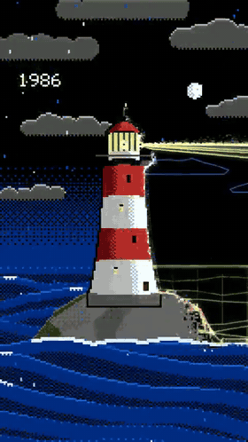</a> <b><a href="https://x.com/aollivier82/status/2120260208245043663">计算机图形学的历史，动画呈现</a></b> <a href="https://x.com/aollivier82">@aollivier82</a> · 0:29 · <a href="https://x.com/aollivier82/status/2120260208245043663">X 原帖</a></td>
<td width="33%" valign="top"><a href="https://x.com/DeryaTR_/status/2119974354260013293">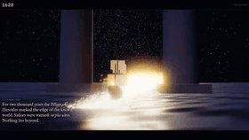</a> <b><a href="https://x.com/DeryaTR_/status/2119974354260013293">用代码做的科学史 3D 之旅</a></b> <a href="https://x.com/DeryaTR_">@DeryaTR_</a> · 4:56 · <a href="https://x.com/DeryaTR_/status/2119974354260013293">X 原帖</a></td>
</tr>
<tr>
<td width="33%" valign="top"><a href="https://x.com/Rasmic/status/2119919466163093768">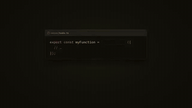</a> <b><a href="https://x.com/Rasmic/status/2119919466163093768">讲解 Convex 的动态图形视频</a></b> <a href="https://x.com/Rasmic">@Rasmic</a> · 4:08 · <a href="https://x.com/Rasmic/status/2119919466163093768">X 原帖</a></td>
<td width="33%" valign="top"> <b><a href="https://x.com/linxiaobei888/status/2119978892861829227">给 3–6 岁孩子看的英语启蒙动画</a></b> <a href="https://x.com/linxiaobei888">@linxiaobei888</a> · 2:27 · <a href="https://x.com/linxiaobei888/status/2119978892861829227">X 原帖</a> Codex</td>
<td width="33%" valign="top"><a href="https://x.com/konstantinsaifo/status/2119941967136379334">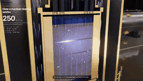</a> <b><a href="https://x.com/konstantinsaifo/status/2119941967136379334">核反应堆如何工作：可拆解的 three.js 模型</a></b> <a href="https://x.com/konstantinsaifo">@konstantinsaifo</a> · 0:36 · <a href="https://x.com/konstantinsaifo/status/2119941967136379334">X 原帖</a> three.js · $92</td>
</tr>
<tr>
<td width="33%" valign="top"> <b><a href="https://x.com/MatthewBerman/status/2119868633086378471">讲解 LLM 工作原理的动态图形</a></b> <a href="https://x.com/MatthewBerman">@MatthewBerman</a> · 0:50 · <a href="https://x.com/MatthewBerman/status/2119868633086378471">X 原帖</a></td>
</tr>
</table>

## 动画短片

<table>
<tr>
<td width="33%" valign="top"><a href="https://x.com/gavinpurcell/status/2120002682421182624">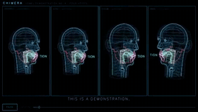</a> <b><a href="https://x.com/gavinpurcell/status/2120002682421182624">拿到一个代码仓库后自由发挥做出的短片</a></b> <a href="https://x.com/gavinpurcell">@gavinpurcell</a> · 1:56 · <a href="https://x.com/gavinpurcell/status/2120002682421182624">X 原帖</a></td>
<td width="33%" valign="top"> <b><a href="https://x.com/devteamdrew/status/2119892540950241283">一段 32 秒的短片，发布时未附说明</a></b> <a href="https://x.com/devteamdrew">@devteamdrew</a> · 0:32 · <a href="https://x.com/devteamdrew/status/2119892540950241283">X 原帖</a></td>
<td width="33%" valign="top"><a href="https://x.com/kevin_t_ngo/status/2119938129079808282">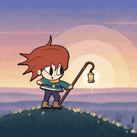</a> <b><a href="https://x.com/kevin_t_ngo/status/2119938129079808282">每一帧都用 JavaScript 绘制的短片</a></b> <a href="https://x.com/kevin_t_ngo">@kevin_t_ngo</a> · 1:40 · <a href="https://x.com/kevin_t_ngo/status/2119938129079808282">X 原帖</a> JavaScript</td>
</tr>
<tr>
<td width="33%" valign="top"><a href="https://x.com/kevin_t_ngo/status/2119972124211454139">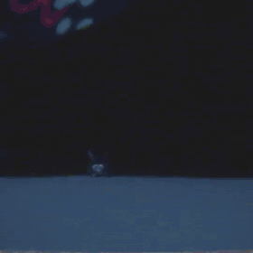</a> <b><a href="https://x.com/kevin_t_ngo/status/2119972124211454139">90 年代风玩具广告：Python + Blender</a></b> <a href="https://x.com/kevin_t_ngo">@kevin_t_ngo</a> · 1:05 · <a href="https://x.com/kevin_t_ngo/status/2119972124211454139">X 原帖</a> Python · Blender</td>
<td width="33%" valign="top"><a href="https://x.com/rileybrown/status/2119973951027724385">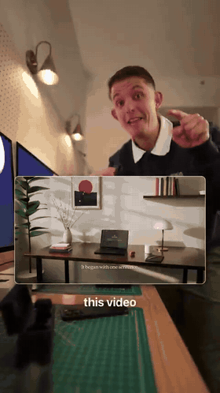</a> <b><a href="https://x.com/rileybrown/status/2119973951027724385">由 Fable 5.2 剪辑的一段真人出镜口播视频</a></b> <a href="https://x.com/rileybrown">@rileybrown</a> · 2:01 · <a href="https://x.com/rileybrown/status/2119973951027724385">X 原帖</a></td>
<td width="33%" valign="top"> <b><a href="https://x.com/mattshumer_/status/2119900920347828670">49 分钟的电影，配音和画面全部由代码生成</a></b> <a href="https://x.com/mattshumer_">@mattshumer_</a> · 48:49 · <a href="https://x.com/mattshumer_/status/2119900920347828670">X 原帖</a></td>
</tr>
<tr>
<td width="33%" valign="top"><a href="https://x.com/rute1203d/status/2120077147872391540">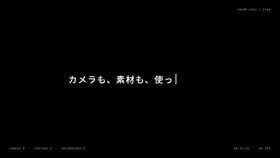</a> <b><a href="https://x.com/rute1203d/status/2120077147872391540">一部展示实力的短片：先秀技术，再打动人心</a></b> <a href="https://x.com/rute1203d">@rute1203d</a> · 2:26 · <a href="https://x.com/rute1203d/status/2120077147872391540">X 原帖</a> 提示词: “あなたが世界有数の動画クリエイターです... 今の実力を見せつける最高の動画を作ってください 技術をみせその後感動を見せる”</td>
<td width="33%" valign="top"> <b><a href="https://x.com/EHuanglu/status/2119947980400976267">把剧本变成迪士尼风格的动画片</a></b> <a href="https://x.com/EHuanglu">@EHuanglu</a> · 1:46 · <a href="https://x.com/EHuanglu/status/2119947980400976267">X 原帖</a></td>
<td width="33%" valign="top"> <b><a href="https://x.com/0kncn/status/2119901782482543073">90 秒动漫短片：变身机器人的蒸汽机车</a></b> <a href="https://x.com/0kncn">@0kncn</a> · 1:30 · <a href="https://x.com/0kncn/status/2119901782482543073">X 原帖</a> Blender · <a href="https://x.com/0kncn/status/2119901786060259612">提示词见作者的回复</a></td>
</tr>
<tr>
<td width="33%" valign="top"><a href="https://x.com/lemomo_ai/status/2120118194409193682">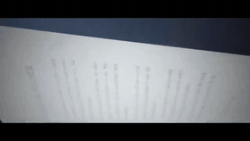</a> <b><a href="https://x.com/lemomo_ai/status/2120118194409193682">深夜图书馆里 24000 页纸乘风飞舞，配钢琴曲</a></b> <a href="https://x.com/lemomo_ai">@lemomo_ai</a> · 0:55 · <a href="https://x.com/lemomo_ai/status/2120118194409193682">X 原帖</a></td>
<td width="33%" valign="top"><a href="https://x.com/mgrczyk/status/2119943813028548721">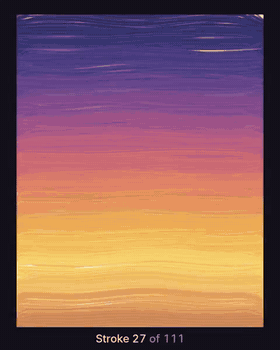</a> <b><a href="https://x.com/mgrczyk/status/2119943813028548721">一笔一笔画出日出时的鸟，无法撤销或修改</a></b> <a href="https://x.com/mgrczyk">@mgrczyk</a> · 0:21 · <a href="https://x.com/mgrczyk/status/2119943813028548721">X 原帖</a></td>
<td width="33%" valign="top"><a href="https://x.com/jsnnsa/status/2120161161803088061">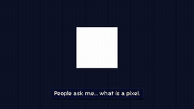</a> <b><a href="https://x.com/jsnnsa/status/2120161161803088061">一部纪录短片：为品牌套件设计一款字体</a></b> <a href="https://x.com/jsnnsa">@jsnnsa</a> · 1:43 · <a href="https://x.com/jsnnsa/status/2120161161803088061">X 原帖</a></td>
</tr>
<tr>
<td width="33%" valign="top"> <b><a href="https://x.com/dfeinition/status/2119881243990859818">动起来的粉笔画</a></b> <a href="https://x.com/dfeinition">@dfeinition</a> · 0:31 · <a href="https://x.com/dfeinition/status/2119881243990859818">X 原帖</a></td>
<td width="33%" valign="top"><a href="https://x.com/higgsfield_ai/status/2120007830065614926">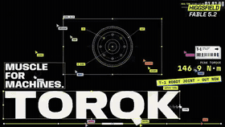</a> <b><a href="https://x.com/higgsfield_ai/status/2120007830065614926">为一款虚构机器人关节做的发布片，在 Blender 中搭建</a></b> <a href="https://x.com/higgsfield_ai">@higgsfield_ai</a> · 0:30 · <a href="https://x.com/higgsfield_ai/status/2120007830065614926">X 原帖</a> Blender · 4h 31m</td>
<td width="33%" valign="top"> <b><a href="https://x.com/dfeinition/status/2119886262211625062">布料褶皱、透光、运镜与声音，全部由代码完成</a></b> <a href="https://x.com/dfeinition">@dfeinition</a> · 0:19 · <a href="https://x.com/dfeinition/status/2119886262211625062">X 原帖</a></td>
</tr>
<tr>
<td width="33%" valign="top"><a href="https://x.com/kevin_t_ngo/status/2120308118127309173">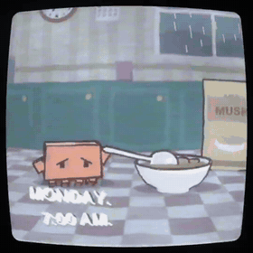</a> <b><a href="https://x.com/kevin_t_ngo/status/2120308118127309173">90 年代风格的麦片广告，全部用代码绘制</a></b> <a href="https://x.com/kevin_t_ngo">@kevin_t_ngo</a> · 1:04 · <a href="https://x.com/kevin_t_ngo/status/2120308118127309173">X 原帖</a></td>
<td width="33%" valign="top"><a href="https://x.com/dfeinition/status/2119892208937517201">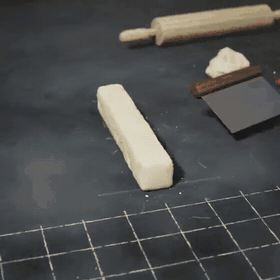</a> <b><a href="https://x.com/dfeinition/status/2119892208937517201">一段黏土动画风格的短片</a></b> <a href="https://x.com/dfeinition">@dfeinition</a> · 0:20 · <a href="https://x.com/dfeinition/status/2119892208937517201">X 原帖</a></td>
<td width="33%" valign="top"> <b><a href="https://x.com/kickingkeys/status/2119945841997672698">一段绘画作品，画面和声音都由代码生成</a></b> <a href="https://x.com/kickingkeys">@kickingkeys</a> · 0:23 · <a href="https://x.com/kickingkeys/status/2119945841997672698">X 原帖</a></td>
</tr>
<tr>
<td width="33%" valign="top"> <b><a href="https://x.com/wangray/status/2120040640423850168">参考一支发布视频的风格，为 BlewUp 做的发布视频</a></b> <a href="https://x.com/wangray">@wangray</a> · 0:19 · <a href="https://x.com/wangray/status/2120040640423850168">X 原帖</a> 提示词: “参考这个 launch video 风格给 BlewUp 做一个类似的视频”</td>
<td width="33%" valign="top"> <b><a href="https://x.com/anstapnever/status/2119915123070644263">一部 79 秒的日式动画短片</a></b> <a href="https://x.com/anstapnever">@anstapnever</a> · 1:19 · <a href="https://x.com/anstapnever/status/2119915123070644263">X 原帖</a></td>
<td width="33%" valign="top"> <b><a href="https://x.com/xKaka1456/status/2120008408774717666">一部诠释模型审美的短片</a></b> <a href="https://x.com/xKaka1456">@xKaka1456</a> · 0:57 · <a href="https://x.com/xKaka1456/status/2120008408774717666">X 原帖</a></td>
</tr>
<tr>
<td width="33%" valign="top"><a href="https://x.com/thomaszhou_/status/2120048570443395161">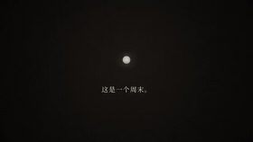</a> <b><a href="https://x.com/thomaszhou_/status/2120048570443395161">《936》：一句话提示词生成的短片</a></b> <a href="https://x.com/thomaszhou_">@thomaszhou_</a> · 1:42 · <a href="https://x.com/thomaszhou_/status/2120048570443395161">X 原帖</a> 提示词: “请制作一段视频短片，会深刻影响到我的余生。”</td>
<td width="33%" valign="top"><a href="https://x.com/higgsfield_ai/status/2119964448077316238">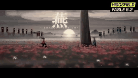</a> <b><a href="https://x.com/higgsfield_ai/status/2119964448077316238">2.5D 决斗动画，Higgsfield MCP 制作</a></b> <a href="https://x.com/higgsfield_ai">@higgsfield_ai</a> · 1:30 · <a href="https://x.com/higgsfield_ai/status/2119964448077316238">X 原帖</a> Higgsfield</td>
</tr>
</table>

## 3D 场景

<table>
<tr>
<td width="33%" valign="top"><a href="https://x.com/claudeai/status/2120174844822298730">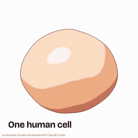</a> <b><a href="https://x.com/claudeai/status/2120174844822298730">细胞的 3D 模型，一个细胞器一个细胞器地搭建</a></b> <a href="https://x.com/claudeai">@claudeai</a> · 2:14 · <a href="https://x.com/claudeai/status/2120174844822298730">X 原帖</a></td>
<td width="33%" valign="top"><a href="https://x.com/rileybrown/status/2119902109709537708">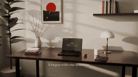</a> <b><a href="https://x.com/rileybrown/status/2119902109709537708">Blender 书桌场景：13 个镜头，从黄昏到日出</a></b> <a href="https://x.com/rileybrown">@rileybrown</a> · 0:59 · <a href="https://x.com/rileybrown/status/2119902109709537708">X 原帖</a> Blender · RunPod · ElevenLabs · $5.75 · 52 min render</td>
<td width="33%" valign="top"> <b><a href="https://x.com/everestchris6/status/2120175941616128277">由 2D 户型图生成的 3D 漫游</a></b> <a href="https://x.com/everestchris6">@everestchris6</a> · 0:10 · <a href="https://x.com/everestchris6/status/2120175941616128277">X 原帖</a></td>
</tr>
<tr>
<td width="33%" valign="top"> <b><a href="https://x.com/mattshumer_/status/2120282133503820150">一个开放世界城市游戏演示</a></b> <a href="https://x.com/mattshumer_">@mattshumer_</a> · 1:04 · <a href="https://x.com/mattshumer_/status/2120282133503820150">X 原帖</a></td>
<td width="33%" valign="top"> <b><a href="https://x.com/alexmichael/status/2119876626179870838">用 Python 控制 Blender 从零做出的视频</a></b> <a href="https://x.com/alexmichael">@alexmichael</a> · 0:18 · <a href="https://x.com/alexmichael/status/2119876626179870838">X 原帖</a> Python · Blender</td>
<td width="33%" valign="top"> <b><a href="https://x.com/LexnLin/status/2119880654858977333">约 30 分钟完成，用了几个 Opus 5.5 子智能体</a></b> <a href="https://x.com/LexnLin">@LexnLin</a> · 0:30 · <a href="https://x.com/LexnLin/status/2119880654858977333">X 原帖</a> about 30 min</td>
</tr>
<tr>
<td width="33%" valign="top"><a href="https://x.com/xikhar/status/2119966147328299284">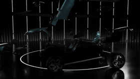</a> <b><a href="https://x.com/xikhar/status/2119966147328299284">Blender 建模并渲染的布加迪 Tourbillon</a></b> <a href="https://x.com/xikhar">@xikhar</a> · 0:34 · <a href="https://x.com/xikhar/status/2119966147328299284">X 原帖</a> Blender · 2.5 hours</td>
<td width="33%" valign="top"><a href="https://x.com/Grummz/status/2120255060957659498">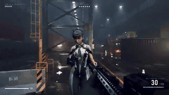</a> <b><a href="https://x.com/Grummz/status/2120255060957659498">一个小型第一人称射击关卡，没有用任何现成素材</a></b> <a href="https://x.com/Grummz">@Grummz</a> · 0:40 · <a href="https://x.com/Grummz/status/2120255060957659498">X 原帖</a> 2.9 hours</td>
<td width="33%" valign="top"><a href="https://x.com/higgsfield_ai/status/2119893970897490135">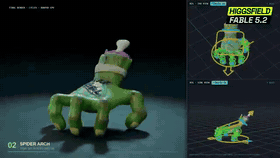</a> <b><a href="https://x.com/higgsfield_ai/status/2119893970897490135">Blender 中带骨骼绑定的僵尸手：爬行、后空翻</a></b> <a href="https://x.com/higgsfield_ai">@higgsfield_ai</a> · 0:19 · <a href="https://x.com/higgsfield_ai/status/2119893970897490135">X 原帖</a> Blender · Higgsfield</td>
</tr>
<tr>
<td width="33%" valign="top"> <b><a href="https://x.com/kevin_t_ngo/status/2120238844754923874">黑暗奇幻类魂 Boss 战，可在浏览器中游玩</a></b> <a href="https://x.com/kevin_t_ngo">@kevin_t_ngo</a> · 2:18 · <a href="https://x.com/kevin_t_ngo/status/2120238844754923874">X 原帖</a></td>
<td width="33%" valign="top"> <b><a href="https://x.com/aecyydesign/status/2120239401821487149">用 Blender 做的一段动画</a></b> <a href="https://x.com/aecyydesign">@aecyydesign</a> · 0:10 · <a href="https://x.com/aecyydesign/status/2120239401821487149">X 原帖</a> Blender</td>
<td width="33%" valign="top"><a href="https://x.com/higgsfield_ai/status/2119993841692582398">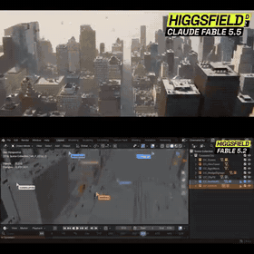</a> <b><a href="https://x.com/higgsfield_ai/status/2119993841692582398">十个智能体在 Blender 中搭建的 3D 城市</a></b> <a href="https://x.com/higgsfield_ai">@higgsfield_ai</a> · 0:38 · <a href="https://x.com/higgsfield_ai/status/2119993841692582398">X 原帖</a> Blender · Higgsfield MCP</td>
</tr>
<tr>
<td width="33%" valign="top"> <b><a href="https://x.com/alightinastorm/status/2120010936584945922">用 Three.js 做的篮球游戏，带动画和音效</a></b> <a href="https://x.com/alightinastorm">@alightinastorm</a> · 0:41 · <a href="https://x.com/alightinastorm/status/2120010936584945922">X 原帖</a> Three.js</td>
<td width="33%" valign="top"> <b><a href="https://x.com/KanaWorks_AI/status/2120098607382880627">一镜到底飞越无限自动生成的世界</a></b> <a href="https://x.com/KanaWorks_AI">@KanaWorks_AI</a> · 0:37 · <a href="https://x.com/KanaWorks_AI/status/2120098607382880627">X 原帖</a></td>
<td width="33%" valign="top"> <b><a href="https://x.com/AymericRoucher/status/2120247208918266080">《指环王》河流场景，带水体物理模拟</a></b> <a href="https://x.com/AymericRoucher">@AymericRoucher</a> · 0:08 · <a href="https://x.com/AymericRoucher/status/2120247208918266080">X 原帖</a> a few days</td>
</tr>
<tr>
<td width="33%" valign="top"><a href="https://x.com/deedydas/status/2119930300990177509">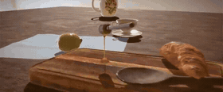</a> <b><a href="https://x.com/deedydas/status/2119930300990177509">WebGL 中的写实蜂蜜模拟，实时渲染</a></b> <a href="https://x.com/deedydas">@deedydas</a> · 0:51 · <a href="https://x.com/deedydas/status/2119930300990177509">X 原帖</a> WebGL · 提示词: “Can you write the most intricate photorealistic simulation of honey in WebGL in the browser”</td>
<td width="33%" valign="top"><a href="https://x.com/sparklabhq/status/2119917375080521921">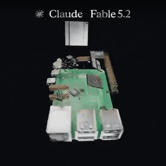</a> <b><a href="https://x.com/sparklabhq/status/2119917375080521921">Raspberry Pi 5 的动画</a></b> <a href="https://x.com/sparklabhq">@sparklabhq</a> · 0:06 · <a href="https://x.com/sparklabhq/status/2119917375080521921">X 原帖</a> 提示词: “animate a raspberry pi 5”</td>
<td width="33%" valign="top"><a href="https://x.com/MaxXWilliamson/status/2119953172634677533">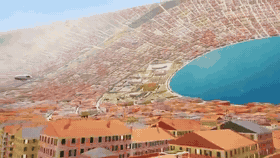</a> <b><a href="https://x.com/MaxXWilliamson/status/2119953172634677533">地中海主题的太空栖居站</a></b> <a href="https://x.com/MaxXWilliamson">@MaxXWilliamson</a> · 0:25 · <a href="https://x.com/MaxXWilliamson/status/2119953172634677533">X 原帖</a></td>
</tr>
<tr>
<td width="33%" valign="top"> <b><a href="https://x.com/BlendiByl/status/2120341251178594532">手绘质感的浏览器游戏，画面由笔触构成</a></b> <a href="https://x.com/BlendiByl">@BlendiByl</a> · 0:16 · <a href="https://x.com/BlendiByl/status/2120341251178594532">X 原帖</a> under 1 hour</td>
<td width="33%" valign="top"> <b><a href="https://x.com/earthtojake/status/2120247469900800316">一款人形机器人设计，含 CAD 文件和仿真</a></b> <a href="https://x.com/earthtojake">@earthtojake</a> · 0:39 · <a href="https://x.com/earthtojake/status/2120247469900800316">X 原帖</a> build123d · MuJoCo · Blender · overnight</td>
<td width="33%" valign="top"><a href="https://x.com/Angaisb_/status/2119947748690841841">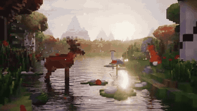</a> <b><a href="https://x.com/Angaisb_/status/2119947748690841841">体素风格的湖</a></b> <a href="https://x.com/Angaisb_">@Angaisb_</a> · 0:15 · <a href="https://x.com/Angaisb_/status/2119947748690841841">X 原帖</a></td>
</tr>
<tr>
<td width="33%" valign="top"><a href="https://x.com/chetaslua/status/2120111159726727321">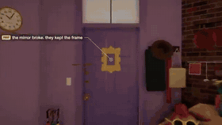</a> <b><a href="https://x.com/chetaslua/status/2120111159726727321">用 Three.js 搭建的莫妮卡公寓</a></b> <a href="https://x.com/chetaslua">@chetaslua</a> · 0:32 · <a href="https://x.com/chetaslua/status/2120111159726727321">X 原帖</a> Three.js</td>
<td width="33%" valign="top"> <b><a href="https://x.com/higgsfield_ai/status/2119910344998912507">1940 年的巴黎，用 three.js 依参考图制作</a></b> <a href="https://x.com/higgsfield_ai">@higgsfield_ai</a> · 0:24 · <a href="https://x.com/higgsfield_ai/status/2119910344998912507">X 原帖</a> three.js · Higgsfield</td>
<td width="33%" valign="top"><a href="https://x.com/oalanicolas/status/2120266468780585456">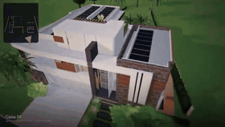</a> <b><a href="https://x.com/oalanicolas/status/2120266468780585456">根据户型图和照片生成的房屋 3D 漫游</a></b> <a href="https://x.com/oalanicolas">@oalanicolas</a> · 0:45 · <a href="https://x.com/oalanicolas/status/2120266468780585456">X 原帖</a> <a href="https://x.com/oalanicolas/status/2120266468780585456">提示词见作者的回复</a></td>
</tr>
<tr>
<td width="33%" valign="top"><a href="https://x.com/pleometric/status/2119901747930186234">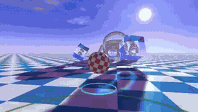</a> <b><a href="https://x.com/pleometric/status/2119901747930186234">用 Bryce 渲染引擎做的 3D 视频测试</a></b> <a href="https://x.com/pleometric">@pleometric</a> · 0:15 · <a href="https://x.com/pleometric/status/2119901747930186234">X 原帖</a> Bryce</td>
<td width="33%" valign="top"><a href="https://x.com/seiiiiiiiiiiru/status/2119919169768747313">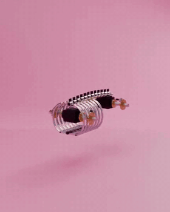</a> <b><a href="https://x.com/seiiiiiiiiiiru/status/2119919169768747313">通过操作 Blender 做出的场景</a></b> <a href="https://x.com/seiiiiiiiiiiru">@seiiiiiiiiiiru</a> · 0:20 · <a href="https://x.com/seiiiiiiiiiiru/status/2119919169768747313">X 原帖</a> Blender</td>
<td width="33%" valign="top"><a href="https://x.com/MengTo/status/2120316203738829180">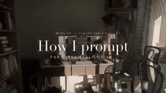</a> <b><a href="https://x.com/MengTo/status/2120316203738829180">把 Three.js 公寓在 Blender 中重新搭建</a></b> <a href="https://x.com/MengTo">@MengTo</a> · 0:52 · <a href="https://x.com/MengTo/status/2120316203738829180">X 原帖</a> Blender</td>
</tr>
<tr>
<td width="33%" valign="top"> <b><a href="https://x.com/marcthecreatorr/status/2119890973560054072">用 three.js 做的 3D 帆船，没有外部素材</a></b> <a href="https://x.com/marcthecreatorr">@marcthecreatorr</a> · 0:53 · <a href="https://x.com/marcthecreatorr/status/2119890973560054072">X 原帖</a> three.js · Claude Code · ~$17 · ~38 min</td>
<td width="33%" valign="top"><a href="https://x.com/orcdev/status/2120248774861689199">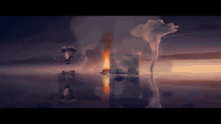</a> <b><a href="https://x.com/orcdev/status/2120248774861689199">用 Three.js 做的四元素 3D 测试场景</a></b> <a href="https://x.com/orcdev">@orcdev</a> · 0:29 · <a href="https://x.com/orcdev/status/2120248774861689199">X 原帖</a> Three.js</td>
<td width="33%" valign="top"><a href="https://x.com/loktar00/status/2119958719362666708">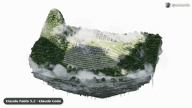</a> <b><a href="https://x.com/loktar00/status/2119958719362666708">马丘比丘微缩世界，有体积雾和小羊驼</a></b> <a href="https://x.com/loktar00">@loktar00</a> · 0:40 · <a href="https://x.com/loktar00/status/2119958719362666708">X 原帖</a></td>
</tr>
<tr>
<td width="33%" valign="top"> <b><a href="https://x.com/ivanfioravanti/status/2119936753892983162">用 three.js 做的杭州西湖</a></b> <a href="https://x.com/ivanfioravanti">@ivanfioravanti</a> · 0:10 · <a href="https://x.com/ivanfioravanti/status/2119936753892983162">X 原帖</a> three.js</td>
<td width="33%" valign="top"> <b><a href="https://x.com/leo114119/status/2119928576548237346">代码生成的动漫风 3D 岛屿，成千上万只鹈鹕在骑行</a></b> <a href="https://x.com/leo114119">@leo114119</a> · 0:46 · <a href="https://x.com/leo114119/status/2119928576548237346">X 原帖</a></td>
</tr>
</table>

## 音乐

<table>
<tr>
<td width="33%" valign="top"><a href="https://x.com/imjustnewatai/status/2119902327423258787">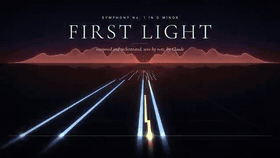</a> <b><a href="https://x.com/imjustnewatai/status/2119902327423258787">一首交响曲，要求是写出它能写的最好作品</a></b> <a href="https://x.com/imjustnewatai">@imjustnewatai</a> · 4:09 · <a href="https://x.com/imjustnewatai/status/2119902327423258787">X 原帖</a></td>
<td width="33%" valign="top"> <b><a href="https://x.com/imjustnewatai/status/2119919644836347926">贝多芬风格的钢琴奏鸣曲乐章，用 LilyPond 写谱</a></b> <a href="https://x.com/imjustnewatai">@imjustnewatai</a> · 2:51 · <a href="https://x.com/imjustnewatai/status/2119919644836347926">X 原帖</a> LilyPond</td>
<td width="33%" valign="top"><a href="https://x.com/WesRoth/status/2119953913160093817">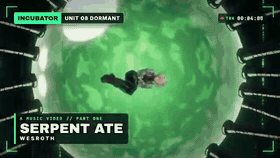</a> <b><a href="https://x.com/WesRoth/status/2119953913160093817">又一支一次生成的视频</a></b> <a href="https://x.com/WesRoth">@WesRoth</a> · 2:27 · <a href="https://x.com/WesRoth/status/2119953913160093817">X 原帖</a></td>
</tr>
<tr>
<td width="33%" valign="top"><a href="https://x.com/parhelion318/status/2120212304809918827">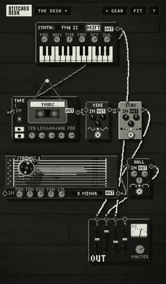</a> <b><a href="https://x.com/parhelion318/status/2120212304809918827">一套磁带风格的氛围音乐装置</a></b> <a href="https://x.com/parhelion318">@parhelion318</a> · 0:44 · <a href="https://x.com/parhelion318/status/2120212304809918827">X 原帖</a> Opus 5.5</td>
<td width="33%" valign="top"><a href="https://x.com/kevin_t_ngo/status/2120198663062622581">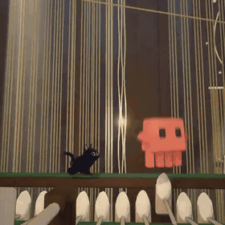</a> <b><a href="https://x.com/kevin_t_ngo/status/2120198663062622581">用 Python 做动画、Blender 渲染的音乐视频</a></b> <a href="https://x.com/kevin_t_ngo">@kevin_t_ngo</a> · 1:17 · <a href="https://x.com/kevin_t_ngo/status/2120198663062622581">X 原帖</a> Python · Blender</td>
<td width="33%" valign="top"><a href="https://x.com/codyavant/status/2119987600437985600">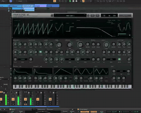</a> <b><a href="https://x.com/codyavant/status/2119987600437985600">软件实现的模拟合成器演奏演示</a></b> <a href="https://x.com/codyavant">@codyavant</a> · 0:36 · <a href="https://x.com/codyavant/status/2119987600437985600">X 原帖</a></td>
</tr>
<tr>
<td width="33%" valign="top"> <b><a href="https://x.com/WesRoth/status/2119911161386934330">一支带歌词的音乐视频</a></b> <a href="https://x.com/WesRoth">@WesRoth</a> · 0:37 · <a href="https://x.com/WesRoth/status/2119911161386934330">X 原帖</a></td>
<td width="33%" valign="top"><a href="https://x.com/higgsfield_ai/status/2119907675265987047">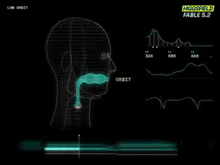</a> <b><a href="https://x.com/higgsfield_ai/status/2119907675265987047">Claude 演唱一首从零做出的科幻 lo-fi 曲目</a></b> <a href="https://x.com/higgsfield_ai">@higgsfield_ai</a> · 0:50 · <a href="https://x.com/higgsfield_ai/status/2119907675265987047">X 原帖</a> Higgsfield</td>
</tr>
</table>

## 模型对比

<table>
<tr>
<td width="33%" valign="top"> <b><a href="https://x.com/EnvolDev/status/2119907318729245180">冰之大教堂：Fable 5.2 对比 Opus 5.5</a></b> <a href="https://x.com/EnvolDev">@EnvolDev</a> · 0:25 · <a href="https://x.com/EnvolDev/status/2119907318729245180">X 原帖</a> $81.10 · 1h 56m 52s</td>
<td width="33%" valign="top"> <b><a href="https://x.com/MrTacticalX/status/2119955647542542439">玻璃泳池：Fable 5.2 对比 Opus 5.5</a></b> <a href="https://x.com/MrTacticalX">@MrTacticalX</a> · 0:30 · <a href="https://x.com/MrTacticalX/status/2119955647542542439">X 原帖</a> $57.87 · 1 hr 30 min</td>
<td width="33%" valign="top"> <b><a href="https://x.com/developedbyed/status/2119898145777983634">同场景对比：Opus 5.5 与 Fable 5.2</a></b> <a href="https://x.com/developedbyed">@developedbyed</a> · 0:12 · <a href="https://x.com/developedbyed/status/2119898145777983634">X 原帖</a></td>
</tr>
<tr>
<td width="33%" valign="top"> <b><a href="https://x.com/rayanabdulcader/status/2119995155625181371">Dock 图标化身火柴人对战：Opus 5.5 对比 Fable 5.2</a></b> <a href="https://x.com/rayanabdulcader">@rayanabdulcader</a> · 0:56 · <a href="https://x.com/rayanabdulcader/status/2119995155625181371">X 原帖</a></td>
<td width="33%" valign="top"> <b><a href="https://x.com/dom_scholz/status/2119933150025363661">同一任务：Opus 5.5 对比 Fable 5.2</a></b> <a href="https://x.com/dom_scholz">@dom_scholz</a> · 0:30 · <a href="https://x.com/dom_scholz/status/2119933150025363661">X 原帖</a></td>
<td width="33%" valign="top"> <b><a href="https://x.com/Bhavani_00007/status/2119902204320780676">火箭发射场景：Fable 5.2 对比 Opus 5.5</a></b> <a href="https://x.com/Bhavani_00007">@Bhavani_00007</a> · 0:25 · <a href="https://x.com/Bhavani_00007/status/2119902204320780676">X 原帖</a> $23.45 · 32 min</td>
</tr>
<tr>
<td width="33%" valign="top"> <b><a href="https://x.com/vib3coded/status/2119951060752375827">果冻虎鲸：Fable 5.2 对比 Opus 5.5</a></b> <a href="https://x.com/vib3coded">@vib3coded</a> · 0:18 · <a href="https://x.com/vib3coded/status/2119951060752375827">X 原帖</a></td>
<td width="33%" valign="top"> <b><a href="https://x.com/pleometric/status/2119879605607862329">动画测试：比 Opus 更流畅，但提升不算大</a></b> <a href="https://x.com/pleometric">@pleometric</a> · 0:50 · <a href="https://x.com/pleometric/status/2119879605607862329">X 原帖</a></td>
<td width="33%" valign="top"> <b><a href="https://x.com/karminski3/status/2120007187808534965">同一个 demo：DeepSeek V4.1 Flash 对比 Fable 5.2</a></b> <a href="https://x.com/karminski3">@karminski3</a> · 1:00 · <a href="https://x.com/karminski3/status/2120007187808534965">X 原帖</a> $40</td>
</tr>
<tr>
<td width="33%" valign="top"> <b><a href="https://x.com/dom_scholz/status/2120281700991463448">同一任务对比 Fable 5.2 与 Opus 5.5，给了 Fable 更多时间</a></b> <a href="https://x.com/dom_scholz">@dom_scholz</a> · 0:30 · <a href="https://x.com/dom_scholz/status/2120281700991463448">X 原帖</a></td>
<td width="33%" valign="top"> <b><a href="https://x.com/theoardley/status/2120124748159996152">Zack D. Films 风格的 3D 短片：Opus 5.5 对比 Fable 5.2</a></b> <a href="https://x.com/theoardley">@theoardley</a> · 0:56 · <a href="https://x.com/theoardley/status/2120124748159996152">X 原帖</a> Blender · MPFB · <a href="https://x.com/theoardley/status/2120124748159996152">提示词见作者的回复</a></td>
<td width="33%" valign="top"> <b><a href="https://x.com/ZryMiller/status/2120180769033441317">同一提示词在四档 effort 下的结果，从 low 到 xhigh</a></b> <a href="https://x.com/ZryMiller">@ZryMiller</a> · 1:00 · <a href="https://x.com/ZryMiller/status/2120180769033441317">X 原帖</a> 29–86 min, $7.09–$42.10</td>
</tr>
<tr>
<td width="33%" valign="top"> <b><a href="https://x.com/MrTacticalX/status/2119949557664735583">雪花玻璃球：Fable 5.2 对比 Opus 5.5</a></b> <a href="https://x.com/MrTacticalX">@MrTacticalX</a> · 0:30 · <a href="https://x.com/MrTacticalX/status/2119949557664735583">X 原帖</a> $6.97 · 21 min</td>
</tr>
</table>

## 自己做一支

- [如何用 Claude Fable 5.2 制作视频](https://claude-motion.com/zh/claude-fable-video)：三种做法，以及同样四条提示词在 Fable 5.2 和 Opus 5.5 上的实测。
- [HTML 转视频](https://claude-motion.com/zh/html-to-video)：粘贴模型写的 HTML，在浏览器里免费导出 MP4、GIF 或 WebM。
- [Motion Director](https://github.com/hideewsj-maker/motion-skills)：免费 Skill，在 Claude Code、Codex、Cursor 里做出带配乐的整支片子。

## 提交作品

提 issue 或 pull request，附上 X 原帖链接。原帖需要写明是用 Fable 5.2 做的。收录前会人工核对。

## 署名与下架

视频归创作者所有；每条都注明作者并链接到原帖。标题是对原帖内容的描述。如果其中有作品需要下架，请提 issue，或写信到 claude-motion.com 页脚的下架邮箱，会及时移除。

列表本身（标题、分类和本文）采用 CC BY 4.0。视频和提示词归各自作者所有。
