# Claude Fable 5.2 视频作品合集

[English](README.md)

收录 **277 条用 Claude Fable 5.2 做出的视频**，都是 2026 年 11 月 9 日发布以来创作者在 X 上分享的：动态图形、讲解视频、动画短片、3D 场景和音乐。每一帧都由模型写的代码画出来，没有用视频模型。

带分类筛选的完整合集： **[claude-motion.com/fable-5-2-videos](https://claude-motion.com/zh/fable-5-2-videos)**

## 动态图形

<table>
<tr>
<td width="33%" valign="top"><a href="https://x.com/mathiaschpl/status/2119878412181676283">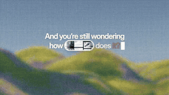</a> <b><a href="https://x.com/mathiaschpl/status/2119878412181676283">10 分钟做出的一段动效</a></b> <a href="https://x.com/mathiaschpl">@mathiaschpl</a> · 0:37 · <a href="https://x.com/mathiaschpl/status/2119878412181676283">X 原帖</a> 10 min</td>
<td width="33%" valign="top"> <b><a href="https://x.com/ChrisGPT/status/2119998815856218494">一段告诉剪辑师自己要抢走他们工作的视频</a></b> <a href="https://x.com/ChrisGPT">@ChrisGPT</a> · 0:44 · <a href="https://x.com/ChrisGPT/status/2119998815856218494">X 原帖</a></td>
<td width="33%" valign="top"> <b><a href="https://x.com/midudev/status/2119876297304203273">10 分钟做出的终端风 Rust 预告片</a></b> <a href="https://x.com/midudev">@midudev</a> · 0:32 · <a href="https://x.com/midudev/status/2119876297304203273">X 原帖</a></td>
</tr>
<tr>
<td width="33%" valign="top"> <b><a href="https://x.com/kevin_t_ngo/status/2123194632670748790">旧金山，一段用代码画出的动画</a></b> <a href="https://x.com/kevin_t_ngo">@kevin_t_ngo</a> · 0:52 · <a href="https://x.com/kevin_t_ngo/status/2123194632670748790">X 原帖</a></td>
<td width="33%" valign="top"><a href="https://x.com/crtvTeknologist/status/2119894073024606617">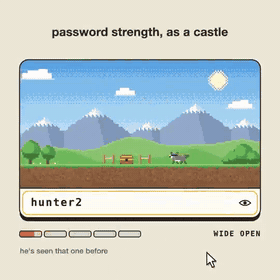</a> <b><a href="https://x.com/crtvTeknologist/status/2119894073024606617">密码强度指示器动画</a></b> <a href="https://x.com/crtvTeknologist">@crtvTeknologist</a> · 0:18 · <a href="https://x.com/crtvTeknologist/status/2119894073024606617">X 原帖</a></td>
<td width="33%" valign="top"> <b><a href="https://x.com/DaveJ/status/2120486254852608470">与现有设计保持一致的动效设计</a></b> <a href="https://x.com/DaveJ">@DaveJ</a> · 0:25 · <a href="https://x.com/DaveJ/status/2120486254852608470">X 原帖</a></td>
</tr>
<tr>
<td width="33%" valign="top"><a href="https://x.com/Aprilzz423/status/2123788440714260673">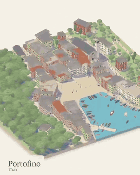</a> <b><a href="https://x.com/Aprilzz423/status/2123788440714260673">Pocket City：把任何街角变成手绘小城的免费 Skill</a></b> <a href="https://x.com/Aprilzz423">@Aprilzz423</a> · 0:24 · <a href="https://x.com/Aprilzz423/status/2123788440714260673">X 原帖</a></td>
<td width="33%" valign="top"> <b><a href="https://x.com/alegiiaa/status/2120517875144233201">7 分钟设计出的一组动画</a></b> <a href="https://x.com/alegiiaa">@alegiiaa</a> · 0:08 · <a href="https://x.com/alegiiaa/status/2120517875144233201">X 原帖</a></td>
<td width="33%" valign="top"> <b><a href="https://x.com/bhavya_gx/status/2120210072810983687">实拍素材，剪辑和特效由 Fable 5.2 完成</a></b> <a href="https://x.com/bhavya_gx">@bhavya_gx</a> · 0:29 · <a href="https://x.com/bhavya_gx/status/2120210072810983687">X 原帖</a></td>
</tr>
<tr>
<td width="33%" valign="top"> <b><a href="https://x.com/chetaslua/status/2120179018964324566">用纯 JavaScript 代码画出的一幅画</a></b> <a href="https://x.com/chetaslua">@chetaslua</a> · 0:34 · <a href="https://x.com/chetaslua/status/2120179018964324566">X 原帖</a> JavaScript</td>
<td width="33%" valign="top"> <b><a href="https://x.com/op7418/status/2120085300185833878">打出的字化作水墨形象，实时流体模拟</a></b> <a href="https://x.com/op7418">@op7418</a> · 1:06 · <a href="https://x.com/op7418/status/2120085300185833878">X 原帖</a></td>
<td width="33%" valign="top"> <b><a href="https://x.com/LexnLin/status/2120167637133238295">一段 Claude 标志动画</a></b> <a href="https://x.com/LexnLin">@LexnLin</a> · 0:30 · <a href="https://x.com/LexnLin/status/2120167637133238295">X 原帖</a></td>
</tr>
<tr>
<td width="33%" valign="top"><a href="https://x.com/Khazix0918/status/2119902325460590834">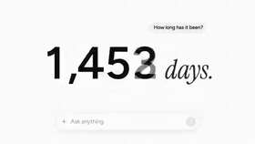</a> <b><a href="https://x.com/Khazix0918/status/2119902325460590834">为 ChatGPT 四周年做的庆生视频</a></b> <a href="https://x.com/Khazix0918">@Khazix0918</a> · 0:58 · <a href="https://x.com/Khazix0918/status/2119902325460590834">X 原帖</a></td>
<td width="33%" valign="top"><a href="https://x.com/ravisparikh/status/2120398428157194589">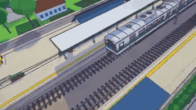</a> <b><a href="https://x.com/ravisparikh/status/2120398428157194589">列车驶过的动漫风小镇，20 秒渲染完成</a></b> <a href="https://x.com/ravisparikh">@ravisparikh</a> · 0:08 · <a href="https://x.com/ravisparikh/status/2120398428157194589">X 原帖</a></td>
<td width="33%" valign="top"><a href="https://x.com/kevin_t_ngo/status/2125288449788019168">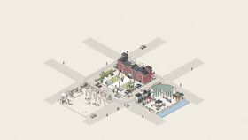</a> <b><a href="https://x.com/kevin_t_ngo/status/2125288449788019168">东京，一段用代码画出的动画</a></b> <a href="https://x.com/kevin_t_ngo">@kevin_t_ngo</a> · 0:52 · <a href="https://x.com/kevin_t_ngo/status/2125288449788019168">X 原帖</a></td>
</tr>
<tr>
<td width="33%" valign="top"><a href="https://x.com/jeanalexandre_b/status/2120783430606840084">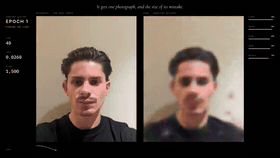</a> <b><a href="https://x.com/jeanalexandre_b/status/2120783430606840084">只用代码，以 10 万个色块重现一张照片</a></b> <a href="https://x.com/jeanalexandre_b">@jeanalexandre_b</a> · 1:08 · <a href="https://x.com/jeanalexandre_b/status/2120783430606840084">X 原帖</a></td>
<td width="33%" valign="top"> <b><a href="https://x.com/ann_nnng/status/2122283549000712249">带纸张质感的互动圣诞贺卡</a></b> <a href="https://x.com/ann_nnng">@ann_nnng</a> · 0:35 · <a href="https://x.com/ann_nnng/status/2122283549000712249">X 原帖</a></td>
<td width="33%" valign="top"><a href="https://x.com/Gregoirechp/status/2119879667457073355">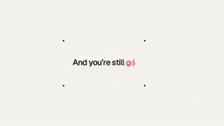</a> <b><a href="https://x.com/Gregoirechp/status/2119879667457073355">几分钟做出的一段动效设计</a></b> <a href="https://x.com/Gregoirechp">@Gregoirechp</a> · 0:40 · <a href="https://x.com/Gregoirechp/status/2119879667457073355">X 原帖</a></td>
</tr>
<tr>
<td width="33%" valign="top"> <b><a href="https://x.com/AmirMushich/status/2121339167800213934">用 Blender 做的文字动效短片，已作为免费模板发布</a></b> <a href="https://x.com/AmirMushich">@AmirMushich</a> · 0:08 · <a href="https://x.com/AmirMushich/status/2121339167800213934">X 原帖</a></td>
<td width="33%" valign="top"> <b><a href="https://x.com/crtvTeknologist/status/2121657720289767666">日式作画（Sakuga）风格的一组 UI 控件动画</a></b> <a href="https://x.com/crtvTeknologist">@crtvTeknologist</a> · 0:17 · <a href="https://x.com/crtvTeknologist/status/2121657720289767666">X 原帖</a></td>
<td width="33%" valign="top"><a href="https://x.com/internetphysics/status/2119903808935313778">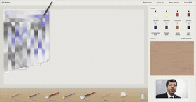</a> <b><a href="https://x.com/internetphysics/status/2119903808935313778">用模拟油画颜料画的 Sam Altman 肖像</a></b> <a href="https://x.com/internetphysics">@internetphysics</a> · 1:00 · <a href="https://x.com/internetphysics/status/2119903808935313778">X 原帖</a></td>
</tr>
<tr>
<td width="33%" valign="top"><a href="https://x.com/yuwen_lu_/status/2120230407878930739">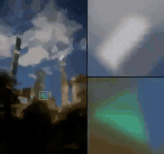</a> <b><a href="https://x.com/yuwen_lu_/status/2120230407878930739">用 p5.js 笔刷重现的一张中央公园照片</a></b> <a href="https://x.com/yuwen_lu_">@yuwen_lu_</a> · 0:19 · <a href="https://x.com/yuwen_lu_/status/2120230407878930739">X 原帖</a> p5.js</td>
<td width="33%" valign="top"> <b><a href="https://x.com/sota_web15/status/2120446425545023792">不拍摄、不剪辑，人工 8 分钟、成本约 300 日元的视频</a></b> <a href="https://x.com/sota_web15">@sota_web15</a> · 1:46 · <a href="https://x.com/sota_web15/status/2120446425545023792">X 原帖</a></td>
<td width="33%" valign="top"><a href="https://x.com/LexnLin/status/2121395037565337862">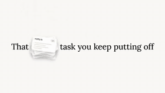</a> <b><a href="https://x.com/LexnLin/status/2121395037565337862">不到 1 小时做出的 Opus 5.6 发布视频</a></b> <a href="https://x.com/LexnLin">@LexnLin</a> · 0:20 · <a href="https://x.com/LexnLin/status/2121395037565337862">X 原帖</a></td>
</tr>
<tr>
<td width="33%" valign="top"> <b><a href="https://x.com/noel_ai_lab/status/2121589715363303843">舞台灯光下的日文动态字体，配乐来自 Suno</a></b> <a href="https://x.com/noel_ai_lab">@noel_ai_lab</a> · 0:29 · <a href="https://x.com/noel_ai_lab/status/2121589715363303843">X 原帖</a></td>
<td width="33%" valign="top"><a href="https://x.com/pradeepXkapoor/status/2124022052554453137">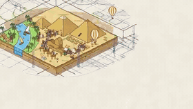</a> <b><a href="https://x.com/pradeepXkapoor/status/2124022052554453137">手绘风的地标拼块世界，自己一块块搭起来</a></b> <a href="https://x.com/pradeepXkapoor">@pradeepXkapoor</a> · 0:58 · <a href="https://x.com/pradeepXkapoor/status/2124022052554453137">X 原帖</a></td>
<td width="33%" valign="top"><a href="https://x.com/venturetwins/status/2120331599283954137">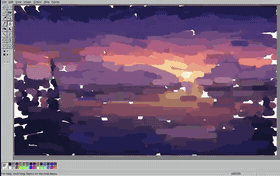</a> <b><a href="https://x.com/venturetwins/status/2120331599283954137">在 MS Paint 仿制版里画的黄昏湖景，延时呈现</a></b> <a href="https://x.com/venturetwins">@venturetwins</a> · 0:46 · <a href="https://x.com/venturetwins/status/2120331599283954137">X 原帖</a> 94 min</td>
</tr>
<tr>
<td width="33%" valign="top"><a href="https://x.com/aziz4ai/status/2119928581405200726">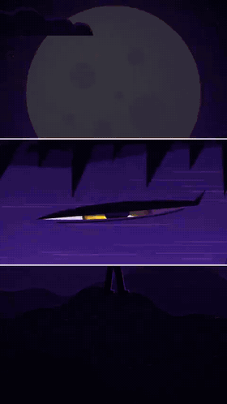</a> <b><a href="https://x.com/aziz4ai/status/2119928581405200726">只用代码做出的 15 秒场景，没有用视频模型</a></b> <a href="https://x.com/aziz4ai">@aziz4ai</a> · 0:15 · <a href="https://x.com/aziz4ai/status/2119928581405200726">X 原帖</a></td>
<td width="33%" valign="top"><a href="https://x.com/devteamdrew/status/2120090542419984686">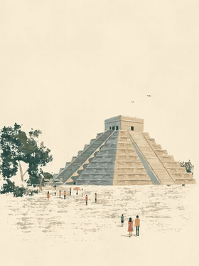</a> <b><a href="https://x.com/devteamdrew/status/2120090542419984686">绘制并做成动画的世界七大奇迹</a></b> <a href="https://x.com/devteamdrew">@devteamdrew</a> · 0:10 · <a href="https://x.com/devteamdrew/status/2120090542419984686">X 原帖</a></td>
<td width="33%" valign="top"><a href="https://x.com/justkarangupta/status/2119995965776200047">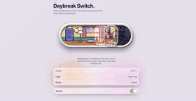</a> <b><a href="https://x.com/justkarangupta/status/2119995965776200047">一个电灯开关：小猫醒来，小狗来敲门</a></b> <a href="https://x.com/justkarangupta">@justkarangupta</a> · 0:15 · <a href="https://x.com/justkarangupta/status/2119995965776200047">X 原帖</a></td>
</tr>
<tr>
<td width="33%" valign="top"><a href="https://x.com/slimer48484/status/2120094263673319609">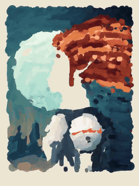</a> <b><a href="https://x.com/slimer48484/status/2120094263673319609">用 Python 画的一幅画，逐笔呈现</a></b> <a href="https://x.com/slimer48484">@slimer48484</a> · 0:30 · <a href="https://x.com/slimer48484/status/2120094263673319609">X 原帖</a> Python</td>
<td width="33%" valign="top"> <b><a href="https://x.com/Masimo_Blue/status/2119943368612487285">10 秒 Claude 裤子宣传片，配酸性 Techno</a></b> <a href="https://x.com/Masimo_Blue">@Masimo_Blue</a> · 0:10 · <a href="https://x.com/Masimo_Blue/status/2119943368612487285">X 原帖</a></td>
<td width="33%" valign="top"><a href="https://x.com/Hunter_Weiss/status/2119932937642946900">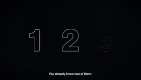</a> <b><a href="https://x.com/Hunter_Weiss/status/2119932937642946900">一次生成：面向高中水平讲解火箭科学</a></b> <a href="https://x.com/Hunter_Weiss">@Hunter_Weiss</a> · 1:58 · <a href="https://x.com/Hunter_Weiss/status/2119932937642946900">X 原帖</a> 提示词: “I need you to create the most impressive video I can share with people about Fable 5.2, explaining rocket science as if it were for someone with a high school education.”</td>
</tr>
</table>

## 讲解视频

<table>
<tr>
<td width="33%" valign="top"><a href="https://x.com/aollivier82/status/2120260208245043663">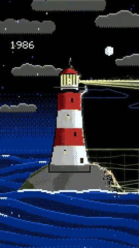</a> <b><a href="https://x.com/aollivier82/status/2120260208245043663">计算机图形学的历史，动画呈现</a></b> <a href="https://x.com/aollivier82">@aollivier82</a> · 0:29 · <a href="https://x.com/aollivier82/status/2120260208245043663">X 原帖</a></td>
<td width="33%" valign="top"> <b><a href="https://x.com/cube_224/status/2120152637249315094">魔方与数学的 3 分钟科普视频，耗时 2 小时</a></b> <a href="https://x.com/cube_224">@cube_224</a> · 3:06 · <a href="https://x.com/cube_224/status/2120152637249315094">X 原帖</a></td>
<td width="33%" valign="top"><a href="https://x.com/imjustnewatai/status/2120695368874631226">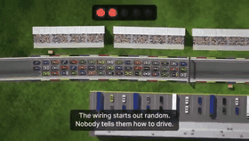</a> <b><a href="https://x.com/imjustnewatai/status/2120695368874631226">50 辆车在没人教的情况下自己学会驾驶</a></b> <a href="https://x.com/imjustnewatai">@imjustnewatai</a> · 1:38 · <a href="https://x.com/imjustnewatai/status/2120695368874631226">X 原帖</a></td>
</tr>
<tr>
<td width="33%" valign="top"><a href="https://x.com/claudeai/status/2120174863210201316">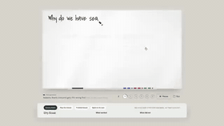</a> <b><a href="https://x.com/claudeai/status/2120174863210201316">任意提问，答案在板书上一步步画出来</a></b> <a href="https://x.com/claudeai">@claudeai</a> · 0:36 · <a href="https://x.com/claudeai/status/2120174863210201316">X 原帖</a></td>
<td width="33%" valign="top"> <b><a href="https://x.com/rileybrown/status/2119946022767980985">文字书写的历史，一条提示词生成</a></b> <a href="https://x.com/rileybrown">@rileybrown</a> · 1:36 · <a href="https://x.com/rileybrown/status/2119946022767980985">X 原帖</a> <a href="https://v2.video/riley/the-history-of-writing/v1">提示词和文件见作者的页面</a></td>
<td width="33%" valign="top"><a href="https://x.com/claudeai/status/2120174860252897530">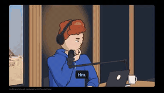</a> <b><a href="https://x.com/claudeai/status/2120174860252897530">关于埃及金字塔的播客，画面全由代码绘制</a></b> <a href="https://x.com/claudeai">@claudeai</a> · 2:07 · <a href="https://x.com/claudeai/status/2120174860252897530">X 原帖</a></td>
</tr>
<tr>
<td width="33%" valign="top"><a href="https://x.com/MartinOesterhel/status/2120464036030517525">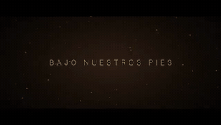</a> <b><a href="https://x.com/MartinOesterhel/status/2120464036030517525">以预告片形式讲解土壤质地三角图</a></b> <a href="https://x.com/MartinOesterhel">@MartinOesterhel</a> · 1:32 · <a href="https://x.com/MartinOesterhel/status/2120464036030517525">X 原帖</a></td>
<td width="33%" valign="top"><a href="https://x.com/amrnth0/status/2120849097871810973">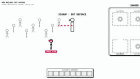</a> <b><a href="https://x.com/amrnth0/status/2120849097871810973">Railway 大规模入侵事件解说</a></b> <a href="https://x.com/amrnth0">@amrnth0</a> · 2:12 · <a href="https://x.com/amrnth0/status/2120849097871810973">X 原帖</a></td>
<td width="33%" valign="top"> <b><a href="https://x.com/withbassam/status/2121536898976100486">那些以阿拉伯语命名的星星，Low 强度下修改约 4 次</a></b> <a href="https://x.com/withbassam">@withbassam</a> · 0:18 · <a href="https://x.com/withbassam/status/2121536898976100486">X 原帖</a></td>
</tr>
<tr>
<td width="33%" valign="top"><a href="https://x.com/theojaffee/status/2120312766544437738">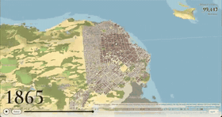</a> <b><a href="https://x.com/theojaffee/status/2120312766544437738">可按年份浏览的旧金山湾区 250 年历史模拟</a></b> <a href="https://x.com/theojaffee">@theojaffee</a> · 0:33 · <a href="https://x.com/theojaffee/status/2120312766544437738">X 原帖</a></td>
<td width="33%" valign="top"><a href="https://x.com/DeryaTR_/status/2119974354260013293">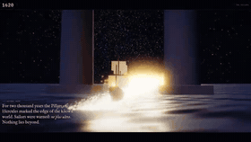</a> <b><a href="https://x.com/DeryaTR_/status/2119974354260013293">用代码做的科学史 3D 之旅</a></b> <a href="https://x.com/DeryaTR_">@DeryaTR_</a> · 4:56 · <a href="https://x.com/DeryaTR_/status/2119974354260013293">X 原帖</a></td>
<td width="33%" valign="top"><a href="https://x.com/Rasmic/status/2119919466163093768">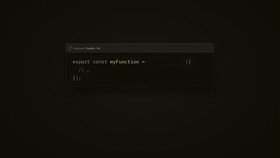</a> <b><a href="https://x.com/Rasmic/status/2119919466163093768">讲解 Convex 的动态图形视频</a></b> <a href="https://x.com/Rasmic">@Rasmic</a> · 4:08 · <a href="https://x.com/Rasmic/status/2119919466163093768">X 原帖</a></td>
</tr>
<tr>
<td width="33%" valign="top"> <b><a href="https://x.com/linxiaobei888/status/2119978892861829227">给 3–6 岁孩子看的英语启蒙动画</a></b> <a href="https://x.com/linxiaobei888">@linxiaobei888</a> · 2:27 · <a href="https://x.com/linxiaobei888/status/2119978892861829227">X 原帖</a> Codex</td>
<td width="33%" valign="top"><a href="https://x.com/konstantinsaifo/status/2119941967136379334">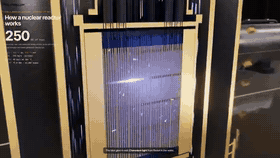</a> <b><a href="https://x.com/konstantinsaifo/status/2119941967136379334">核反应堆如何工作：可拆解的 three.js 模型</a></b> <a href="https://x.com/konstantinsaifo">@konstantinsaifo</a> · 0:36 · <a href="https://x.com/konstantinsaifo/status/2119941967136379334">X 原帖</a> three.js · $92</td>
<td width="33%" valign="top"> <b><a href="https://x.com/MatthewBerman/status/2119868633086378471">讲解 LLM 工作原理的动态图形</a></b> <a href="https://x.com/MatthewBerman">@MatthewBerman</a> · 0:50 · <a href="https://x.com/MatthewBerman/status/2119868633086378471">X 原帖</a></td>
</tr>
</table>

## 动画短片

<table>
<tr>
<td width="33%" valign="top"> <b><a href="https://x.com/suna_gaku/status/2119952985933697063">以终端输入开场的实力展示短片</a></b> <a href="https://x.com/suna_gaku">@suna_gaku</a> · 1:29 · <a href="https://x.com/suna_gaku/status/2119952985933697063">X 原帖</a></td>
<td width="33%" valign="top"><a href="https://x.com/gavinpurcell/status/2120002682421182624">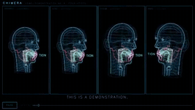</a> <b><a href="https://x.com/gavinpurcell/status/2120002682421182624">拿到一个代码仓库后自由发挥做出的短片</a></b> <a href="https://x.com/gavinpurcell">@gavinpurcell</a> · 1:56 · <a href="https://x.com/gavinpurcell/status/2120002682421182624">X 原帖</a></td>
<td width="33%" valign="top"><a href="https://x.com/anabology/status/2120010995309457643">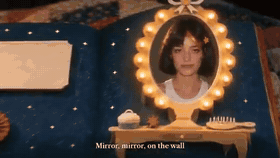</a> <b><a href="https://x.com/anabology/status/2120010995309457643">两次提示、9 小时做出的绘本风梦境短片</a></b> <a href="https://x.com/anabology">@anabology</a> · 4:04 · <a href="https://x.com/anabology/status/2120010995309457643">X 原帖</a></td>
</tr>
<tr>
<td width="33%" valign="top"> <b><a href="https://x.com/rileybrown/status/2121642720045261185">《The Fable of Clawd》：2 分钟 4K Blender 短片，花费约 20 美元</a></b> <a href="https://x.com/rileybrown">@rileybrown</a> · 2:19 · <a href="https://x.com/rileybrown/status/2121642720045261185">X 原帖</a></td>
<td width="33%" valign="top"> <b><a href="https://x.com/DanielZambrini/status/2124583559256313944">蜂鸟眼中的世界，Blender 里 100% 代码完成</a></b> <a href="https://x.com/DanielZambrini">@DanielZambrini</a> · 0:30 · <a href="https://x.com/DanielZambrini/status/2124583559256313944">X 原帖</a></td>
<td width="33%" valign="top"><a href="https://x.com/DanielZambrini/status/2123360069513302141">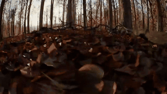</a> <b><a href="https://x.com/DanielZambrini/status/2123360069513302141">一只松鼠的一天，用 Python 驱动 Blender 渲染</a></b> <a href="https://x.com/DanielZambrini">@DanielZambrini</a> · 0:30 · <a href="https://x.com/DanielZambrini/status/2123360069513302141">X 原帖</a></td>
</tr>
<tr>
<td width="33%" valign="top"> <b><a href="https://x.com/BubbleBrain/status/2122313967473434639">小猫眼中的世界，画面和声音全部由代码生成</a></b> <a href="https://x.com/BubbleBrain">@BubbleBrain</a> · 1:50 · <a href="https://x.com/BubbleBrain/status/2122313967473434639">X 原帖</a></td>
<td width="33%" valign="top"><a href="https://x.com/DeryaTR_/status/2120382619082727604">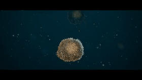</a> <b><a href="https://x.com/DeryaTR_/status/2120382619082727604">T 细胞的一生：8 分钟带旁白的 Blender 影片</a></b> <a href="https://x.com/DeryaTR_">@DeryaTR_</a> · 8:40 · <a href="https://x.com/DeryaTR_/status/2120382619082727604">X 原帖</a></td>
<td width="33%" valign="top"> <b><a href="https://x.com/polinaaAi/status/2120753459498549757">开放世界风格的城市驾驶场景，45 秒 4K</a></b> <a href="https://x.com/polinaaAi">@polinaaAi</a> · 0:46 · <a href="https://x.com/polinaaAi/status/2120753459498549757">X 原帖</a></td>
</tr>
<tr>
<td width="33%" valign="top"> <b><a href="https://x.com/devteamdrew/status/2119892540950241283">一段 32 秒的短片，发布时未附说明</a></b> <a href="https://x.com/devteamdrew">@devteamdrew</a> · 0:32 · <a href="https://x.com/devteamdrew/status/2119892540950241283">X 原帖</a></td>
<td width="33%" valign="top"> <b><a href="https://x.com/aollivier82/status/2119920990893244510">它心中最美的视频，从海面之下开场</a></b> <a href="https://x.com/aollivier82">@aollivier82</a> · 0:48 · <a href="https://x.com/aollivier82/status/2119920990893244510">X 原帖</a></td>
<td width="33%" valign="top"><a href="https://x.com/kevin_t_ngo/status/2119938129079808282">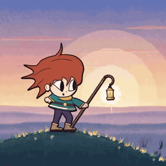</a> <b><a href="https://x.com/kevin_t_ngo/status/2119938129079808282">每一帧都用 JavaScript 绘制的短片</a></b> <a href="https://x.com/kevin_t_ngo">@kevin_t_ngo</a> · 1:40 · <a href="https://x.com/kevin_t_ngo/status/2119938129079808282">X 原帖</a> JavaScript</td>
</tr>
<tr>
<td width="33%" valign="top"><a href="https://x.com/mattshumer_/status/2119884041331892403">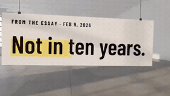</a> <b><a href="https://x.com/mattshumer_/status/2119884041331892403">一次提示做出的 3D 画廊，墙上挂着社交帖子</a></b> <a href="https://x.com/mattshumer_">@mattshumer_</a> · 4:44 · <a href="https://x.com/mattshumer_/status/2119884041331892403">X 原帖</a></td>
<td width="33%" valign="top"><a href="https://x.com/kevin_t_ngo/status/2119972124211454139">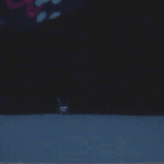</a> <b><a href="https://x.com/kevin_t_ngo/status/2119972124211454139">90 年代风玩具广告：Python + Blender</a></b> <a href="https://x.com/kevin_t_ngo">@kevin_t_ngo</a> · 1:05 · <a href="https://x.com/kevin_t_ngo/status/2119972124211454139">X 原帖</a> Python · Blender</td>
<td width="33%" valign="top"><a href="https://x.com/rute1203d/status/2120077147872391540">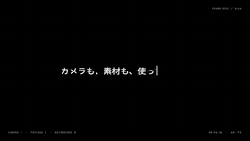</a> <b><a href="https://x.com/rute1203d/status/2120077147872391540">一部展示实力的短片：先秀技术，再打动人心</a></b> <a href="https://x.com/rute1203d">@rute1203d</a> · 2:26 · <a href="https://x.com/rute1203d/status/2120077147872391540">X 原帖</a> 提示词: “あなたが世界有数の動画クリエイターです... 今の実力を見せつける最高の動画を作ってください 技術をみせその後感動を見せる”</td>
</tr>
<tr>
<td width="33%" valign="top"><a href="https://x.com/kevin_t_ngo/status/2120308118127309173">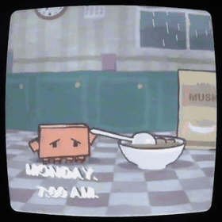</a> <b><a href="https://x.com/kevin_t_ngo/status/2120308118127309173">90 年代风格的麦片广告，全部用代码绘制</a></b> <a href="https://x.com/kevin_t_ngo">@kevin_t_ngo</a> · 1:04 · <a href="https://x.com/kevin_t_ngo/status/2120308118127309173">X 原帖</a></td>
<td width="33%" valign="top"> <b><a href="https://x.com/lemomo_ai/status/2120118194409193682">深夜图书馆里 24000 页纸乘风飞舞，配钢琴曲</a></b> <a href="https://x.com/lemomo_ai">@lemomo_ai</a> · 0:55 · <a href="https://x.com/lemomo_ai/status/2120118194409193682">X 原帖</a></td>
<td width="33%" valign="top"> <b><a href="https://x.com/0xMovez/status/2121001440470577157">纯 Three.js 制作的 2 分钟动画短片，8 个世界 16 个镜头</a></b> <a href="https://x.com/0xMovez">@0xMovez</a> · 1:41 · <a href="https://x.com/0xMovez/status/2121001440470577157">X 原帖</a></td>
</tr>
<tr>
<td width="33%" valign="top"><a href="https://x.com/kevin_t_ngo/status/2120540964909711415">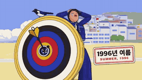</a> <b><a href="https://x.com/kevin_t_ngo/status/2120540964909711415">全部由代码制作的动画剧集片头，用 Blender 渲染</a></b> <a href="https://x.com/kevin_t_ngo">@kevin_t_ngo</a> · 0:45 · <a href="https://x.com/kevin_t_ngo/status/2120540964909711415">X 原帖</a></td>
<td width="33%" valign="top"> <b><a href="https://x.com/thomaszhou_/status/2120389154970509666">《美》：一句话提示生成的短片</a></b> <a href="https://x.com/thomaszhou_">@thomaszhou_</a> · 1:51 · <a href="https://x.com/thomaszhou_/status/2120389154970509666">X 原帖</a></td>
<td width="33%" valign="top"><a href="https://x.com/rileybrown/status/2119973951027724385">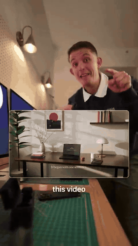</a> <b><a href="https://x.com/rileybrown/status/2119973951027724385">由 Fable 5.2 剪辑的一段真人出镜口播视频</a></b> <a href="https://x.com/rileybrown">@rileybrown</a> · 2:01 · <a href="https://x.com/rileybrown/status/2119973951027724385">X 原帖</a></td>
</tr>
<tr>
<td width="33%" valign="top"> <b><a href="https://x.com/EHuanglu/status/2119947980400976267">把剧本变成迪士尼风格的动画片</a></b> <a href="https://x.com/EHuanglu">@EHuanglu</a> · 1:46 · <a href="https://x.com/EHuanglu/status/2119947980400976267">X 原帖</a></td>
<td width="33%" valign="top"> <b><a href="https://x.com/mattshumer_/status/2119900920347828670">49 分钟的电影，配音和画面全部由代码生成</a></b> <a href="https://x.com/mattshumer_">@mattshumer_</a> · 48:49 · <a href="https://x.com/mattshumer_/status/2119900920347828670">X 原帖</a></td>
<td width="33%" valign="top"><a href="https://x.com/gavinpurcell/status/2120581152054583369">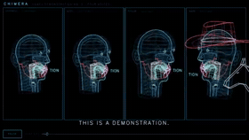</a> <b><a href="https://x.com/gavinpurcell/status/2120581152054583369">意式西部片系列新篇章：一段波折的青涩恋情</a></b> <a href="https://x.com/gavinpurcell">@gavinpurcell</a> · 2:27 · <a href="https://x.com/gavinpurcell/status/2120581152054583369">X 原帖</a></td>
</tr>
<tr>
<td width="33%" valign="top"> <b><a href="https://x.com/jsnnsa/status/2120161161803088061">一部纪录短片：为品牌套件设计一款字体</a></b> <a href="https://x.com/jsnnsa">@jsnnsa</a> · 1:43 · <a href="https://x.com/jsnnsa/status/2120161161803088061">X 原帖</a></td>
<td width="33%" valign="top"><a href="https://x.com/dhruvalgolakiya/status/2120551422324527242">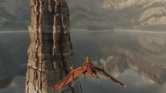</a> <b><a href="https://x.com/dhruvalgolakiya/status/2120551422324527242">带模拟火焰的飞龙动画，在 Blender 中绑定和渲染</a></b> <a href="https://x.com/dhruvalgolakiya">@dhruvalgolakiya</a> · 0:30 · <a href="https://x.com/dhruvalgolakiya/status/2120551422324527242">X 原帖</a></td>
<td width="33%" valign="top"> <b><a href="https://x.com/0kncn/status/2119901782482543073">90 秒动漫短片：变身机器人的蒸汽机车</a></b> <a href="https://x.com/0kncn">@0kncn</a> · 1:30 · <a href="https://x.com/0kncn/status/2119901782482543073">X 原帖</a> Blender · <a href="https://x.com/0kncn/status/2119901786060259612">提示词见作者的回复</a></td>
</tr>
<tr>
<td width="33%" valign="top"><a href="https://x.com/JacobMolBio/status/2120648796334178374">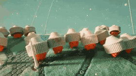</a> <b><a href="https://x.com/JacobMolBio/status/2120648796334178374">《Better Half》：螃蟹与噬菌体的 Blender 动画短片</a></b> <a href="https://x.com/JacobMolBio">@JacobMolBio</a> · 1:25 · <a href="https://x.com/JacobMolBio/status/2120648796334178374">X 原帖</a></td>
<td width="33%" valign="top"> <b><a href="https://x.com/chetaslua/status/2120438091647218025">一只厌倦了路途的鹈鹕，单个 HTML 文件里的手绘风短片</a></b> <a href="https://x.com/chetaslua">@chetaslua</a> · 0:56 · <a href="https://x.com/chetaslua/status/2120438091647218025">X 原帖</a></td>
<td width="33%" valign="top"><a href="https://x.com/MatinSenPai/status/2120210882382971263">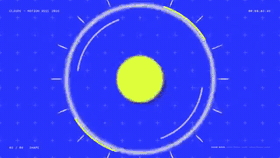</a> <b><a href="https://x.com/MatinSenPai/status/2120210882382971263">一次提示生成的 15 秒动效作品集，API 花费 11 美元</a></b> <a href="https://x.com/MatinSenPai">@MatinSenPai</a> · 0:15 · <a href="https://x.com/MatinSenPai/status/2120210882382971263">X 原帖</a></td>
</tr>
<tr>
<td width="33%" valign="top"> <b><a href="https://x.com/ery_treasure/status/2123041616688820509">青蛙视角的夏日乡间，用 Blender 制作</a></b> <a href="https://x.com/ery_treasure">@ery_treasure</a> · 1:30 · <a href="https://x.com/ery_treasure/status/2123041616688820509">X 原帖</a></td>
<td width="33%" valign="top"><a href="https://x.com/mgrczyk/status/2119943813028548721">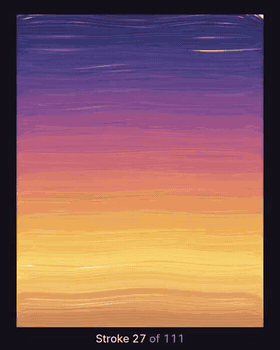</a> <b><a href="https://x.com/mgrczyk/status/2119943813028548721">一笔一笔画出日出时的鸟，无法撤销或修改</a></b> <a href="https://x.com/mgrczyk">@mgrczyk</a> · 0:21 · <a href="https://x.com/mgrczyk/status/2119943813028548721">X 原帖</a></td>
<td width="33%" valign="top"><a href="https://x.com/diegocabezas01/status/2124488567628149034">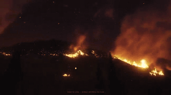</a> <b><a href="https://x.com/diegocabezas01/status/2124488567628149034">夜晚山坡上的野火，Fable 5.2 Max 生成</a></b> <a href="https://x.com/diegocabezas01">@diegocabezas01</a> · 0:38 · <a href="https://x.com/diegocabezas01/status/2124488567628149034">X 原帖</a></td>
</tr>
<tr>
<td width="33%" valign="top"><a href="https://x.com/higgsfield_ai/status/2120007830065614926">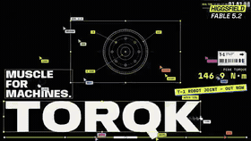</a> <b><a href="https://x.com/higgsfield_ai/status/2120007830065614926">为一款虚构机器人关节做的发布片，在 Blender 中搭建</a></b> <a href="https://x.com/higgsfield_ai">@higgsfield_ai</a> · 0:30 · <a href="https://x.com/higgsfield_ai/status/2120007830065614926">X 原帖</a> Blender · 4h 31m</td>
<td width="33%" valign="top"> <b><a href="https://x.com/dfeinition/status/2119881243990859818">动起来的粉笔画</a></b> <a href="https://x.com/dfeinition">@dfeinition</a> · 0:31 · <a href="https://x.com/dfeinition/status/2119881243990859818">X 原帖</a></td>
<td width="33%" valign="top"> <b><a href="https://x.com/dfeinition/status/2119886262211625062">布料褶皱、透光、运镜与声音，全部由代码完成</a></b> <a href="https://x.com/dfeinition">@dfeinition</a> · 0:19 · <a href="https://x.com/dfeinition/status/2119886262211625062">X 原帖</a></td>
</tr>
<tr>
<td width="33%" valign="top"><a href="https://x.com/thomaszhou_/status/2120048570443395161">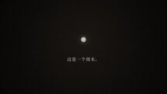</a> <b><a href="https://x.com/thomaszhou_/status/2120048570443395161">《936》：一句话提示词生成的短片</a></b> <a href="https://x.com/thomaszhou_">@thomaszhou_</a> · 1:42 · <a href="https://x.com/thomaszhou_/status/2120048570443395161">X 原帖</a> 提示词: “请制作一段视频短片，会深刻影响到我的余生。”</td>
<td width="33%" valign="top"> <b><a href="https://x.com/kickingkeys/status/2119945841997672698">一段绘画作品，画面和声音都由代码生成</a></b> <a href="https://x.com/kickingkeys">@kickingkeys</a> · 0:23 · <a href="https://x.com/kickingkeys/status/2119945841997672698">X 原帖</a></td>
<td width="33%" valign="top"><a href="https://x.com/dfeinition/status/2119892208937517201">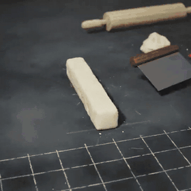</a> <b><a href="https://x.com/dfeinition/status/2119892208937517201">一段黏土动画风格的短片</a></b> <a href="https://x.com/dfeinition">@dfeinition</a> · 0:20 · <a href="https://x.com/dfeinition/status/2119892208937517201">X 原帖</a></td>
</tr>
<tr>
<td width="33%" valign="top"> <b><a href="https://x.com/wangray/status/2120040640423850168">参考一支发布视频的风格，为 BlewUp 做的发布视频</a></b> <a href="https://x.com/wangray">@wangray</a> · 0:19 · <a href="https://x.com/wangray/status/2120040640423850168">X 原帖</a> 提示词: “参考这个 launch video 风格给 BlewUp 做一个类似的视频”</td>
<td width="33%" valign="top"> <b><a href="https://x.com/anstapnever/status/2119915123070644263">一部 79 秒的日式动画短片</a></b> <a href="https://x.com/anstapnever">@anstapnever</a> · 1:19 · <a href="https://x.com/anstapnever/status/2119915123070644263">X 原帖</a></td>
<td width="33%" valign="top"> <b><a href="https://x.com/xKaka1456/status/2120008408774717666">一部诠释模型审美的短片</a></b> <a href="https://x.com/xKaka1456">@xKaka1456</a> · 0:57 · <a href="https://x.com/xKaka1456/status/2120008408774717666">X 原帖</a></td>
</tr>
<tr>
<td width="33%" valign="top"><a href="https://x.com/higgsfield_ai/status/2119964448077316238">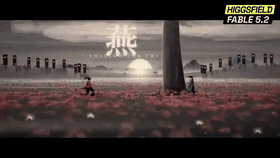</a> <b><a href="https://x.com/higgsfield_ai/status/2119964448077316238">2.5D 决斗动画，Higgsfield MCP 制作</a></b> <a href="https://x.com/higgsfield_ai">@higgsfield_ai</a> · 1:30 · <a href="https://x.com/higgsfield_ai/status/2119964448077316238">X 原帖</a> Higgsfield</td>
</tr>
</table>

## 3D 场景

<table>
<tr>
<td width="33%" valign="top"> <b><a href="https://x.com/ebbyamir/status/2120284261089673376">梵高驰骋在自己的《星月夜》里，一款可玩的游戏</a></b> <a href="https://x.com/ebbyamir">@ebbyamir</a> · 0:53 · <a href="https://x.com/ebbyamir/status/2120284261089673376">X 原帖</a></td>
<td width="33%" valign="top"><a href="https://x.com/claudeai/status/2120174844822298730">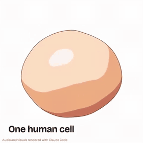</a> <b><a href="https://x.com/claudeai/status/2120174844822298730">细胞的 3D 模型，一个细胞器一个细胞器地搭建</a></b> <a href="https://x.com/claudeai">@claudeai</a> · 2:14 · <a href="https://x.com/claudeai/status/2120174844822298730">X 原帖</a></td>
<td width="33%" valign="top"> <b><a href="https://x.com/ViktorKav/status/2122647483281015155">车顶带梯子的 96 款 Uno Mille 驰骋赛道，仅一个 603 KB 的 HTML 文件</a></b> <a href="https://x.com/ViktorKav">@ViktorKav</a> · 1:00 · <a href="https://x.com/ViktorKav/status/2122647483281015155">X 原帖</a></td>
</tr>
<tr>
<td width="33%" valign="top"> <b><a href="https://x.com/BlendiByl/status/2120341251178594532">手绘质感的浏览器游戏，画面由笔触构成</a></b> <a href="https://x.com/BlendiByl">@BlendiByl</a> · 0:16 · <a href="https://x.com/BlendiByl/status/2120341251178594532">X 原帖</a> under 1 hour</td>
<td width="33%" valign="top"> <b><a href="https://x.com/mattshumer_/status/2120282133503820150">一个开放世界城市游戏演示</a></b> <a href="https://x.com/mattshumer_">@mattshumer_</a> · 1:04 · <a href="https://x.com/mattshumer_/status/2120282133503820150">X 原帖</a></td>
<td width="33%" valign="top"> <b><a href="https://x.com/everestchris6/status/2120175941616128277">由 2D 户型图生成的 3D 漫游</a></b> <a href="https://x.com/everestchris6">@everestchris6</a> · 0:10 · <a href="https://x.com/everestchris6/status/2120175941616128277">X 原帖</a></td>
</tr>
<tr>
<td width="33%" valign="top"> <b><a href="https://x.com/rileybrown/status/2119902109709537708">Blender 书桌场景：13 个镜头，从黄昏到日出</a></b> <a href="https://x.com/rileybrown">@rileybrown</a> · 0:59 · <a href="https://x.com/rileybrown/status/2119902109709537708">X 原帖</a> Blender · RunPod · ElevenLabs · $5.75 · 52 min render</td>
<td width="33%" valign="top"> <b><a href="https://x.com/ravisparikh/status/2121333521663017401">一个学会奔跑的角色，用 vork 渲染</a></b> <a href="https://x.com/ravisparikh">@ravisparikh</a> · 0:30 · <a href="https://x.com/ravisparikh/status/2121333521663017401">X 原帖</a></td>
<td width="33%" valign="top"> <b><a href="https://x.com/Dstudio_ai/status/2122569461547098595">手游风格的大厅界面，3D 模型用 Tripo 制作</a></b> <a href="https://x.com/Dstudio_ai">@Dstudio_ai</a> · 1:00 · <a href="https://x.com/Dstudio_ai/status/2122569461547098595">X 原帖</a></td>
</tr>
<tr>
<td width="33%" valign="top"> <b><a href="https://x.com/JungleSilicon/status/2121782359901212987">蓝色像素风巨龙，由高斯泼溅构成</a></b> <a href="https://x.com/JungleSilicon">@JungleSilicon</a> · 0:36 · <a href="https://x.com/JungleSilicon/status/2121782359901212987">X 原帖</a></td>
<td width="33%" valign="top"> <b><a href="https://x.com/MrTacticalX/status/2121082861902070130">3 个 Fable 5.2 智能体用 7 小时 41 分做出的一台电脑</a></b> <a href="https://x.com/MrTacticalX">@MrTacticalX</a> · 0:35 · <a href="https://x.com/MrTacticalX/status/2121082861902070130">X 原帖</a></td>
<td width="33%" valign="top"> <b><a href="https://x.com/__morse/status/2122013410309153042">手持火把与长剑的第一人称林间小径，浏览器可玩</a></b> <a href="https://x.com/__morse">@__morse</a> · 0:30 · <a href="https://x.com/__morse/status/2122013410309153042">X 原帖</a></td>
</tr>
<tr>
<td width="33%" valign="top"> <b><a href="https://x.com/mixie3D/status/2121548293834740076">每一朵花都是 3D 的花卉场景</a></b> <a href="https://x.com/mixie3D">@mixie3D</a> · 0:30 · <a href="https://x.com/mixie3D/status/2121548293834740076">X 原帖</a></td>
<td width="33%" valign="top"> <b><a href="https://x.com/XRarchitect/status/2120947265007440052">用 Atlas 和 Fable 5.2 做的 Three.js 实验</a></b> <a href="https://x.com/XRarchitect">@XRarchitect</a> · 0:21 · <a href="https://x.com/XRarchitect/status/2120947265007440052">X 原帖</a></td>
<td width="33%" valign="top"> <b><a href="https://x.com/chetaslua/status/2121176151234330707">不用任何外部素材的 Three.js 场景</a></b> <a href="https://x.com/chetaslua">@chetaslua</a> · 1:25 · <a href="https://x.com/chetaslua/status/2121176151234330707">X 原帖</a></td>
</tr>
<tr>
<td width="33%" valign="top"> <b><a href="https://x.com/apekshik/status/2123139308932702468">AnyMachine：在 Blender 里建模并绑定直升机、救生艇和行走机器人</a></b> <a href="https://x.com/apekshik">@apekshik</a> · 1:50 · <a href="https://x.com/apekshik/status/2123139308932702468">X 原帖</a></td>
<td width="33%" valign="top"> <b><a href="https://x.com/M__Houser/status/2124153573718307003">《Age of Dragon》，一个人做的开放世界奇幻游戏</a></b> <a href="https://x.com/M__Houser">@M__Houser</a> · 1:30 · <a href="https://x.com/M__Houser/status/2124153573718307003">X 原帖</a></td>
<td width="33%" valign="top"> <b><a href="https://x.com/petergostev/status/2119877733488394520">Max 强度下制作的 3D 伊斯坦布尔与金角湾</a></b> <a href="https://x.com/petergostev">@petergostev</a> · 0:39 · <a href="https://x.com/petergostev/status/2119877733488394520">X 原帖</a></td>
</tr>
<tr>
<td width="33%" valign="top"> <b><a href="https://x.com/Rubzem/status/2122013352755126431">《Getting There》：4 小时做出的手绘绘本风游戏</a></b> <a href="https://x.com/Rubzem">@Rubzem</a> · 2:17 · <a href="https://x.com/Rubzem/status/2122013352755126431">X 原帖</a></td>
<td width="33%" valign="top"> <b><a href="https://x.com/BlendiByl/status/2121594536153718972">一天做出的巫师沙盒游戏，共 7 种法术</a></b> <a href="https://x.com/BlendiByl">@BlendiByl</a> · 0:55 · <a href="https://x.com/BlendiByl/status/2121594536153718972">X 原帖</a></td>
<td width="33%" valign="top"> <b><a href="https://x.com/aecyydesign/status/2120239401821487149">用 Blender 做的一段动画</a></b> <a href="https://x.com/aecyydesign">@aecyydesign</a> · 0:10 · <a href="https://x.com/aecyydesign/status/2120239401821487149">X 原帖</a> Blender</td>
</tr>
<tr>
<td width="33%" valign="top"> <b><a href="https://x.com/alexalbert__/status/2119916954337349737">从一份 PDF 出发，把达·芬奇手稿里的发明做成可交互模型</a></b> <a href="https://x.com/alexalbert__">@alexalbert__</a> · 0:25 · <a href="https://x.com/alexalbert__/status/2119916954337349737">X 原帖</a></td>
<td width="33%" valign="top"> <b><a href="https://x.com/xikhar/status/2122682962647122403">《Papertrails》：在浏览器中不断弹出的无尽纸艺世界</a></b> <a href="https://x.com/xikhar">@xikhar</a> · 0:54 · <a href="https://x.com/xikhar/status/2122682962647122403">X 原帖</a></td>
<td width="33%" valign="top"> <b><a href="https://x.com/ryoma_nakajima/status/2120052388434473233">一张纸自己折成折纸作品</a></b> <a href="https://x.com/ryoma_nakajima">@ryoma_nakajima</a> · 0:26 · <a href="https://x.com/ryoma_nakajima/status/2120052388434473233">X 原帖</a></td>
</tr>
<tr>
<td width="33%" valign="top"> <b><a href="https://x.com/kevin_t_ngo/status/2125119969109418333">Cinderwatch，单个 HTML 文件里的塔防游戏</a></b> <a href="https://x.com/kevin_t_ngo">@kevin_t_ngo</a> · 0:20 · <a href="https://x.com/kevin_t_ngo/status/2125119969109418333">X 原帖</a></td>
<td width="33%" valign="top"> <b><a href="https://x.com/_sholtodouglas/status/2119935331499925557">带传送门的竞技场射击游戏</a></b> <a href="https://x.com/_sholtodouglas">@_sholtodouglas</a> · 1:11 · <a href="https://x.com/_sholtodouglas/status/2119935331499925557">X 原帖</a></td>
<td width="33%" valign="top"> <b><a href="https://x.com/emollick/status/2119918307457577163">穿越 450 个由传送门相连的世界的无尽旅程</a></b> <a href="https://x.com/emollick">@emollick</a> · 1:11 · <a href="https://x.com/emollick/status/2119918307457577163">X 原帖</a></td>
</tr>
<tr>
<td width="33%" valign="top"> <b><a href="https://x.com/alexmichael/status/2119876626179870838">用 Python 控制 Blender 从零做出的视频</a></b> <a href="https://x.com/alexmichael">@alexmichael</a> · 0:18 · <a href="https://x.com/alexmichael/status/2119876626179870838">X 原帖</a> Python · Blender</td>
<td width="33%" valign="top"> <b><a href="https://x.com/BlendiByl/status/2120694003230560585">可游玩的手绘动画风山谷场景，开源</a></b> <a href="https://x.com/BlendiByl">@BlendiByl</a> · 0:23 · <a href="https://x.com/BlendiByl/status/2120694003230560585">X 原帖</a></td>
<td width="33%" valign="top"> <b><a href="https://x.com/kevin_t_ngo/status/2120238844754923874">黑暗奇幻类魂 Boss 战，可在浏览器中游玩</a></b> <a href="https://x.com/kevin_t_ngo">@kevin_t_ngo</a> · 2:18 · <a href="https://x.com/kevin_t_ngo/status/2120238844754923874">X 原帖</a></td>
</tr>
<tr>
<td width="33%" valign="top"> <b><a href="https://x.com/Grummz/status/2120255060957659498">一个小型第一人称射击关卡，没有用任何现成素材</a></b> <a href="https://x.com/Grummz">@Grummz</a> · 0:40 · <a href="https://x.com/Grummz/status/2120255060957659498">X 原帖</a> 2.9 hours</td>
<td width="33%" valign="top"> <b><a href="https://x.com/pingouh/status/2120636604624560229">完全由代码驱动动画的双足机器人，可在 Unreal 中操控</a></b> <a href="https://x.com/pingouh">@pingouh</a> · 1:12 · <a href="https://x.com/pingouh/status/2120636604624560229">X 原帖</a></td>
<td width="33%" valign="top"> <b><a href="https://x.com/chrisjdimarco/status/2120752985949057215">一百万个纳米机器人变换成各种形状，Three.js 实现</a></b> <a href="https://x.com/chrisjdimarco">@chrisjdimarco</a> · 1:31 · <a href="https://x.com/chrisjdimarco/status/2120752985949057215">X 原帖</a></td>
</tr>
<tr>
<td width="33%" valign="top"> <b><a href="https://x.com/fe_yukichi/status/2122489950981779504">Blender 中制作的慵懒兔耳角色，约 8000 个三角面</a></b> <a href="https://x.com/fe_yukichi">@fe_yukichi</a> · 0:13 · <a href="https://x.com/fe_yukichi/status/2122489950981779504">X 原帖</a></td>
<td width="33%" valign="top"> <b><a href="https://x.com/LexnLin/status/2119880654858977333">约 30 分钟完成，用了几个 Opus 5.5 子智能体</a></b> <a href="https://x.com/LexnLin">@LexnLin</a> · 0:30 · <a href="https://x.com/LexnLin/status/2119880654858977333">X 原帖</a> about 30 min</td>
<td width="33%" valign="top"> <b><a href="https://x.com/JungleSilicon/status/2120452158961397975">用高斯泼溅做的像素风场景</a></b> <a href="https://x.com/JungleSilicon">@JungleSilicon</a> · 1:48 · <a href="https://x.com/JungleSilicon/status/2120452158961397975">X 原帖</a></td>
</tr>
<tr>
<td width="33%" valign="top"> <b><a href="https://x.com/ChrisGPT/status/2122866766590173419">从半截潜艇上醒来的水下求生游戏</a></b> <a href="https://x.com/ChrisGPT">@ChrisGPT</a> · 1:28 · <a href="https://x.com/ChrisGPT/status/2122866766590173419">X 原帖</a></td>
<td width="33%" valign="top"> <b><a href="https://x.com/vib3coded/status/2122472401124401585">像素风战斗机游戏，耗时 38 分钟、花费 22.78 美元</a></b> <a href="https://x.com/vib3coded">@vib3coded</a> · 0:16 · <a href="https://x.com/vib3coded/status/2122472401124401585">X 原帖</a></td>
<td width="33%" valign="top"> <b><a href="https://x.com/kevin_t_ngo/status/2125321244686029289">程序化开放世界 RPG，装在一个 300 kB 的 HTML 里，每个像素都由着色器画出</a></b> <a href="https://x.com/kevin_t_ngo">@kevin_t_ngo</a> · 0:30 · <a href="https://x.com/kevin_t_ngo/status/2125321244686029289">X 原帖</a></td>
</tr>
<tr>
<td width="33%" valign="top"> <b><a href="https://x.com/RezAIT00/status/2120498246426706176">一夜之间用 Blender 和 Unreal 做出的游戏场景</a></b> <a href="https://x.com/RezAIT00">@RezAIT00</a> · 0:48 · <a href="https://x.com/RezAIT00/status/2120498246426706176">X 原帖</a></td>
<td width="33%" valign="top"> <b><a href="https://x.com/xikhar/status/2119966147328299284">Blender 建模并渲染的布加迪 Tourbillon</a></b> <a href="https://x.com/xikhar">@xikhar</a> · 0:34 · <a href="https://x.com/xikhar/status/2119966147328299284">X 原帖</a> Blender · 2.5 hours</td>
<td width="33%" valign="top"> <b><a href="https://x.com/deedydas/status/2120079288372494782">一颗渲染出来的板球</a></b> <a href="https://x.com/deedydas">@deedydas</a> · 0:18 · <a href="https://x.com/deedydas/status/2120079288372494782">X 原帖</a></td>
</tr>
<tr>
<td width="33%" valign="top"> <b><a href="https://x.com/Xian0063/status/2120417834694250522">把实体手帐做成可交互的 3D 电子手帐</a></b> <a href="https://x.com/Xian0063">@Xian0063</a> · 0:40 · <a href="https://x.com/Xian0063/status/2120417834694250522">X 原帖</a></td>
<td width="33%" valign="top"> <b><a href="https://x.com/op7418/status/2120694045299327187">一个下午做出的 3D 动作游戏，装在 30MB 的 HTML 里</a></b> <a href="https://x.com/op7418">@op7418</a> · 1:06 · <a href="https://x.com/op7418/status/2120694045299327187">X 原帖</a></td>
<td width="33%" valign="top"> <b><a href="https://x.com/literallydenis/status/2120866958790848953">8 小时搭建的公元前 600 年古巴比伦</a></b> <a href="https://x.com/literallydenis">@literallydenis</a> · 1:06 · <a href="https://x.com/literallydenis/status/2120866958790848953">X 原帖</a></td>
</tr>
<tr>
<td width="33%" valign="top"> <b><a href="https://x.com/anshu4321/status/2119938067758772403">用地图数据搭出的 1 平方公里印第拉纳加尔街区</a></b> <a href="https://x.com/anshu4321">@anshu4321</a> · 0:35 · <a href="https://x.com/anshu4321/status/2119938067758772403">X 原帖</a></td>
<td width="33%" valign="top"> <b><a href="https://x.com/JungleSilicon/status/2120807580461306010">以高斯泼溅渲染成 3D 像素画的 Inkwell</a></b> <a href="https://x.com/JungleSilicon">@JungleSilicon</a> · 9:18 · <a href="https://x.com/JungleSilicon/status/2120807580461306010">X 原帖</a></td>
<td width="33%" valign="top"> <b><a href="https://x.com/chongdashu/status/2120154573356793883">用 Unreal Engine 5.9 Preview 做的匹克球游戏</a></b> <a href="https://x.com/chongdashu">@chongdashu</a> · 0:49 · <a href="https://x.com/chongdashu/status/2120154573356793883">X 原帖</a></td>
</tr>
<tr>
<td width="33%" valign="top"> <b><a href="https://x.com/AymericRoucher/status/2120247208918266080">《指环王》河流场景，带水体物理模拟</a></b> <a href="https://x.com/AymericRoucher">@AymericRoucher</a> · 0:08 · <a href="https://x.com/AymericRoucher/status/2120247208918266080">X 原帖</a> a few days</td>
<td width="33%" valign="top"> <b><a href="https://x.com/MengTo/status/2121896633848017145">3 天做出的《黑暗之魂》风格浏览器游戏</a></b> <a href="https://x.com/MengTo">@MengTo</a> · 1:39 · <a href="https://x.com/MengTo/status/2121896633848017145">X 原帖</a></td>
<td width="33%" valign="top"> <b><a href="https://x.com/calebfahlgren/status/2120680918914601165">一条提示词、几小时做出的 3D 房屋</a></b> <a href="https://x.com/calebfahlgren">@calebfahlgren</a> · 0:44 · <a href="https://x.com/calebfahlgren/status/2120680918914601165">X 原帖</a></td>
</tr>
<tr>
<td width="33%" valign="top"> <b><a href="https://x.com/XRarchitect/status/2121336108370014266">更多 Atlas 加 Fable 5.2 的 Three.js 实验</a></b> <a href="https://x.com/XRarchitect">@XRarchitect</a> · 0:26 · <a href="https://x.com/XRarchitect/status/2121336108370014266">X 原帖</a></td>
<td width="33%" valign="top"> <b><a href="https://x.com/thegeomaster/status/2122421921790767239">一天完成的可玩 3D 平台跳跃关卡，从概念图到 Blender 建模</a></b> <a href="https://x.com/thegeomaster">@thegeomaster</a> · 1:02 · <a href="https://x.com/thegeomaster/status/2122421921790767239">X 原帖</a></td>
<td width="33%" valign="top"> <b><a href="https://x.com/higgsfield_ai/status/2119893970897490135">Blender 中带骨骼绑定的僵尸手：爬行、后空翻</a></b> <a href="https://x.com/higgsfield_ai">@higgsfield_ai</a> · 0:19 · <a href="https://x.com/higgsfield_ai/status/2119893970897490135">X 原帖</a> Blender · Higgsfield</td>
</tr>
<tr>
<td width="33%" valign="top"> <b><a href="https://x.com/Rubzem/status/2125304202587234481">《Getting There》手绘绘本游戏新增四个章节</a></b> <a href="https://x.com/Rubzem">@Rubzem</a> · 1:26 · <a href="https://x.com/Rubzem/status/2125304202587234481">X 原帖</a></td>
<td width="33%" valign="top"> <b><a href="https://x.com/oalanicolas/status/2120138473826877590">一套完整的公寓设计图纸</a></b> <a href="https://x.com/oalanicolas">@oalanicolas</a> · 0:46 · <a href="https://x.com/oalanicolas/status/2120138473826877590">X 原帖</a></td>
<td width="33%" valign="top"> <b><a href="https://x.com/nickvernij/status/2122361634190696575">借助街景 API 搭建的 3D 阿姆斯特丹街道</a></b> <a href="https://x.com/nickvernij">@nickvernij</a> · 0:15 · <a href="https://x.com/nickvernij/status/2122361634190696575">X 原帖</a></td>
</tr>
<tr>
<td width="33%" valign="top"> <b><a href="https://x.com/camperaigg/status/2121516404138754091">30 分钟、一张参考图做出的外星世界射击游戏</a></b> <a href="https://x.com/camperaigg">@camperaigg</a> · 0:24 · <a href="https://x.com/camperaigg/status/2121516404138754091">X 原帖</a></td>
<td width="33%" valign="top"> <b><a href="https://x.com/higgsfield_ai/status/2119993841692582398">十个智能体在 Blender 中搭建的 3D 城市</a></b> <a href="https://x.com/higgsfield_ai">@higgsfield_ai</a> · 0:38 · <a href="https://x.com/higgsfield_ai/status/2119993841692582398">X 原帖</a> Blender · Higgsfield MCP</td>
<td width="33%" valign="top"> <b><a href="https://x.com/KHvostikk/status/2120621109125202344">参考图转成带 PBR 贴图的 3D 模型</a></b> <a href="https://x.com/KHvostikk">@KHvostikk</a> · 0:12 · <a href="https://x.com/KHvostikk/status/2120621109125202344">X 原帖</a></td>
</tr>
<tr>
<td width="33%" valign="top"> <b><a href="https://x.com/LexnLin/status/2120910879361548565">用 Three.js 搭建的写实卧室，没有用 3D 素材</a></b> <a href="https://x.com/LexnLin">@LexnLin</a> · 0:45 · <a href="https://x.com/LexnLin/status/2120910879361548565">X 原帖</a></td>
<td width="33%" valign="top"> <b><a href="https://x.com/kevin_t_ngo/status/2121780322106999106">虚构主播在 itch.io 挑游戏来玩，边玩边回应弹幕</a></b> <a href="https://x.com/kevin_t_ngo">@kevin_t_ngo</a> · 2:08 · <a href="https://x.com/kevin_t_ngo/status/2121780322106999106">X 原帖</a></td>
<td width="33%" valign="top"> <b><a href="https://x.com/pwnies/status/2119987174884143348">受《魔女宅急便》启发的骑扫帚飞行游戏</a></b> <a href="https://x.com/pwnies">@pwnies</a> · 0:45 · <a href="https://x.com/pwnies/status/2119987174884143348">X 原帖</a></td>
</tr>
<tr>
<td width="33%" valign="top"> <b><a href="https://x.com/DilumSanjaya/status/2120561077385867663">采用摇臂转向架悬挂的探测车驶过外星地形</a></b> <a href="https://x.com/DilumSanjaya">@DilumSanjaya</a> · 1:22 · <a href="https://x.com/DilumSanjaya/status/2120561077385867663">X 原帖</a></td>
<td width="33%" valign="top"> <b><a href="https://x.com/gamemangaanime/status/2122416618177479147">像素风农场小岛，由高斯泼溅构成，未用任何 3D 模型</a></b> <a href="https://x.com/gamemangaanime">@gamemangaanime</a> · 0:30 · <a href="https://x.com/gamemangaanime/status/2122416618177479147">X 原帖</a></td>
<td width="33%" valign="top"> <b><a href="https://x.com/scottstts/status/2120254108104007712">《Dragon's Nest》：Three.js 中盘旋在楼阁山谷上空的龙</a></b> <a href="https://x.com/scottstts">@scottstts</a> · 1:00 · <a href="https://x.com/scottstts/status/2120254108104007712">X 原帖</a></td>
</tr>
<tr>
<td width="33%" valign="top"> <b><a href="https://x.com/BlendiByl/status/2122673770607591855">可以自由飞行的迷你太阳系，灵感来自《星际拓荒》</a></b> <a href="https://x.com/BlendiByl">@BlendiByl</a> · 1:20 · <a href="https://x.com/BlendiByl/status/2122673770607591855">X 原帖</a></td>
<td width="33%" valign="top"> <b><a href="https://x.com/hectorVFX/status/2125250192773390610">Blender 加 Unreal Engine 里燃烧的房子，全程用手机语音指挥</a></b> <a href="https://x.com/hectorVFX">@hectorVFX</a> · 0:13 · <a href="https://x.com/hectorVFX/status/2125250192773390610">X 原帖</a></td>
<td width="33%" valign="top"> <b><a href="https://x.com/LexnLin/status/2121737343287828694">从列车车窗望出去的 Three.js 夕阳小城</a></b> <a href="https://x.com/LexnLin">@LexnLin</a> · 1:00 · <a href="https://x.com/LexnLin/status/2121737343287828694">X 原帖</a></td>
</tr>
<tr>
<td width="33%" valign="top"> <b><a href="https://x.com/BlendiByl/status/2121130385723789637">彩色铅笔风格的小镇游戏片段，全部代码着色，开源</a></b> <a href="https://x.com/BlendiByl">@BlendiByl</a> · 0:14 · <a href="https://x.com/BlendiByl/status/2121130385723789637">X 原帖</a></td>
<td width="33%" valign="top"> <b><a href="https://x.com/JaydenDavisNC/status/2120306434575392793">不用任何外部素材的 Three.js 第一人称射击游戏</a></b> <a href="https://x.com/JaydenDavisNC">@JaydenDavisNC</a> · 3:46 · <a href="https://x.com/JaydenDavisNC/status/2120306434575392793">X 原帖</a></td>
<td width="33%" valign="top"> <b><a href="https://x.com/anvithbuilds/status/2122408638950371579">迈着机械腿走过绿色山丘的小镇，three.js 一次生成</a></b> <a href="https://x.com/anvithbuilds">@anvithbuilds</a> · 0:52 · <a href="https://x.com/anvithbuilds/status/2122408638950371579">X 原帖</a></td>
</tr>
<tr>
<td width="33%" valign="top"> <b><a href="https://x.com/davis7/status/2120810499415908356">Fable 5.2 带领 Opus 5.5 花 48 小时做出的浏览器场景</a></b> <a href="https://x.com/davis7">@davis7</a> · 0:26 · <a href="https://x.com/davis7/status/2120810499415908356">X 原帖</a></td>
<td width="33%" valign="top"> <b><a href="https://x.com/hayashimon1/status/2124647333329862986">机械天狗大殿从 Blender 搬到 Unreal Engine，渲染快了约 100 倍</a></b> <a href="https://x.com/hayashimon1">@hayashimon1</a> · 0:20 · <a href="https://x.com/hayashimon1/status/2124647333329862986">X 原帖</a></td>
<td width="33%" valign="top"> <b><a href="https://x.com/alightinastorm/status/2120010936584945922">用 Three.js 做的篮球游戏，带动画和音效</a></b> <a href="https://x.com/alightinastorm">@alightinastorm</a> · 0:41 · <a href="https://x.com/alightinastorm/status/2120010936584945922">X 原帖</a> Three.js</td>
</tr>
<tr>
<td width="33%" valign="top"> <b><a href="https://x.com/Rubzem/status/2124142554371502140">扮演会变形的水的物理解谜平台游戏，只有 190 KB</a></b> <a href="https://x.com/Rubzem">@Rubzem</a> · 0:40 · <a href="https://x.com/Rubzem/status/2124142554371502140">X 原帖</a></td>
<td width="33%" valign="top"> <b><a href="https://x.com/JungleSilicon/status/2121498263522328811">盘在青苔岩石上的绿色巨蛇，像素风高斯泼溅</a></b> <a href="https://x.com/JungleSilicon">@JungleSilicon</a> · 0:30 · <a href="https://x.com/JungleSilicon/status/2121498263522328811">X 原帖</a></td>
<td width="33%" valign="top"> <b><a href="https://x.com/KanaWorks_AI/status/2120098607382880627">一镜到底飞越无限自动生成的世界</a></b> <a href="https://x.com/KanaWorks_AI">@KanaWorks_AI</a> · 0:37 · <a href="https://x.com/KanaWorks_AI/status/2120098607382880627">X 原帖</a></td>
</tr>
<tr>
<td width="33%" valign="top"> <b><a href="https://x.com/imantiai/status/2119979537320534135">原生 WebGPU 打造的热带海岛射击游戏，连续运行 9 小时</a></b> <a href="https://x.com/imantiai">@imantiai</a> · 0:31 · <a href="https://x.com/imantiai/status/2119979537320534135">X 原帖</a></td>
<td width="33%" valign="top"> <b><a href="https://x.com/BlendiByl/status/2124439671006748853">用代码画出的装饰艺术风 3D 场景，已开源</a></b> <a href="https://x.com/BlendiByl">@BlendiByl</a> · 0:37 · <a href="https://x.com/BlendiByl/status/2124439671006748853">X 原帖</a></td>
<td width="33%" valign="top"> <b><a href="https://x.com/maxt3chno/status/2121296570872107145">不用 3D 模型的 Three.js 游艇模拟器</a></b> <a href="https://x.com/maxt3chno">@maxt3chno</a> · 1:36 · <a href="https://x.com/maxt3chno/status/2121296570872107145">X 原帖</a></td>
</tr>
<tr>
<td width="33%" valign="top"> <b><a href="https://x.com/KanaWorks_AI/status/2121962610711277978">四季流转的山寺，可交互的 4D 高斯泼溅场景</a></b> <a href="https://x.com/KanaWorks_AI">@KanaWorks_AI</a> · 1:00 · <a href="https://x.com/KanaWorks_AI/status/2121962610711277978">X 原帖</a></td>
<td width="33%" valign="top"> <b><a href="https://x.com/mxvdl/status/2120809570344050705">轻量 Three.js 笔触着色器与动画的完整拆解</a></b> <a href="https://x.com/mxvdl">@mxvdl</a> · 1:40 · <a href="https://x.com/mxvdl/status/2120809570344050705">X 原帖</a></td>
<td width="33%" valign="top"> <b><a href="https://x.com/earthtojake/status/2120247469900800316">一款人形机器人设计，含 CAD 文件和仿真</a></b> <a href="https://x.com/earthtojake">@earthtojake</a> · 0:39 · <a href="https://x.com/earthtojake/status/2120247469900800316">X 原帖</a> build123d · MuJoCo · Blender · overnight</td>
</tr>
<tr>
<td width="33%" valign="top"> <b><a href="https://x.com/builderjaydub/status/2120223731520040966">直升机大战中世纪城堡的浏览器游戏</a></b> <a href="https://x.com/builderjaydub">@builderjaydub</a> · 1:04 · <a href="https://x.com/builderjaydub/status/2120223731520040966">X 原帖</a></td>
<td width="33%" valign="top"> <b><a href="https://x.com/MrTacticalX/status/2120342453807157720">在 Blender 中从零造出并敲击的机械键盘，耗时 2 小时 55 分、花费 90.78 美元</a></b> <a href="https://x.com/MrTacticalX">@MrTacticalX</a> · 0:21 · <a href="https://x.com/MrTacticalX/status/2120342453807157720">X 原帖</a></td>
<td width="33%" valign="top"> <b><a href="https://x.com/tkm_hmng8/status/2120813043101946324">冰中燃烧的火焰，纯 WebGPU 渲染，不用 Three.js</a></b> <a href="https://x.com/tkm_hmng8">@tkm_hmng8</a> · 0:19 · <a href="https://x.com/tkm_hmng8/status/2120813043101946324">X 原帖</a></td>
</tr>
<tr>
<td width="33%" valign="top"> <b><a href="https://x.com/MengTo/status/2121139143615074501">樱花山谷里的日式第一人称射击游戏，HTML 不到 10MB</a></b> <a href="https://x.com/MengTo">@MengTo</a> · 0:53 · <a href="https://x.com/MengTo/status/2121139143615074501">X 原帖</a></td>
<td width="33%" valign="top"> <b><a href="https://x.com/MengTo/status/2120316203738829180">把 Three.js 公寓在 Blender 中重新搭建</a></b> <a href="https://x.com/MengTo">@MengTo</a> · 0:52 · <a href="https://x.com/MengTo/status/2120316203738829180">X 原帖</a> Blender</td>
<td width="33%" valign="top"> <b><a href="https://x.com/kevin_t_ngo/status/2121701020598415465">画面全部由代码绘制的横版 RPG 试玩</a></b> <a href="https://x.com/kevin_t_ngo">@kevin_t_ngo</a> · 1:45 · <a href="https://x.com/kevin_t_ngo/status/2121701020598415465">X 原帖</a></td>
</tr>
<tr>
<td width="33%" valign="top"> <b><a href="https://x.com/ann_nnng/status/2120156122133004665">压纹纸画风格的捕鱼与农耕场景</a></b> <a href="https://x.com/ann_nnng">@ann_nnng</a> · 0:29 · <a href="https://x.com/ann_nnng/status/2120156122133004665">X 原帖</a></td>
<td width="33%" valign="top"> <b><a href="https://x.com/oalanicolas/status/2120266468780585456">根据户型图和照片生成的房屋 3D 漫游</a></b> <a href="https://x.com/oalanicolas">@oalanicolas</a> · 0:45 · <a href="https://x.com/oalanicolas/status/2120266468780585456">X 原帖</a> <a href="https://x.com/oalanicolas/status/2120266468780585456">提示词见作者的回复</a></td>
<td width="33%" valign="top"> <b><a href="https://x.com/MrTacticalX/status/2121671659371585638">在 Blender 中建模的玻璃键盘，耗时 7 小时、花费 139.87 美元</a></b> <a href="https://x.com/MrTacticalX">@MrTacticalX</a> · 0:32 · <a href="https://x.com/MrTacticalX/status/2121671659371585638">X 原帖</a></td>
</tr>
<tr>
<td width="33%" valign="top"> <b><a href="https://x.com/JungleSilicon/status/2121893902286524880">发光蜂巢中的蜜蜂，像素风高斯泼溅</a></b> <a href="https://x.com/JungleSilicon">@JungleSilicon</a> · 0:38 · <a href="https://x.com/JungleSilicon/status/2121893902286524880">X 原帖</a></td>
<td width="33%" valign="top"> <b><a href="https://x.com/kevin_t_ngo/status/2122969346935017497">《Dawnlings》，可在浏览器里玩的治愈系平台游戏试玩</a></b> <a href="https://x.com/kevin_t_ngo">@kevin_t_ngo</a> · 0:55 · <a href="https://x.com/kevin_t_ngo/status/2122969346935017497">X 原帖</a></td>
<td width="33%" valign="top"> <b><a href="https://x.com/anvithbuilds/status/2122993773722608099">鲸鱼飞过绿色山谷，three.js 一次生成</a></b> <a href="https://x.com/anvithbuilds">@anvithbuilds</a> · 0:22 · <a href="https://x.com/anvithbuilds/status/2122993773722608099">X 原帖</a></td>
</tr>
<tr>
<td width="33%" valign="top"> <b><a href="https://x.com/scottstts/status/2121262812228141395">《Astral Realm》：2 小时做出的程序化场景</a></b> <a href="https://x.com/scottstts">@scottstts</a> · 2:00 · <a href="https://x.com/scottstts/status/2121262812228141395">X 原帖</a></td>
<td width="33%" valign="top"> <b><a href="https://x.com/ForwardEditor/status/2119867743965163994">骑龙飞行模拟器</a></b> <a href="https://x.com/ForwardEditor">@ForwardEditor</a> · 0:38 · <a href="https://x.com/ForwardEditor/status/2119867743965163994">X 原帖</a></td>
<td width="33%" valign="top"> <b><a href="https://x.com/devteamdrew/status/2121405946211799421">用代码绘制的北极光</a></b> <a href="https://x.com/devteamdrew">@devteamdrew</a> · 0:10 · <a href="https://x.com/devteamdrew/status/2121405946211799421">X 原帖</a></td>
</tr>
<tr>
<td width="33%" valign="top"> <b><a href="https://x.com/scottstts/status/2121626206613491787">《Ivory Kingdom》：约 2 小时用 Three.js 程序化生成的宫殿</a></b> <a href="https://x.com/scottstts">@scottstts</a> · 2:00 · <a href="https://x.com/scottstts/status/2121626206613491787">X 原帖</a></td>
<td width="33%" valign="top"> <b><a href="https://x.com/apekshik/status/2122464141990588795">Blender 中 100 英尺高的步行机器人，160 个零件，带绑定和行走循环</a></b> <a href="https://x.com/apekshik">@apekshik</a> · 1:27 · <a href="https://x.com/apekshik/status/2122464141990588795">X 原帖</a></td>
<td width="33%" valign="top"> <b><a href="https://x.com/deedydas/status/2119930300990177509">WebGL 中的写实蜂蜜模拟，实时渲染</a></b> <a href="https://x.com/deedydas">@deedydas</a> · 0:51 · <a href="https://x.com/deedydas/status/2119930300990177509">X 原帖</a> WebGL · 提示词: “Can you write the most intricate photorealistic simulation of honey in WebGL in the browser”</td>
</tr>
<tr>
<td width="33%" valign="top"> <b><a href="https://x.com/LexnLin/status/2122359035751989341">迈着机械腿穿过薄雾的公寓楼</a></b> <a href="https://x.com/LexnLin">@LexnLin</a> · 0:45 · <a href="https://x.com/LexnLin/status/2122359035751989341">X 原帖</a></td>
<td width="33%" valign="top"> <b><a href="https://x.com/0xKense1/status/2120518961221529661">根据三视图用代码在 Blender 里雕出的游戏 Boss</a></b> <a href="https://x.com/0xKense1">@0xKense1</a> · 0:39 · <a href="https://x.com/0xKense1/status/2120518961221529661">X 原帖</a></td>
<td width="33%" valign="top"> <b><a href="https://x.com/kevin_t_ngo/status/2124669366512001493">《Ballpoint Dominion》，用墨水画出军队的策略游戏</a></b> <a href="https://x.com/kevin_t_ngo">@kevin_t_ngo</a> · 0:53 · <a href="https://x.com/kevin_t_ngo/status/2124669366512001493">X 原帖</a></td>
</tr>
<tr>
<td width="33%" valign="top"> <b><a href="https://x.com/MaxXWilliamson/status/2119953172634677533">地中海主题的太空栖居站</a></b> <a href="https://x.com/MaxXWilliamson">@MaxXWilliamson</a> · 0:25 · <a href="https://x.com/MaxXWilliamson/status/2119953172634677533">X 原帖</a></td>
<td width="33%" valign="top"> <b><a href="https://x.com/sparklabhq/status/2119917375080521921">Raspberry Pi 5 的动画</a></b> <a href="https://x.com/sparklabhq">@sparklabhq</a> · 0:06 · <a href="https://x.com/sparklabhq/status/2119917375080521921">X 原帖</a> 提示词: “animate a raspberry pi 5”</td>
<td width="33%" valign="top"> <b><a href="https://x.com/JungleSilicon/status/2122929026084012461">熔岩、齿轮和猫头鹰，像素风高斯泼溅</a></b> <a href="https://x.com/JungleSilicon">@JungleSilicon</a> · 0:28 · <a href="https://x.com/JungleSilicon/status/2122929026084012461">X 原帖</a></td>
</tr>
<tr>
<td width="33%" valign="top"> <b><a href="https://x.com/alexwg/status/2120205080796315824">《Neon Requiem》：一次提示做出的赛博朋克射击游戏</a></b> <a href="https://x.com/alexwg">@alexwg</a> · 1:07 · <a href="https://x.com/alexwg/status/2120205080796315824">X 原帖</a></td>
<td width="33%" valign="top"> <b><a href="https://x.com/NathanWilbanks_/status/2122359334290313441">可交互的奥尼尔圆筒世界，单个 1064 KB HTML 文件</a></b> <a href="https://x.com/NathanWilbanks_">@NathanWilbanks_</a> · 1:17 · <a href="https://x.com/NathanWilbanks_/status/2122359334290313441">X 原帖</a></td>
<td width="33%" valign="top"> <b><a href="https://x.com/vib3coded/status/2122640890309050820">飞越海滨城市的像素风直升机游戏，耗时 19 分钟、花费 19.79 美元</a></b> <a href="https://x.com/vib3coded">@vib3coded</a> · 0:18 · <a href="https://x.com/vib3coded/status/2122640890309050820">X 原帖</a></td>
</tr>
<tr>
<td width="33%" valign="top"> <b><a href="https://x.com/_nilni/status/2119977575053443467">《CinderDeep》：每个像素都经过模拟的 Roguelike 游戏</a></b> <a href="https://x.com/_nilni">@_nilni</a> · 0:29 · <a href="https://x.com/_nilni/status/2119977575053443467">X 原帖</a></td>
<td width="33%" valign="top"> <b><a href="https://x.com/dfeinition/status/2119867661463019972">挂着 7330 颗露珠的蛛网，全部用代码绘制</a></b> <a href="https://x.com/dfeinition">@dfeinition</a> · 0:41 · <a href="https://x.com/dfeinition/status/2119867661463019972">X 原帖</a></td>
<td width="33%" valign="top"> <b><a href="https://x.com/LexnLin/status/2122112228522623459">悬崖上的城堡，在 Blender 中用约 9000 行 Python 写成</a></b> <a href="https://x.com/LexnLin">@LexnLin</a> · 0:45 · <a href="https://x.com/LexnLin/status/2122112228522623459">X 原帖</a></td>
</tr>
<tr>
<td width="33%" valign="top"> <b><a href="https://x.com/apekshik/status/2120224530367119758">程序化绑定的手臂，能伸手抓住小球</a></b> <a href="https://x.com/apekshik">@apekshik</a> · 0:37 · <a href="https://x.com/apekshik/status/2120224530367119758">X 原帖</a></td>
<td width="33%" valign="top"> <b><a href="https://x.com/LexnLin/status/2121934071429468543">2 天做出的山谷第一人称射击游戏</a></b> <a href="https://x.com/LexnLin">@LexnLin</a> · 0:45 · <a href="https://x.com/LexnLin/status/2121934071429468543">X 原帖</a></td>
<td width="33%" valign="top"> <b><a href="https://x.com/Angaisb_/status/2119917807119089926">意大利北部某处的一幕</a></b> <a href="https://x.com/Angaisb_">@Angaisb_</a> · 0:20 · <a href="https://x.com/Angaisb_/status/2119917807119089926">X 原帖</a></td>
</tr>
<tr>
<td width="33%" valign="top"> <b><a href="https://x.com/danjan_design/status/2124960426454905138">雪山小屋，小雪渐渐变成暴风雪</a></b> <a href="https://x.com/danjan_design">@danjan_design</a> · 0:14 · <a href="https://x.com/danjan_design/status/2124960426454905138">X 原帖</a></td>
<td width="33%" valign="top"> <b><a href="https://x.com/LexnLin/status/2121253191748669705">不用任何素材做出的开放世界 RPG 试玩</a></b> <a href="https://x.com/LexnLin">@LexnLin</a> · 1:20 · <a href="https://x.com/LexnLin/status/2121253191748669705">X 原帖</a></td>
<td width="33%" valign="top"> <b><a href="https://x.com/Angaisb_/status/2119947748690841841">体素风格的湖</a></b> <a href="https://x.com/Angaisb_">@Angaisb_</a> · 0:15 · <a href="https://x.com/Angaisb_/status/2119947748690841841">X 原帖</a></td>
</tr>
<tr>
<td width="33%" valign="top"> <b><a href="https://x.com/chetaslua/status/2120111159726727321">用 Three.js 搭建的莫妮卡公寓</a></b> <a href="https://x.com/chetaslua">@chetaslua</a> · 0:32 · <a href="https://x.com/chetaslua/status/2120111159726727321">X 原帖</a> Three.js</td>
<td width="33%" valign="top"> <b><a href="https://x.com/higgsfield_ai/status/2119910344998912507">1940 年的巴黎，用 three.js 依参考图制作</a></b> <a href="https://x.com/higgsfield_ai">@higgsfield_ai</a> · 0:24 · <a href="https://x.com/higgsfield_ai/status/2119910344998912507">X 原帖</a> three.js · Higgsfield</td>
<td width="33%" valign="top"> <b><a href="https://x.com/pleometric/status/2119901747930186234">用 Bryce 渲染引擎做的 3D 视频测试</a></b> <a href="https://x.com/pleometric">@pleometric</a> · 0:15 · <a href="https://x.com/pleometric/status/2119901747930186234">X 原帖</a> Bryce</td>
</tr>
<tr>
<td width="33%" valign="top"> <b><a href="https://x.com/seiiiiiiiiiiru/status/2119919169768747313">通过操作 Blender 做出的场景</a></b> <a href="https://x.com/seiiiiiiiiiiru">@seiiiiiiiiiiru</a> · 0:20 · <a href="https://x.com/seiiiiiiiiiiru/status/2119919169768747313">X 原帖</a> Blender</td>
<td width="33%" valign="top"> <b><a href="https://x.com/marcthecreatorr/status/2119890973560054072">用 three.js 做的 3D 帆船，没有外部素材</a></b> <a href="https://x.com/marcthecreatorr">@marcthecreatorr</a> · 0:53 · <a href="https://x.com/marcthecreatorr/status/2119890973560054072">X 原帖</a> three.js · Claude Code · ~$17 · ~38 min</td>
<td width="33%" valign="top"> <b><a href="https://x.com/orcdev/status/2120248774861689199">用 Three.js 做的四元素 3D 测试场景</a></b> <a href="https://x.com/orcdev">@orcdev</a> · 0:29 · <a href="https://x.com/orcdev/status/2120248774861689199">X 原帖</a> Three.js</td>
</tr>
<tr>
<td width="33%" valign="top"> <b><a href="https://x.com/loktar00/status/2119958719362666708">马丘比丘微缩世界，有体积雾和小羊驼</a></b> <a href="https://x.com/loktar00">@loktar00</a> · 0:40 · <a href="https://x.com/loktar00/status/2119958719362666708">X 原帖</a></td>
<td width="33%" valign="top"> <b><a href="https://x.com/ivanfioravanti/status/2119936753892983162">用 three.js 做的杭州西湖</a></b> <a href="https://x.com/ivanfioravanti">@ivanfioravanti</a> · 0:10 · <a href="https://x.com/ivanfioravanti/status/2119936753892983162">X 原帖</a> three.js</td>
<td width="33%" valign="top"> <b><a href="https://x.com/leo114119/status/2119928576548237346">代码生成的动漫风 3D 岛屿，成千上万只鹈鹕在骑行</a></b> <a href="https://x.com/leo114119">@leo114119</a> · 0:46 · <a href="https://x.com/leo114119/status/2119928576548237346">X 原帖</a></td>
</tr>
</table>

## 音乐

<table>
<tr>
<td width="33%" valign="top"> <b><a href="https://x.com/imjustnewatai/status/2120383964686729410">按模型训练过程谱写的交响曲，从噪音走向旋律</a></b> <a href="https://x.com/imjustnewatai">@imjustnewatai</a> · 2:09 · <a href="https://x.com/imjustnewatai/status/2120383964686729410">X 原帖</a></td>
<td width="33%" valign="top"> <b><a href="https://x.com/kevin_t_ngo/status/2123980980994318416">Fable 5.2 用纯 Python 给自己做出声音</a></b> <a href="https://x.com/kevin_t_ngo">@kevin_t_ngo</a> · 0:40 · <a href="https://x.com/kevin_t_ngo/status/2123980980994318416">X 原帖</a></td>
<td width="33%" valign="top"> <b><a href="https://x.com/deedydas/status/2120905625852936318">依据乐理生成的 72 小节 House 舞曲</a></b> <a href="https://x.com/deedydas">@deedydas</a> · 5:51 · <a href="https://x.com/deedydas/status/2120905625852936318">X 原帖</a></td>
</tr>
<tr>
<td width="33%" valign="top"> <b><a href="https://x.com/imjustnewatai/status/2119919644836347926">贝多芬风格的钢琴奏鸣曲乐章，用 LilyPond 写谱</a></b> <a href="https://x.com/imjustnewatai">@imjustnewatai</a> · 2:51 · <a href="https://x.com/imjustnewatai/status/2119919644836347926">X 原帖</a> LilyPond</td>
<td width="33%" valign="top"> <b><a href="https://x.com/parhelion318/status/2120212304809918827">一套磁带风格的氛围音乐装置</a></b> <a href="https://x.com/parhelion318">@parhelion318</a> · 0:44 · <a href="https://x.com/parhelion318/status/2120212304809918827">X 原帖</a> Opus 5.5</td>
<td width="33%" valign="top"> <b><a href="https://x.com/imjustnewatai/status/2119902327423258787">一首交响曲，要求是写出它能写的最好作品</a></b> <a href="https://x.com/imjustnewatai">@imjustnewatai</a> · 4:09 · <a href="https://x.com/imjustnewatai/status/2119902327423258787">X 原帖</a></td>
</tr>
<tr>
<td width="33%" valign="top"> <b><a href="https://x.com/kevin_t_ngo/status/2120198663062622581">用 Python 做动画、Blender 渲染的音乐视频</a></b> <a href="https://x.com/kevin_t_ngo">@kevin_t_ngo</a> · 1:17 · <a href="https://x.com/kevin_t_ngo/status/2120198663062622581">X 原帖</a> Python · Blender</td>
<td width="33%" valign="top"> <b><a href="https://x.com/WesRoth/status/2119953913160093817">又一支一次生成的视频</a></b> <a href="https://x.com/WesRoth">@WesRoth</a> · 2:27 · <a href="https://x.com/WesRoth/status/2119953913160093817">X 原帖</a></td>
<td width="33%" valign="top"> <b><a href="https://x.com/codyavant/status/2119987600437985600">软件实现的模拟合成器演奏演示</a></b> <a href="https://x.com/codyavant">@codyavant</a> · 0:36 · <a href="https://x.com/codyavant/status/2119987600437985600">X 原帖</a></td>
</tr>
<tr>
<td width="33%" valign="top"> <b><a href="https://x.com/Avenoxai/status/2120129114346488084">《Kaldığım Yerden》：自写歌词，MV 全部由代码制作</a></b> <a href="https://x.com/Avenoxai">@Avenoxai</a> · 2:55 · <a href="https://x.com/Avenoxai/status/2120129114346488084">X 原帖</a></td>
<td width="33%" valign="top"> <b><a href="https://x.com/WesRoth/status/2119911161386934330">一支带歌词的音乐视频</a></b> <a href="https://x.com/WesRoth">@WesRoth</a> · 0:37 · <a href="https://x.com/WesRoth/status/2119911161386934330">X 原帖</a></td>
<td width="33%" valign="top"> <b><a href="https://x.com/higgsfield_ai/status/2119907675265987047">Claude 演唱一首从零做出的科幻 lo-fi 曲目</a></b> <a href="https://x.com/higgsfield_ai">@higgsfield_ai</a> · 0:50 · <a href="https://x.com/higgsfield_ai/status/2119907675265987047">X 原帖</a> Higgsfield</td>
</tr>
</table>

## 模型对比

<table>
<tr>
<td width="33%" valign="top"> <b><a href="https://x.com/EnvolDev/status/2119907318729245180">冰之大教堂：Fable 5.2 对比 Opus 5.5</a></b> <a href="https://x.com/EnvolDev">@EnvolDev</a> · 0:25 · <a href="https://x.com/EnvolDev/status/2119907318729245180">X 原帖</a> $81.10 · 1h 56m 52s</td>
<td width="33%" valign="top"> <b><a href="https://x.com/vib3coded/status/2121646685319221546">同一提示的果冻橙子片：Fable 5.2 对比 Opus 5.5</a></b> <a href="https://x.com/vib3coded">@vib3coded</a> · 0:17 · <a href="https://x.com/vib3coded/status/2121646685319221546">X 原帖</a></td>
<td width="33%" valign="top"> <b><a href="https://x.com/jony_palino/status/2122072152686121146">奔马：Gemini 4 Krypton、Fable 5.2、Opus 5.5 与 DeepSeek V4.1 Flash 四模型对比</a></b> <a href="https://x.com/jony_palino">@jony_palino</a> · 0:17 · <a href="https://x.com/jony_palino/status/2122072152686121146">X 原帖</a></td>
</tr>
<tr>
<td width="33%" valign="top"> <b><a href="https://x.com/MrTacticalX/status/2119955647542542439">玻璃泳池：Fable 5.2 对比 Opus 5.5</a></b> <a href="https://x.com/MrTacticalX">@MrTacticalX</a> · 0:30 · <a href="https://x.com/MrTacticalX/status/2119955647542542439">X 原帖</a> $57.87 · 1 hr 30 min</td>
<td width="33%" valign="top"> <b><a href="https://x.com/kinderlayer/status/2120890033833922611">眼镜蛇破毯而出：Fable 5.2 对比 Gemini 4 Argon</a></b> <a href="https://x.com/kinderlayer">@kinderlayer</a> · 0:30 · <a href="https://x.com/kinderlayer/status/2120890033833922611">X 原帖</a></td>
<td width="33%" valign="top"> <b><a href="https://x.com/kinderlayer/status/2124465319087308918">同一提示的发动机剖面：Fable 5.2、GPT-6.2 Astra、Gemini 4 Neon、Grok 4.7 对比</a></b> <a href="https://x.com/kinderlayer">@kinderlayer</a> · 0:12 · <a href="https://x.com/kinderlayer/status/2124465319087308918">X 原帖</a></td>
</tr>
<tr>
<td width="33%" valign="top"> <b><a href="https://x.com/dom_scholz/status/2122862040326807696">three.js 海底潜艇：Fable 5.2 仅 242 KB，GPT-6.2 Astra 达 32.9 MB</a></b> <a href="https://x.com/dom_scholz">@dom_scholz</a> · 0:40 · <a href="https://x.com/dom_scholz/status/2122862040326807696">X 原帖</a></td>
<td width="33%" valign="top"> <b><a href="https://x.com/developedbyed/status/2119898145777983634">同场景对比：Opus 5.5 与 Fable 5.2</a></b> <a href="https://x.com/developedbyed">@developedbyed</a> · 0:12 · <a href="https://x.com/developedbyed/status/2119898145777983634">X 原帖</a></td>
<td width="33%" valign="top"> <b><a href="https://x.com/maxt3chno/status/2121714155757441227">游艇模拟器：Three.js 对比 Blender，由 Opus 5.5 与 Fable 5.2 制作</a></b> <a href="https://x.com/maxt3chno">@maxt3chno</a> · 0:52 · <a href="https://x.com/maxt3chno/status/2121714155757441227">X 原帖</a></td>
</tr>
<tr>
<td width="33%" valign="top"> <b><a href="https://x.com/EnvolDev/status/2122803967272866254">同一 Alpine Gold 提示的飞机：GPT-6.2 Astra、GPT-6.2 Sol、Fable 5.2 与 Opus 5.5 对比</a></b> <a href="https://x.com/EnvolDev">@EnvolDev</a> · 0:25 · <a href="https://x.com/EnvolDev/status/2122803967272866254">X 原帖</a></td>
<td width="33%" valign="top"> <b><a href="https://x.com/omni1896837/status/2119900615447044494">相隔 5 个月的地球场景：Fable 5 对比 Fable 5.2</a></b> <a href="https://x.com/omni1896837">@omni1896837</a> · 1:00 · <a href="https://x.com/omni1896837/status/2119900615447044494">X 原帖</a></td>
<td width="33%" valign="top"> <b><a href="https://x.com/kinderlayer/status/2120112222227648957">狮子从地毯中挣脱而出：Fable 5.2 对比 Gemini 4 Argon</a></b> <a href="https://x.com/kinderlayer">@kinderlayer</a> · 0:30 · <a href="https://x.com/kinderlayer/status/2120112222227648957">X 原帖</a></td>
</tr>
<tr>
<td width="33%" valign="top"> <b><a href="https://x.com/EnvolDev/status/2122773694783349144">同一提示的冰之大教堂：GPT-6.2 Astra 对比 Fable 5.2</a></b> <a href="https://x.com/EnvolDev">@EnvolDev</a> · 0:25 · <a href="https://x.com/EnvolDev/status/2122773694783349144">X 原帖</a></td>
<td width="33%" valign="top"> <b><a href="https://x.com/eliadele/status/2123878763624857693">一句话让水上飞机降落波拉波拉岛：四个前沿模型并排对比</a></b> <a href="https://x.com/eliadele">@eliadele</a> · 1:16 · <a href="https://x.com/eliadele/status/2123878763624857693">X 原帖</a></td>
<td width="33%" valign="top"> <b><a href="https://x.com/mizugame_22/status/2123756243827486822">Blender 里雨夜的京都小巷：Fable 5.2、GPT-6.2 Astra、Gemini 4 Neon 对比</a></b> <a href="https://x.com/mizugame_22">@mizugame_22</a> · 0:13 · <a href="https://x.com/mizugame_22/status/2123756243827486822">X 原帖</a></td>
</tr>
<tr>
<td width="33%" valign="top"> <b><a href="https://x.com/rayanabdulcader/status/2119995155625181371">Dock 图标化身火柴人对战：Opus 5.5 对比 Fable 5.2</a></b> <a href="https://x.com/rayanabdulcader">@rayanabdulcader</a> · 0:56 · <a href="https://x.com/rayanabdulcader/status/2119995155625181371">X 原帖</a></td>
<td width="33%" valign="top"> <b><a href="https://x.com/AmirMushich/status/2122815524124152216">在 Blender 中建模并制作动画的机械手：GPT-6.2 Astra 对比 Fable 5.2</a></b> <a href="https://x.com/AmirMushich">@AmirMushich</a> · 0:12 · <a href="https://x.com/AmirMushich/status/2122815524124152216">X 原帖</a></td>
<td width="33%" valign="top"> <b><a href="https://x.com/jony_palino/status/2123889278501495127">日落骑行：Gemini 4 Neon、GPT-6.2 Sol、DeepSeek V4.1 Flash、Fable 5.2 对比</a></b> <a href="https://x.com/jony_palino">@jony_palino</a> · 0:16 · <a href="https://x.com/jony_palino/status/2123889278501495127">X 原帖</a></td>
</tr>
<tr>
<td width="33%" valign="top"> <b><a href="https://x.com/ChrisGPT/status/2122837291874070590">Blender 中 10 秒的牛仔玩具短片：GPT-6.2 Astra 对比 Fable 5.2</a></b> <a href="https://x.com/ChrisGPT">@ChrisGPT</a> · 0:10 · <a href="https://x.com/ChrisGPT/status/2122837291874070590">X 原帖</a></td>
<td width="33%" valign="top"> <b><a href="https://x.com/vib3coded/status/2120489288857252235">果冻物理：Opus 5.5 对比贵近 4 倍的 Fable 5.2</a></b> <a href="https://x.com/vib3coded">@vib3coded</a> · 0:17 · <a href="https://x.com/vib3coded/status/2120489288857252235">X 原帖</a></td>
<td width="33%" valign="top"> <b><a href="https://x.com/MrTacticalX/status/2122806350543774075">同一提示的玻璃泳池：Fable 5.2 对比 GPT-6.2 Astra</a></b> <a href="https://x.com/MrTacticalX">@MrTacticalX</a> · 0:30 · <a href="https://x.com/MrTacticalX/status/2122806350543774075">X 原帖</a></td>
</tr>
<tr>
<td width="33%" valign="top"> <b><a href="https://x.com/PhotoGarrido/status/2122292866894680476">Houdini 瀑布模拟基准测试：Astra 6 对比 Fable 5.2</a></b> <a href="https://x.com/PhotoGarrido">@PhotoGarrido</a> · 0:20 · <a href="https://x.com/PhotoGarrido/status/2122292866894680476">X 原帖</a></td>
<td width="33%" valign="top"> <b><a href="https://x.com/dom_scholz/status/2119933150025363661">同一任务：Opus 5.5 对比 Fable 5.2</a></b> <a href="https://x.com/dom_scholz">@dom_scholz</a> · 0:30 · <a href="https://x.com/dom_scholz/status/2119933150025363661">X 原帖</a></td>
<td width="33%" valign="top"> <b><a href="https://x.com/semichenkko/status/2119960596951236675">第一版提示对比最终版：漂浮在空中的 1886 年纽约</a></b> <a href="https://x.com/semichenkko">@semichenkko</a> · 0:10 · <a href="https://x.com/semichenkko/status/2119960596951236675">X 原帖</a></td>
</tr>
<tr>
<td width="33%" valign="top"> <b><a href="https://x.com/0xmurasame/status/2122091376011854236">同一提示的北极破冰船：Fable 5.2 对比 GPT-6 Astra</a></b> <a href="https://x.com/0xmurasame">@0xmurasame</a> · 0:10 · <a href="https://x.com/0xmurasame/status/2122091376011854236">X 原帖</a></td>
<td width="33%" valign="top"> <b><a href="https://x.com/lemomo_ai/status/2123305001804333337">冰块里的草莓融化：Gemini 4 Neon、Fable 5.2、Opus 5.5、GPT-6.2 Astra 对比</a></b> <a href="https://x.com/lemomo_ai">@lemomo_ai</a> · 0:20 · <a href="https://x.com/lemomo_ai/status/2123305001804333337">X 原帖</a></td>
<td width="33%" valign="top"> <b><a href="https://x.com/loktar00/status/2119980613369319706">同一提示的月夜港湾小镇：DeepSeek 对比 Fable 5.2</a></b> <a href="https://x.com/loktar00">@loktar00</a> · 0:30 · <a href="https://x.com/loktar00/status/2119980613369319706">X 原帖</a></td>
</tr>
<tr>
<td width="33%" valign="top"> <b><a href="https://x.com/MrTacticalX/status/2120565434424439292">暴风雨中的灯塔油画：Fable 5.1 对比 5.2</a></b> <a href="https://x.com/MrTacticalX">@MrTacticalX</a> · 0:39 · <a href="https://x.com/MrTacticalX/status/2120565434424439292">X 原帖</a></td>
<td width="33%" valign="top"> <b><a href="https://x.com/rubenssoto_ai/status/2122879969420566740">林中篝火：GPT-6.2 Astra、Fable 5.2、Opus 5.5 对比</a></b> <a href="https://x.com/rubenssoto_ai">@rubenssoto_ai</a> · 0:30 · <a href="https://x.com/rubenssoto_ai/status/2122879969420566740">X 原帖</a></td>
<td width="33%" valign="top"> <b><a href="https://x.com/EnvolDev/status/2121339316311888329">Fable 5.2 四档强度对比：水上飞机短片，61.90 至 288.25 美元</a></b> <a href="https://x.com/EnvolDev">@EnvolDev</a> · 0:25 · <a href="https://x.com/EnvolDev/status/2121339316311888329">X 原帖</a></td>
</tr>
<tr>
<td width="33%" valign="top"> <b><a href="https://x.com/vib3coded/status/2122384446397768047">果冻抹香鲸：Opus 5.5 花费 5.02 美元，Fable 5.2 花费 24.60 美元</a></b> <a href="https://x.com/vib3coded">@vib3coded</a> · 0:17 · <a href="https://x.com/vib3coded/status/2122384446397768047">X 原帖</a></td>
<td width="33%" valign="top"> <b><a href="https://x.com/EnvolDev/status/2121701704139956250">云端之上的里约：Fable 5.2、Opus 5.5、Gemini 4 Hydrogen 与 GPT-6 Astra 对比</a></b> <a href="https://x.com/EnvolDev">@EnvolDev</a> · 0:25 · <a href="https://x.com/EnvolDev/status/2121701704139956250">X 原帖</a></td>
<td width="33%" valign="top"> <b><a href="https://x.com/noclipepe/status/2120846360064692377">恐龙跑酷游戏：Fable 5.2 与另外三款模型对比</a></b> <a href="https://x.com/noclipepe">@noclipepe</a> · 0:28 · <a href="https://x.com/noclipepe/status/2120846360064692377">X 原帖</a></td>
</tr>
<tr>
<td width="33%" valign="top"> <b><a href="https://x.com/vib3coded/status/2124245249786855836">像素风飞行游戏：GPT-6.2 Astra（5.31 美元）对比 Fable 5.2（22.78 美元）</a></b> <a href="https://x.com/vib3coded">@vib3coded</a> · 0:16 · <a href="https://x.com/vib3coded/status/2124245249786855836">X 原帖</a></td>
<td width="33%" valign="top"> <b><a href="https://x.com/Bhavani_00007/status/2119902204320780676">火箭发射场景：Fable 5.2 对比 Opus 5.5</a></b> <a href="https://x.com/Bhavani_00007">@Bhavani_00007</a> · 0:25 · <a href="https://x.com/Bhavani_00007/status/2119902204320780676">X 原帖</a> $23.45 · 32 min</td>
<td width="33%" valign="top"> <b><a href="https://x.com/vib3coded/status/2124612292490752267">锦鲤池：GPT-6.2 Astra（28 分钟，8.71 美元）对比 Fable 5.2（16 分钟，12.44 美元）</a></b> <a href="https://x.com/vib3coded">@vib3coded</a> · 0:17 · <a href="https://x.com/vib3coded/status/2124612292490752267">X 原帖</a></td>
</tr>
<tr>
<td width="33%" valign="top"> <b><a href="https://x.com/ZryMiller/status/2120674046983720973">Opus 4.6 对比 Fable 5.2，发布相隔 278 天</a></b> <a href="https://x.com/ZryMiller">@ZryMiller</a> · 0:33 · <a href="https://x.com/ZryMiller/status/2120674046983720973">X 原帖</a></td>
<td width="33%" valign="top"> <b><a href="https://x.com/IndependentEco/status/2123169526619758996">同一个 3D 战场各跑 30 分钟，附速度与花费：Fable 5.2 对比 Gemini 4 Neon</a></b> <a href="https://x.com/IndependentEco">@IndependentEco</a> · 1:20 · <a href="https://x.com/IndependentEco/status/2123169526619758996">X 原帖</a></td>
<td width="33%" valign="top"> <b><a href="https://x.com/dom_scholz/status/2120281700991463448">同一任务对比 Fable 5.2 与 Opus 5.5，给了 Fable 更多时间</a></b> <a href="https://x.com/dom_scholz">@dom_scholz</a> · 0:30 · <a href="https://x.com/dom_scholz/status/2120281700991463448">X 原帖</a></td>
</tr>
<tr>
<td width="33%" valign="top"> <b><a href="https://x.com/vib3coded/status/2119951060752375827">果冻虎鲸：Fable 5.2 对比 Opus 5.5</a></b> <a href="https://x.com/vib3coded">@vib3coded</a> · 0:18 · <a href="https://x.com/vib3coded/status/2119951060752375827">X 原帖</a></td>
<td width="33%" valign="top"> <b><a href="https://x.com/theoardley/status/2120124748159996152">Zack D. Films 风格的 3D 短片：Opus 5.5 对比 Fable 5.2</a></b> <a href="https://x.com/theoardley">@theoardley</a> · 0:56 · <a href="https://x.com/theoardley/status/2120124748159996152">X 原帖</a> Blender · MPFB · <a href="https://x.com/theoardley/status/2120124748159996152">提示词见作者的回复</a></td>
<td width="33%" valign="top"> <b><a href="https://x.com/pleometric/status/2119879605607862329">动画测试：比 Opus 更流畅，但提升不算大</a></b> <a href="https://x.com/pleometric">@pleometric</a> · 0:50 · <a href="https://x.com/pleometric/status/2119879605607862329">X 原帖</a></td>
</tr>
<tr>
<td width="33%" valign="top"> <b><a href="https://x.com/karminski3/status/2120007187808534965">同一个 demo：DeepSeek V4.1 Flash 对比 Fable 5.2</a></b> <a href="https://x.com/karminski3">@karminski3</a> · 1:00 · <a href="https://x.com/karminski3/status/2120007187808534965">X 原帖</a> $40</td>
<td width="33%" valign="top"> <b><a href="https://x.com/ZryMiller/status/2120180769033441317">同一提示词在四档 effort 下的结果，从 low 到 xhigh</a></b> <a href="https://x.com/ZryMiller">@ZryMiller</a> · 1:00 · <a href="https://x.com/ZryMiller/status/2120180769033441317">X 原帖</a> 29–86 min, $7.09–$42.10</td>
<td width="33%" valign="top"> <b><a href="https://x.com/MrTacticalX/status/2119949557664735583">雪花玻璃球：Fable 5.2 对比 Opus 5.5</a></b> <a href="https://x.com/MrTacticalX">@MrTacticalX</a> · 0:30 · <a href="https://x.com/MrTacticalX/status/2119949557664735583">X 原帖</a> $6.97 · 21 min</td>
</tr>
</table>

## 自己做一支

- [如何用 Claude Fable 5.2 制作视频](https://claude-motion.com/zh/claude-fable-video)：三种做法，以及同样四条提示词在 Fable 5.2 和 Opus 5.5 上的实测。
- [HTML 转视频](https://claude-motion.com/zh/html-to-video)：粘贴模型写的 HTML，在浏览器里免费导出 MP4、GIF 或 WebM。
- [Motion Director](https://github.com/hideewsj-maker/motion-skills)：免费 Skill，在 Claude Code、Codex、Cursor 里做出带配乐的整支片子。

## 提交作品

提 issue 或 pull request，附上 X 原帖链接。原帖需要写明是用 Fable 5.2 做的。收录前会人工核对。

## 署名与下架

视频归创作者所有；每条都注明作者并链接到原帖。标题是对原帖内容的描述。如果其中有作品需要下架，请提 issue，或写信到 claude-motion.com 页脚的下架邮箱，会及时移除。

列表本身（标题、分类和本文）采用 CC BY 4.0。视频和提示词归各自作者所有。
